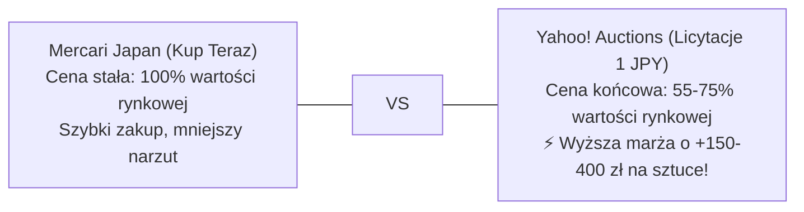

# 📡 Yahoo! Auctions Live Radar & Real Closing Price Intelligence

> **Radar Aktywnych Licytacji, Baza Rzeczywistych Cen Końcowych (落札相場) i Arbitraż Yahoo vs Mercari**  
> *Dedykowane narzędzie analityczne: gdzie aukcje miażdżą oferty Kup Teraz, jakie są realne ceny zamknięcia i które licytacje natychmiast wrzucić na celownik.*

     

⬅ **Nawigacja:** [📱 **Aplikacja Android / PWA (Live)**](https://110kc3.github.io/japan-deal-watcher/) · [Główny Dashboard Mercari (README.md)](README.md) · [📦 **Pakiety Różności & Danshari (MYSTERY_LOTS_ANALYSIS.md)**](MYSTERY_LOTS_ANALYSIS.md) · [🎯 Poradnik Snajpera i Limity (AUCTION_SNIPING_GUIDE.md)](AUCTION_SNIPING_GUIDE.md) · [🔨 Katalog Alternatywnych Ofert (YAHOO_AUCTIONS_DEALS.md)](YAHOO_AUCTIONS_DEALS.md) · [📈 Historia Sprzedaży (MARKET_SALES_HISTORY.md)](MARKET_SALES_HISTORY.md) · [💰 Audyt Opłacalności (REAL_PROFITABILITY_AUDIT.md)](REAL_PROFITABILITY_AUDIT.md)

---

## 💡 Dlaczego na Aukcjach Yahoo Kupisz Taniej Niż na Mercari? (Fakty i Liczby)

> [!NOTE]
> **Mercari Japan vs Yahoo! Auctions Japan – Dwa Różne Światy Handlu:**
> - **Mercari (Kup Teraz / BIN):** Sprzedawcy wyceniają towar na podstawie innych aktywnych ofert. Ceny są sztywne. Jeśli ktoś wystawi tanio, boty i resellerzy wykupują to w 2–15 minut. Zostają tylko oferty w cenach rynkowych.
> - **Yahoo! Auctions (Licytacje od 1 JPY):** Japończycy wystawiający spadki, likwidacje strychów czy szaf wystawiają towar od 1 JPY na 5–7 dni bez ceny minimalnej. **Aukcje hurtowe i nieprzetestowane zamykają się średnio 25%–55% taniej niż oferty Kup Teraz na Mercari!**
> - **Magia Ostatnich 120 Sekund:** Ponad 75% licytacji w dni robocze kończy się w godzinach, gdy w Japonii trwa praca lub sen. Wykorzystując automatycznego Snajpera ZenMarket z twardym limitem kapitałowym, wygrywasz aukcje poniżej ceny detalicznej!

---

## 📊 Matryca Arbitrażu: Rzeczywiste Ceny Końcowe Yahoo (落札相場) vs Mercari vs Polska

Poniższa tabela zestawia **rzeczywiste dane transakcyjne z zakończonych aukcji na Yahoo Japan** (zakresy cen zamknięcia dla sprawnych egzemplarzy), ceny Buy-It-Now z Mercari, wycenę rynkową w Polsce oraz wyliczony **Twardy Limit Snajpera (Hard Sniping Cap)** z gwarantowanym zyskiem w PLN.

| Model / Przedmiot | Rzeczywista Cena Zamknięcia Yahoo (落札相場) | Mercari Kup Teraz (BIN) | Przewaga Yahoo | Cena w Polsce (Allegro/OLX) | 🎯 Twardy Limit Snajpera | Zysk Netto przy Limicie | Bateria IATA |
|---|:---:|:---:|:---:|---:|:---:|---:|:---:|
|  **New Nintendo 3DS LL (New 3DS XL)** <small>Metallic Blue / Metallic Black (RED-001)</small> | **13,000 – 25,000 JPY** <small>(~459 zł | śr: 18,500 JPY)</small> | ~23,500 JPY <small>(~583 zł)</small> | <strong style='color:#10b981;'>-21% taniej</strong> <small>(zyskujesz +124 zł)</small> | **690 zł** <small>Allegro: ~740 zł OLX (targ): ~630 zł</small> | **`14,200 JPY`** <small>(~352 zł)</small> | <strong style='color:#10b981;'>+170.34 zł</strong> <small>(+32.8%)</small> | 🔴 1 Li-Ion |
|  **New Nintendo 3DS (Kisekae Cover Plates)** <small>White / Black (KTR-001)</small> | **8,500 – 18,000 JPY** <small>(~322 zł | śr: 13,000 JPY)</small> | ~17,500 JPY <small>(~434 zł)</small> | <strong style='color:#10b981;'>-26% taniej</strong> <small>(zyskujesz +112 zł)</small> | **550 zł** <small>Allegro: ~590 zł OLX (targ): ~500 zł</small> | **`10,900 JPY`** <small>(~270 zł)</small> | <strong style='color:#10b981;'>+133.88 zł</strong> <small>(+32.2%)</small> | 🔴 1 Li-Ion |
|  **Nintendo 3DS LL (Old 3DS XL)** <small>Blue / Black lub Red / Black (SPR-001)</small> | **6,000 – 13,500 JPY** <small>(~236 zł | śr: 9,500 JPY)</small> | ~12,800 JPY <small>(~317 zł)</small> | <strong style='color:#10b981;'>-26% taniej</strong> <small>(zyskujesz +82 zł)</small> | **420 zł** <small>Allegro: ~450 zł OLX (targ): ~380 zł</small> | **`7,100 JPY`** <small>(~176 zł)</small> | <strong style='color:#10b981;'>+123.11 zł</strong> <small>(+41.5%)</small> | 🔴 1 Li-Ion |
|  **Nintendo 3DS (CTR-001)** <small>Aqua Blue</small> | **4,800 – 9,800 JPY** <small>(~179 zł | śr: 7,200 JPY)</small> | ~8,900 JPY <small>(~221 zł)</small> | <strong style='color:#10b981;'>-19% taniej</strong> <small>(zyskujesz +42 zł)</small> | **340 zł** <small>Allegro: ~360 zł OLX (targ): ~310 zł</small> | **`5,300 JPY`** <small>(~131 zł)</small> | <strong style='color:#10b981;'>+99.58 zł</strong> <small>(+41.4%)</small> | 🔴 1 Li-Ion |
|  **Nintendo 3DS (CTR-001)** <small>Cosmo Black</small> | **4,800 – 9,500 JPY** <small>(~179 zł | śr: 7,200 JPY)</small> | ~8,800 JPY <small>(~218 zł)</small> | <strong style='color:#10b981;'>-18% taniej</strong> <small>(zyskujesz +40 zł)</small> | **340 zł** <small>Allegro: ~360 zł OLX (targ): ~310 zł</small> | **`5,300 JPY`** <small>(~131 zł)</small> | <strong style='color:#10b981;'>+99.58 zł</strong> <small>(+41.4%)</small> | 🔴 1 Li-Ion |
|  **New Nintendo 2DS LL (New 2DS XL)** <small>Black x Turquoise (JAN-001)</small> | **10,500 – 21,000 JPY** <small>(~384 zł | śr: 15,500 JPY)</small> | ~19,800 JPY <small>(~491 zł)</small> | <strong style='color:#10b981;'>-22% taniej</strong> <small>(zyskujesz +107 zł)</small> | **620 zł** <small>Allegro: ~660 zł OLX (targ): ~570 zł</small> | **`12,600 JPY`** <small>(~313 zł)</small> | <strong style='color:#10b981;'>+150.53 zł</strong> <small>(+32.1%)</small> | 🔴 1 Li-Ion |
|  **New Nintendo 3DS LL Super Famicom Edition** <small>Super Famicom Edition (Kolekcjonerska)</small> | **26,000 – 48,000 JPY** <small>(~893 zł | śr: 36,000 JPY)</small> | ~45,000 JPY <small>(~1116 zł)</small> | <strong style='color:#10b981;'>-20% taniej</strong> <small>(zyskujesz +223 zł)</small> | **1400 zł** <small>Allegro: ~1550 zł OLX (targ): ~1300 zł</small> | **`32,400 JPY`** <small>(~804 zł)</small> | <strong style='color:#10b981;'>+309.33 zł</strong> <small>(+28.4%)</small> | 🔴 1 Li-Ion |
|  **Nintendo 3DS (CTR-001)** <small>Flare Red (Głęboka Czerwień)</small> | **4,800 – 9,500 JPY** <small>(~179 zł | śr: 7,200 JPY)</small> | ~8,800 JPY <small>(~218 zł)</small> | <strong style='color:#10b981;'>-18% taniej</strong> <small>(zyskujesz +40 zł)</small> | **340 zł** <small>Allegro: ~360 zł OLX (targ): ~310 zł</small> | **`5,300 JPY`** <small>(~131 zł)</small> | <strong style='color:#10b981;'>+99.58 zł</strong> <small>(+41.4%)</small> | 🔴 1 Li-Ion |
|  **Nintendo 3DS LL (Old 3DS XL)** <small>Silver x Black (SPR-001)</small> | **6,200 – 13,000 JPY** <small>(~228 zł | śr: 9,200 JPY)</small> | ~12,500 JPY <small>(~310 zł)</small> | <strong style='color:#10b981;'>-26% taniej</strong> <small>(zyskujesz +82 zł)</small> | **420 zł** <small>Allegro: ~450 zł OLX (targ): ~380 zł</small> | **`7,100 JPY`** <small>(~176 zł)</small> | <strong style='color:#10b981;'>+123.11 zł</strong> <small>(+41.5%)</small> | 🔴 1 Li-Ion |
|  **Nintendo 2DS (Klin / Doorstop)** <small>Electric Blue (FTR-001)</small> | **4,500 – 9,500 JPY** <small>(~169 zł | śr: 6,800 JPY)</small> | ~8,900 JPY <small>(~221 zł)</small> | <strong style='color:#10b981;'>-24% taniej</strong> <small>(zyskujesz +52 zł)</small> | **310 zł** <small>Allegro: ~340 zł OLX (targ): ~280 zł</small> | **`4,600 JPY`** <small>(~114 zł)</small> | <strong style='color:#10b981;'>+91.54 zł</strong> <small>(+41.9%)</small> | 🔴 1 Li-Ion |
|  **Nintendo DSi LL (XL)** <small>Wine Red / Dark Brown (Matryce IPS)</small> | **3,000 – 7,500 JPY** <small>(~119 zł | śr: 4,800 JPY)</small> | ~6,900 JPY <small>(~171 zł)</small> | <strong style='color:#10b981;'>-30% taniej</strong> <small>(zyskujesz +52 zł)</small> | **280 zł** <small>Allegro: ~300 zł OLX (targ): ~250 zł</small> | **`4,000 JPY`** <small>(~99 zł)</small> | <strong style='color:#10b981;'>+80.36 zł</strong> <small>(+40.3%)</small> | 🔴 1 Li-Ion |
|  **Nintendo DSi LL (XL)** <small>Dark Brown (Podwójny IPS)</small> | **3,200 – 7,200 JPY** <small>(~114 zł | śr: 4,600 JPY)</small> | ~6,800 JPY <small>(~169 zł)</small> | <strong style='color:#10b981;'>-32% taniej</strong> <small>(zyskujesz +55 zł)</small> | **270 zł** <small>Allegro: ~290 zł OLX (targ): ~240 zł</small> | **`3,700 JPY`** <small>(~92 zł)</small> | <strong style='color:#10b981;'>+79.77 zł</strong> <small>(+41.9%)</small> | 🔴 1 Li-Ion |
|  **Nintendo DS Lite (USG-001)** <small>Metallic Silver</small> | **1,000 – 4,000 JPY** <small>(~55 zł | śr: 2,200 JPY)</small> | ~3,800 JPY <small>(~94 zł)</small> | <strong style='color:#10b981;'>-42% taniej</strong> <small>(zyskujesz +40 zł)</small> | **160 zł** <small>Allegro: ~180 zł OLX (targ): ~140 zł</small> | **`1,200 JPY`** <small>(~30 zł)</small> | <strong style='color:#10b981;'>+48.21 zł</strong> <small>(+43.1%)</small> | 🔴 1 Li-Ion |
|  **Nintendo DS Lite (Dwukolorowy)** <small>Crimson / Black</small> | **1,200 – 4,500 JPY** <small>(~62 zł | śr: 2,500 JPY)</small> | ~4,200 JPY <small>(~104 zł)</small> | <strong style='color:#10b981;'>-40% taniej</strong> <small>(zyskujesz +42 zł)</small> | **170 zł** <small>Allegro: ~190 zł OLX (targ): ~150 zł</small> | **`1,500 JPY`** <small>(~37 zł)</small> | <strong style='color:#10b981;'>+48.80 zł</strong> <small>(+40.3%)</small> | 🔴 1 Li-Ion |
|  **Nintendo DS Lite Final Fantasy III Crystal Edition** <small>Crystal White (Limited)</small> | **5,000 – 14,000 JPY** <small>(~211 zł | śr: 8,500 JPY)</small> | ~13,000 JPY <small>(~322 zł)</small> | <strong style='color:#10b981;'>-35% taniej</strong> <small>(zyskujesz +112 zł)</small> | **380 zł** <small>Allegro: ~420 zł OLX (targ): ~340 zł</small> | **`6,200 JPY`** <small>(~154 zł)</small> | <strong style='color:#10b981;'>+111.34 zł</strong> <small>(+41.4%)</small> | 🔴 1 Li-Ion |
|  **Nintendo DS Lite (USG-001)** <small>Enamel Navy (Granatowy Lakier)</small> | **1,200 – 3,800 JPY** <small>(~57 zł | śr: 2,300 JPY)</small> | ~3,600 JPY <small>(~89 zł)</small> | <strong style='color:#10b981;'>-36% taniej</strong> <small>(zyskujesz +32 zł)</small> | **160 zł** <small>Allegro: ~180 zł OLX (targ): ~140 zł</small> | **`1,200 JPY`** <small>(~30 zł)</small> | <strong style='color:#10b981;'>+48.21 zł</strong> <small>(+43.1%)</small> | 🔴 1 Li-Ion |
|  **Nintendo DSi LL (XL)** <small>Natural White (Dual IPS + Rysik)</small> | **3,200 – 7,200 JPY** <small>(~119 zł | śr: 4,800 JPY)</small> | ~6,900 JPY <small>(~171 zł)</small> | <strong style='color:#10b981;'>-30% taniej</strong> <small>(zyskujesz +52 zł)</small> | **280 zł** <small>Allegro: ~300 zł OLX (targ): ~250 zł</small> | **`4,000 JPY`** <small>(~99 zł)</small> | <strong style='color:#10b981;'>+80.36 zł</strong> <small>(+40.3%)</small> | 🔴 1 Li-Ion |
|  **Game Boy Advance SP (AGS-101 Brighter LCD)** <small>Pearl Blue (Podświetlenie II Generacji)</small> | **10,000 – 22,000 JPY** <small>(~360 zł | śr: 14,500 JPY)</small> | ~19,500 JPY <small>(~484 zł)</small> | <strong style='color:#10b981;'>-26% taniej</strong> <small>(zyskujesz +124 zł)</small> | **580 zł** <small>Allegro: ~620 zł OLX (targ): ~530 zł</small> | **`11,800 JPY`** <small>(~293 zł)</small> | <strong style='color:#10b981;'>+141.97 zł</strong> <small>(+32.4%)</small> | 🔴 1 Li-Ion |
|  **Game Boy Advance SP Famicom 20th Anniversary Edition** <small>Famicom Red / Gold (Limited)</small> | **8,500 – 17,500 JPY** <small>(~310 zł | śr: 12,500 JPY)</small> | ~16,000 JPY <small>(~397 zł)</small> | <strong style='color:#10b981;'>-22% taniej</strong> <small>(zyskujesz +87 zł)</small> | **520 zł** <small>Allegro: ~560 zł OLX (targ): ~480 zł</small> | **`10,300 JPY`** <small>(~255 zł)</small> | <strong style='color:#10b981;'>+129.02 zł</strong> <small>(+33.0%)</small> | 🔴 1 Li-Ion |
|  **Game Boy Color CGB-001** <small>Atomic Purple (Przezroczysty Fiolet)</small> | **4,500 – 9,500 JPY** <small>(~169 zł | śr: 6,800 JPY)</small> | ~9,000 JPY <small>(~223 zł)</small> | <strong style='color:#10b981;'>-24% taniej</strong> <small>(zyskujesz +55 zł)</small> | **290 zł** <small>Allegro: ~320 zł OLX (targ): ~260 zł</small> | **`4,400 JPY`** <small>(~109 zł)</small> | <strong style='color:#10b981;'>+84.13 zł</strong> <small>(+40.9%)</small> | 🟢 0% Li-Ion |
|  **Game Boy Micro (OXY-001)** <small>Famicom 20th Anniversary Edition</small> | **12,500 – 26,000 JPY** <small>(~459 zł | śr: 18,500 JPY)</small> | ~24,000 JPY <small>(~595 zł)</small> | <strong style='color:#10b981;'>-23% taniej</strong> <small>(zyskujesz +136 zł)</small> | **720 zł** <small>Allegro: ~780 zł OLX (targ): ~650 zł</small> | **`15,200 JPY`** <small>(~377 zł)</small> | <strong style='color:#10b981;'>+175.29 zł</strong> <small>(+32.2%)</small> | 🔴 1 Li-Ion |
|  **Game Boy Advance SP Tribal Edition** <small>Srebrny z czarnym tatuażem Tribal</small> | **5,000 – 11,500 JPY** <small>(~193 zł | śr: 7,800 JPY)</small> | ~11,000 JPY <small>(~273 zł)</small> | <strong style='color:#10b981;'>-29% taniej</strong> <small>(zyskujesz +79 zł)</small> | **330 zł** <small>Allegro: ~360 zł OLX (targ): ~300 zł</small> | **`5,300 JPY`** <small>(~131 zł)</small> | <strong style='color:#10b981;'>+95.90 zł</strong> <small>(+41.0%)</small> | 🔴 1 Li-Ion |
|  **Game Boy Micro (OXY-001)** <small>Silver Aluminum</small> | **11,000 – 23,000 JPY** <small>(~409 zł | śr: 16,500 JPY)</small> | ~22,000 JPY <small>(~546 zł)</small> | <strong style='color:#10b981;'>-25% taniej</strong> <small>(zyskujesz +136 zł)</small> | **680 zł** <small>Allegro: ~730 zł OLX (targ): ~620 zł</small> | **`14,200 JPY`** <small>(~352 zł)</small> | <strong style='color:#10b981;'>+166.67 zł</strong> <small>(+32.5%)</small> | 🔴 1 Li-Ion |
|  **PCH-2000 Slim** <small>Aqua Blue (ZA23)</small> | **12,000 – 21,000 JPY** <small>(~397 zł | śr: 16,000 JPY)</small> | ~19,500 JPY <small>(~484 zł)</small> | <strong style='color:#10b981;'>-18% taniej</strong> <small>(zyskujesz +87 zł)</small> | **620 zł** <small>Allegro: ~660 zł OLX (targ): ~570 zł</small> | **`12,400 JPY`** <small>(~308 zł)</small> | <strong style='color:#10b981;'>+150.50 zł</strong> <small>(+32.1%)</small> | 🔴 1 Li-Ion |
|  **PCH-1000 OLED** <small>Sapphire Blue (ZA04)</small> | **11,500 – 19,500 JPY** <small>(~384 zł | śr: 15,500 JPY)</small> | ~18,900 JPY <small>(~469 zł)</small> | <strong style='color:#10b981;'>-18% taniej</strong> <small>(zyskujesz +84 zł)</small> | **590 zł** <small>Allegro: ~630 zł OLX (targ): ~540 zł</small> | **`11,600 JPY`** <small>(~288 zł)</small> | <strong style='color:#10b981;'>+145.59 zł</strong> <small>(+32.8%)</small> | 🔴 1 Li-Ion |
|  **PCH-2000 Slim** <small>Metallic Red (ZA26)</small> | **12,000 – 21,000 JPY** <small>(~402 zł | śr: 16,200 JPY)</small> | ~19,000 JPY <small>(~471 zł)</small> | <strong style='color:#10b981;'>-15% taniej</strong> <small>(zyskujesz +69 zł)</small> | **620 zł** <small>Allegro: ~660 zł OLX (targ): ~570 zł</small> | **`12,400 JPY`** <small>(~308 zł)</small> | <strong style='color:#10b981;'>+150.50 zł</strong> <small>(+32.1%)</small> | 🔴 1 Li-Ion |
|  **PCH-2000 Slim** <small>Neon Orange (ZA24)</small> | **14,000 – 26,000 JPY** <small>(~484 zł | śr: 19,500 JPY)</small> | ~24,500 JPY <small>(~608 zł)</small> | <strong style='color:#10b981;'>-20% taniej</strong> <small>(zyskujesz +124 zł)</small> | **720 zł** <small>Allegro: ~780 zł OLX (targ): ~660 zł</small> | **`14,800 JPY`** <small>(~367 zł)</small> | <strong style='color:#10b981;'>+175.19 zł</strong> <small>(+32.2%)</small> | 🔴 1 Li-Ion |
|  **PCH-1000 OLED** <small>Crystal White (ZA02)</small> | **11,000 – 19,000 JPY** <small>(~372 zł | śr: 15,000 JPY)</small> | ~18,000 JPY <small>(~446 zł)</small> | <strong style='color:#10b981;'>-17% taniej</strong> <small>(zyskujesz +74 zł)</small> | **580 zł** <small>Allegro: ~620 zł OLX (targ): ~540 zł</small> | **`11,400 JPY`** <small>(~283 zł)</small> | <strong style='color:#10b981;'>+141.87 zł</strong> <small>(+32.4%)</small> | 🔴 1 Li-Ion |
|  **PCH-2000 Slim** <small>Silver (ZA25)</small> | **12,500 – 22,000 JPY** <small>(~422 zł | śr: 17,000 JPY)</small> | ~20,500 JPY <small>(~508 zł)</small> | <strong style='color:#10b981;'>-17% taniej</strong> <small>(zyskujesz +87 zł)</small> | **640 zł** <small>Allegro: ~680 zł OLX (targ): ~590 zł</small> | **`12,800 JPY`** <small>(~317 zł)</small> | <strong style='color:#10b981;'>+157.93 zł</strong> <small>(+32.8%)</small> | 🔴 1 Li-Ion |
|  **PCH-2000 Slim** <small>Khaki / Black (ZA16)</small> | **11,800 – 20,000 JPY** <small>(~392 zł | śr: 15,800 JPY)</small> | ~19,000 JPY <small>(~471 zł)</small> | <strong style='color:#10b981;'>-17% taniej</strong> <small>(zyskujesz +79 zł)</small> | **610 zł** <small>Allegro: ~650 zł OLX (targ): ~560 zł</small> | **`12,100 JPY`** <small>(~300 zł)</small> | <strong style='color:#10b981;'>+149.91 zł</strong> <small>(+32.6%)</small> | 🔴 1 Li-Ion |
|  **PSP-3000 Vibrant Blue** <small>Vibrant Blue (Metaliczny Błękit)</small> | **5,500 – 11,000 JPY** <small>(~193 zł | śr: 7,800 JPY)</small> | ~10,500 JPY <small>(~260 zł)</small> | <strong style='color:#10b981;'>-26% taniej</strong> <small>(zyskujesz +67 zł)</small> | **330 zł** <small>Allegro: ~360 zł OLX (targ): ~300 zł</small> | **`5,100 JPY`** <small>(~126 zł)</small> | <strong style='color:#10b981;'>+95.85 zł</strong> <small>(+40.9%)</small> | 🔴 1 Li-Ion |
|  **PSP-3000 Monster Hunter Portable 3rd Hunters Model** <small>MHB Matowa Czerń / Złote Emblematy</small> | **9,500 – 19,000 JPY** <small>(~335 zł | śr: 13,500 JPY)</small> | ~18,000 JPY <small>(~446 zł)</small> | <strong style='color:#10b981;'>-25% taniej</strong> <small>(zyskujesz +112 zł)</small> | **520 zł** <small>Allegro: ~560 zł OLX (targ): ~480 zł</small> | **`10,100 JPY`** <small>(~251 zł)</small> | <strong style='color:#10b981;'>+128.97 zł</strong> <small>(+33.0%)</small> | 🔴 1 Li-Ion |
|  **PSP-3000 Blossom Pink** <small>Blossom Pink (Kwiat Wiśni)</small> | **5,000 – 10,500 JPY** <small>(~186 zł | śr: 7,500 JPY)</small> | ~10,000 JPY <small>(~248 zł)</small> | <strong style='color:#10b981;'>-25% taniej</strong> <small>(zyskujesz +62 zł)</small> | **330 zł** <small>Allegro: ~360 zł OLX (targ): ~300 zł</small> | **`5,100 JPY`** <small>(~126 zł)</small> | <strong style='color:#10b981;'>+95.85 zł</strong> <small>(+40.9%)</small> | 🔴 1 Li-Ion |
|  **PSP-3000 Radiant Red** <small>Radiant Red (Karminowa Czerwień)</small> | **5,200 – 10,500 JPY** <small>(~188 zł | śr: 7,600 JPY)</small> | ~10,200 JPY <small>(~253 zł)</small> | <strong style='color:#10b981;'>-25% taniej</strong> <small>(zyskujesz +64 zł)</small> | **330 zł** <small>Allegro: ~360 zł OLX (targ): ~300 zł</small> | **`5,100 JPY`** <small>(~126 zł)</small> | <strong style='color:#10b981;'>+95.85 zł</strong> <small>(+40.9%)</small> | 🔴 1 Li-Ion |
|  **PSP-3000 Spirited Green** <small>Spirited Green (Metaliczna Zieleń)</small> | **5,500 – 11,500 JPY** <small>(~198 zł | śr: 8,000 JPY)</small> | ~11,000 JPY <small>(~273 zł)</small> | <strong style='color:#10b981;'>-27% taniej</strong> <small>(zyskujesz +74 zł)</small> | **340 zł** <small>Allegro: ~370 zł OLX (targ): ~310 zł</small> | **`5,300 JPY`** <small>(~131 zł)</small> | <strong style='color:#10b981;'>+99.58 zł</strong> <small>(+41.4%)</small> | 🔴 1 Li-Ion |
|  **Hurtowy Pakiet 50 Gier Retro (Nintendo DS / GBA / SFC / PS2)** <small>Mix 50 Gier Hurtowo</small> | **3,000 – 8,500 JPY** <small>(~136 zł | śr: 5,500 JPY)</small> | ~9,500 JPY <small>(~236 zł)</small> | <strong style='color:#10b981;'>-42% taniej</strong> <small>(zyskujesz +99 zł)</small> | **250 zł** <small>Allegro: ~280 zł OLX (targ): ~220 zł</small> | **`3,700 JPY`** <small>(~92 zł)</small> | <strong style='color:#10b981;'>+72.42 zł</strong> <small>(+40.8%)</small> | 🟢 0% Li-Ion |
|  **Zestaw 30 Gier Nintendo DS / 3DS w Pudełkach (CIB Lot)** <small>Mix 30 Gier DS / 3DS</small> | **2,800 – 7,500 JPY** <small>(~119 zł | śr: 4,800 JPY)</small> | ~7,900 JPY <small>(~196 zł)</small> | <strong style='color:#10b981;'>-39% taniej</strong> <small>(zyskujesz +77 zł)</small> | **220 zł** <small>Allegro: ~250 zł OLX (targ): ~190 zł</small> | **`3,000 JPY`** <small>(~74 zł)</small> | <strong style='color:#10b981;'>+64.38 zł</strong> <small>(+41.4%)</small> | 🟢 0% Li-Ion |
|  **Hurtowy Pakiet 40 Gier PlayStation 1 & 2 (RPG & Akcja)** <small>Mix 40 Gier PS1 / PS2</small> | **3,200 – 8,000 JPY** <small>(~129 zł | śr: 5,200 JPY)</small> | ~8,500 JPY <small>(~211 zł)</small> | <strong style='color:#10b981;'>-39% taniej</strong> <small>(zyskujesz +82 zł)</small> | **220 zł** <small>Allegro: ~250 zł OLX (targ): ~190 zł</small> | **`3,000 JPY`** <small>(~74 zł)</small> | <strong style='color:#10b981;'>+64.38 zł</strong> <small>(+41.4%)</small> | 🟢 0% Li-Ion |
|  **PSone COMBO SCPH-130 (Zintegrowany 5" LCD Sony)** <small>Biały Mini + Doczepiany Ekran LCD</small> | **20,000 – 35,000 JPY** <small>(~645 zł | śr: 26,000 JPY)</small> | ~34,000 JPY <small>(~843 zł)</small> | <strong style='color:#10b981;'>-24% taniej</strong> <small>(zyskujesz +198 zł)</small> | **1050 zł** <small>Allegro: ~1150 zł OLX (targ): ~950 zł</small> | **`21,500 JPY`** <small>(~533 zł)</small> | <strong style='color:#10b981;'>+257.03 zł</strong> <small>(+32.4%)</small> | 🟢 0% Li-Ion |
|  **PlayStation 4 Pro Monster Hunter World Rathalos (1TB)** <small>Rathalos Red & Black + Pad</small> | **23,000 – 38,000 JPY** <small>(~719 zł | śr: 29,000 JPY)</small> | ~37,000 JPY <small>(~918 zł)</small> | <strong style='color:#10b981;'>-22% taniej</strong> <small>(zyskujesz +198 zł)</small> | **1150 zł** <small>Allegro: ~1250 zł OLX (targ): ~1050 zł</small> | **`23,900 JPY`** <small>(~593 zł)</small> | <strong style='color:#10b981;'>+281.73 zł</strong> <small>(+32.4%)</small> | 🔴 1 Li-Ion |
|  **Nintendo GameCube DOL-001 Zestaw** <small>Spice Orange + Pad + Kable</small> | **6,000 – 13,500 JPY** <small>(~236 zł | śr: 9,500 JPY)</small> | ~13,000 JPY <small>(~322 zł)</small> | <strong style='color:#10b981;'>-27% taniej</strong> <small>(zyskujesz +87 zł)</small> | **460 zł** <small>Allegro: ~500 zł OLX (targ): ~420 zł</small> | **`6,600 JPY`** <small>(~164 zł)</small> | <strong style='color:#10b981;'>+134.51 zł</strong> <small>(+41.3%)</small> | 🟢 0% Li-Ion |
|  **PlayStation 4 Metal Gear Solid V Limited Edition** <small>Bordowo-Złota Diamond Dogs</small> | **18,500 – 31,000 JPY** <small>(~595 zł | śr: 24,000 JPY)</small> | ~29,800 JPY <small>(~739 zł)</small> | <strong style='color:#10b981;'>-19% taniej</strong> <small>(zyskujesz +144 zł)</small> | **950 zł** <small>Allegro: ~1050 zł OLX (targ): ~880 zł</small> | **`19,100 JPY`** <small>(~474 zł)</small> | <strong style='color:#10b981;'>+232.32 zł</strong> <small>(+32.4%)</small> | 🔴 1 Li-Ion |
|  **PlayStation 2 Toy's Blue (SCPH-39000)** <small>Lazurowy Półprzezroczysty (Limited)</small> | **8,500 – 19,500 JPY** <small>(~335 zł | śr: 13,500 JPY)</small> | ~18,500 JPY <small>(~459 zł)</small> | <strong style='color:#10b981;'>-27% taniej</strong> <small>(zyskujesz +124 zł)</small> | **520 zł** <small>Allegro: ~580 zł OLX (targ): ~480 zł</small> | **`8,700 JPY`** <small>(~216 zł)</small> | <strong style='color:#10b981;'>+128.62 zł</strong> <small>(+32.9%)</small> | 🟢 0% Li-Ion |
|  **Sega Dreamcast HKT-3000** <small>Biały Japoński (Kompatybilny z MIL-CD)</small> | **5,800 – 12,500 JPY** <small>(~211 zł | śr: 8,500 JPY)</small> | ~12,000 JPY <small>(~298 zł)</small> | <strong style='color:#10b981;'>-29% taniej</strong> <small>(zyskujesz +87 zł)</small> | **420 zł** <small>Allegro: ~460 zł OLX (targ): ~380 zł</small> | **`5,700 JPY`** <small>(~141 zł)</small> | <strong style='color:#10b981;'>+122.75 zł</strong> <small>(+41.3%)</small> | 🟢 0% Li-Ion |
|  **SMC Pentax-M 50mm f/1.4** <small>Mocowanie K</small> | **2,200 – 5,500 JPY** <small>(~94 zł | śr: 3,800 JPY)</small> | ~5,500 JPY <small>(~136 zł)</small> | <strong style='color:#10b981;'>-31% taniej</strong> <small>(zyskujesz +42 zł)</small> | **280 zł** <small>Allegro: ~310 zł OLX (targ): ~250 zł</small> | **`4,000 JPY`** <small>(~99 zł)</small> | <strong style='color:#10b981;'>+86.68 zł</strong> <small>(+44.8%)</small> | 🟢 0% Li-Ion |
|  **Super-Takumar 55mm f/1.8** <small>Mocowanie M42</small> | **1,800 – 4,800 JPY** <small>(~79 zł | śr: 3,200 JPY)</small> | ~4,600 JPY <small>(~114 zł)</small> | <strong style='color:#10b981;'>-30% taniej</strong> <small>(zyskujesz +35 zł)</small> | **210 zł** <small>Allegro: ~230 zł OLX (targ): ~180 zł</small> | **`2,600 JPY`** <small>(~64 zł)</small> | <strong style='color:#10b981;'>+60.61 zł</strong> <small>(+40.6%)</small> | 🟢 0% Li-Ion |
|  **SMC Pentax-M 50mm f/2 (K-mount)** <small>Mocowanie Bagnet K</small> | **1,200 – 3,200 JPY** <small>(~55 zł | śr: 2,200 JPY)</small> | ~3,500 JPY <small>(~87 zł)</small> | <strong style='color:#10b981;'>-37% taniej</strong> <small>(zyskujesz +32 zł)</small> | **140 zł** <small>Allegro: ~150 zł OLX (targ): ~120 zł</small> | **`1,000 JPY`** <small>(~25 zł)</small> | <strong style='color:#10b981;'>+40.82 zł</strong> <small>(+41.2%)</small> | 🟢 0% Li-Ion |
|  **Auto-Chinon 50mm f/1.7 Multi-Coated** <small>Mocowanie Pentax K</small> | **1,200 – 3,500 JPY** <small>(~60 zł | śr: 2,400 JPY)</small> | ~3,600 JPY <small>(~89 zł)</small> | <strong style='color:#10b981;'>-33% taniej</strong> <small>(zyskujesz +30 zł)</small> | **160 zł** <small>Allegro: ~180 zł OLX (targ): ~140 zł</small> | **`1,400 JPY`** <small>(~35 zł)</small> | <strong style='color:#10b981;'>+48.26 zł</strong> <small>(+43.2%)</small> | 🟢 0% Li-Ion |
|  **Olympus OM-System F.Zuiko 50mm f/1.8** <small>Mocowanie Olympus OM</small> | **1,500 – 4,200 JPY** <small>(~69 zł | śr: 2,800 JPY)</small> | ~4,000 JPY <small>(~99 zł)</small> | <strong style='color:#10b981;'>-30% taniej</strong> <small>(zyskujesz +30 zł)</small> | **190 zł** <small>Allegro: ~210 zł OLX (targ): ~170 zł</small> | **`2,100 JPY`** <small>(~52 zł)</small> | <strong style='color:#10b981;'>+56.30 zł</strong> <small>(+42.1%)</small> | 🟢 0% Li-Ion |
|  **Canon FD 50mm f/1.8 S.C.** <small>Mocowanie Canon FD Breech-Lock</small> | **1,400 – 3,900 JPY** <small>(~64 zł | śr: 2,600 JPY)</small> | ~3,800 JPY <small>(~94 zł)</small> | <strong style='color:#10b981;'>-32% taniej</strong> <small>(zyskujesz +30 zł)</small> | **180 zł** <small>Allegro: ~200 zł OLX (targ): ~160 zł</small> | **`1,900 JPY`** <small>(~47 zł)</small> | <strong style='color:#10b981;'>+52.57 zł</strong> <small>(+41.3%)</small> | 🟢 0% Li-Ion |
|  **Canon Autoboy 3 Quartz Date** <small>Czarny / Czerwona Linia (38mm f/2.8 Prime)</small> | **3,200 – 7,800 JPY** <small>(~129 zł | śr: 5,200 JPY)</small> | ~7,500 JPY <small>(~186 zł)</small> | <strong style='color:#10b981;'>-31% taniej</strong> <small>(zyskujesz +57 zł)</small> | **280 zł** <small>Allegro: ~310 zł OLX (targ): ~250 zł</small> | **`4,000 JPY`** <small>(~99 zł)</small> | <strong style='color:#10b981;'>+86.68 zł</strong> <small>(+44.8%)</small> | 🟢 0% Li-Ion |
|  **Olympus AF-10 Twin** <small>Czarny Clamshell (35mm / 70mm)</small> | **1,800 – 5,200 JPY** <small>(~87 zł | śr: 3,500 JPY)</small> | ~4,800 JPY <small>(~119 zł)</small> | <strong style='color:#10b981;'>-27% taniej</strong> <small>(zyskujesz +32 zł)</small> | **160 zł** <small>Allegro: ~180 zł OLX (targ): ~140 zł</small> | **`1,400 JPY`** <small>(~35 zł)</small> | <strong style='color:#10b981;'>+48.26 zł</strong> <small>(+43.2%)</small> | 🟢 0% Li-Ion |
|  **Nikon TW2D Dual Lens** <small>Czarny Klasyczny (35mm / 70mm)</small> | **1,000 – 4,200 JPY** <small>(~62 zł | śr: 2,500 JPY)</small> | ~3,900 JPY <small>(~97 zł)</small> | <strong style='color:#10b981;'>-36% taniej</strong> <small>(zyskujesz +35 zł)</small> | **160 zł** <small>Allegro: ~180 zł OLX (targ): ~140 zł</small> | **`1,400 JPY`** <small>(~35 zł)</small> | <strong style='color:#10b981;'>+48.26 zł</strong> <small>(+43.2%)</small> | 🟢 0% Li-Ion |
|  **Minolta Riva Zoom 70 Date** <small>Black Classic (35-70mm AF)</small> | **800 – 3,000 JPY** <small>(~45 zł | śr: 1,800 JPY)</small> | ~2,800 JPY <small>(~69 zł)</small> | <strong style='color:#10b981;'>-36% taniej</strong> <small>(zyskujesz +25 zł)</small> | **120 zł** <small>Allegro: ~130 zł OLX (targ): ~100 zł</small> | **`500 JPY`** <small>(~12 zł)</small> | <strong style='color:#10b981;'>+36.50 zł</strong> <small>(+43.7%)</small> | 🟢 0% Li-Ion |
|  **Olympus Trip 35** <small>Srebrno-Czarny Klasyk (40mm f/2.8 Zuiko)</small> | **2,200 – 6,800 JPY** <small>(~104 zł | śr: 4,200 JPY)</small> | ~6,500 JPY <small>(~161 zł)</small> | <strong style='color:#10b981;'>-35% taniej</strong> <small>(zyskujesz +57 zł)</small> | **260 zł** <small>Allegro: ~290 zł OLX (targ): ~230 zł</small> | **`3,700 JPY`** <small>(~92 zł)</small> | <strong style='color:#10b981;'>+76.09 zł</strong> <small>(+41.4%)</small> | 🟢 0% Li-Ion |
|  **Canon Autoboy Tele 6 / Sure Shot Tele** <small>Czarny (Dwuogniskowy 35mm / 60mm)</small> | **1,500 – 4,800 JPY** <small>(~79 zł | śr: 3,200 JPY)</small> | ~4,500 JPY <small>(~112 zł)</small> | <strong style='color:#10b981;'>-29% taniej</strong> <small>(zyskujesz +32 zł)</small> | **160 zł** <small>Allegro: ~180 zł OLX (targ): ~140 zł</small> | **`1,400 JPY`** <small>(~35 zł)</small> | <strong style='color:#10b981;'>+48.26 zł</strong> <small>(+43.2%)</small> | 🟢 0% Li-Ion |
|  **Konica Big Mini NEO-R z etui** <small>Tytanowy Szary</small> | **2,500 – 6,500 JPY** <small>(~112 zł | śr: 4,500 JPY)</small> | ~6,200 JPY <small>(~154 zł)</small> | <strong style='color:#10b981;'>-27% taniej</strong> <small>(zyskujesz +42 zł)</small> | **220 zł** <small>Allegro: ~250 zł OLX (targ): ~190 zł</small> | **`2,800 JPY`** <small>(~69 zł)</small> | <strong style='color:#10b981;'>+64.33 zł</strong> <small>(+41.3%)</small> | 🟢 0% Li-Ion |
|  **Olympus [mju:]-II (μ-II 35mm f/2.8 Prime - Czarny)** <small>Czarny Weatherproof (Oryginalny 35mm f/2.8)</small> | **3,500 – 22,000 JPY** <small>(~236 zł | śr: 9,500 JPY)</small> | ~26,000 JPY <small>(~645 zł)</small> | <strong style='color:#10b981;'>-63% taniej</strong> <small>(zyskujesz +409 zł)</small> | **850 zł** <small>Allegro: ~920 zł OLX (targ): ~780 zł</small> | **`4,000 JPY`** <small>(~99 zł)</small> | <strong style='color:#10b981;'>+656.68 zł</strong> <small>(+339.7%)</small> | 🟢 0% Li-Ion |
|  **Pentax PC35AF (Manual Thumbwheel 35mm f/2.8 - Bez PC35AF-M)** <small>Czarny z Czerwonym Paskiem (Seria 1)</small> | **2,800 – 8,900 JPY** <small>(~136 zł | śr: 5,500 JPY)</small> | ~11,000 JPY <small>(~273 zł)</small> | <strong style='color:#10b981;'>-50% taniej</strong> <small>(zyskujesz +136 zł)</small> | **420 zł** <small>Allegro: ~460 zł OLX (targ): ~380 zł</small> | **`4,000 JPY`** <small>(~99 zł)</small> | <strong style='color:#10b981;'>+226.68 zł</strong> <small>(+117.3%)</small> | 🟢 0% Li-Ion |
|  **DualSense 30th Anniversary Limited Edition** <small>Classic PS1 Grey w Pudełku</small> | **11,000 – 19,000 JPY** <small>(~360 zł | śr: 14,500 JPY)</small> | ~18,500 JPY <small>(~459 zł)</small> | <strong style='color:#10b981;'>-22% taniej</strong> <small>(zyskujesz +99 zł)</small> | **580 zł** <small>Allegro: ~630 zł OLX (targ): ~530 zł</small> | **`11,600 JPY`** <small>(~288 zł)</small> | <strong style='color:#10b981;'>+141.92 zł</strong> <small>(+32.4%)</small> | 🔴 1 Li-Ion |
|  **DualSense Astro Bot Limited Edition** <small>Astro Bot Blue & White</small> | **7,800 – 15,000 JPY** <small>(~273 zł | śr: 11,000 JPY)</small> | ~14,500 JPY <small>(~360 zł)</small> | <strong style='color:#10b981;'>-24% taniej</strong> <small>(zyskujesz +87 zł)</small> | **450 zł** <small>Allegro: ~480 zł OLX (targ): ~410 zł</small> | **`7,800 JPY`** <small>(~193 zł)</small> | <strong style='color:#10b981;'>+131.13 zł</strong> <small>(+41.1%)</small> | 🔴 1 Li-Ion |
|  **DualShock 4 500 Million Limited (CUH-ZCT2J50)** <small>Translucent Dark Blue + Złote Logo</small> | **4,500 – 10,500 JPY** <small>(~179 zł | śr: 7,200 JPY)</small> | ~9,800 JPY <small>(~243 zł)</small> | <strong style='color:#10b981;'>-27% taniej</strong> <small>(zyskujesz +64 zł)</small> | **310 zł** <small>Allegro: ~340 zł OLX (targ): ~280 zł</small> | **`4,600 JPY`** <small>(~114 zł)</small> | <strong style='color:#10b981;'>+91.54 zł</strong> <small>(+41.9%)</small> | 🔴 1 Li-Ion |
|  **HORI Dragon Quest Slime Controller PS2 (HP2-177)** <small>Niebieski Kropelka Slime</small> | **3,500 – 8,000 JPY** <small>(~136 zł | śr: 5,500 JPY)</small> | ~7,500 JPY <small>(~186 zł)</small> | <strong style='color:#10b981;'>-27% taniej</strong> <small>(zyskujesz +50 zł)</small> | **260 zł** <small>Allegro: ~290 zł OLX (targ): ~230 zł</small> | **`3,500 JPY`** <small>(~87 zł)</small> | <strong style='color:#10b981;'>+76.04 zł</strong> <small>(+41.3%)</small> | 🟢 0% Li-Ion |
|  **DualShock 4 Monster Hunter World Rathalos Edition** <small>Głęboka Czerwień / Złoty Herb</small> | **3,000 – 6,800 JPY** <small>(~119 zł | śr: 4,800 JPY)</small> | ~6,500 JPY <small>(~161 zł)</small> | <strong style='color:#10b981;'>-26% taniej</strong> <small>(zyskujesz +42 zł)</small> | **240 zł** <small>Allegro: ~260 zł OLX (targ): ~210 zł</small> | **`3,100 JPY`** <small>(~77 zł)</small> | <strong style='color:#10b981;'>+68.59 zł</strong> <small>(+40.0%)</small> | 🔴 1 Li-Ion |
|  **DualShock 4 Sunset Orange Limited Edition** <small>Sunset Orange (Pomarańczowo-Granatowy)</small> | **3,500 – 7,800 JPY** <small>(~136 zł | śr: 5,500 JPY)</small> | ~7,500 JPY <small>(~186 zł)</small> | <strong style='color:#10b981;'>-27% taniej</strong> <small>(zyskujesz +50 zł)</small> | **270 zł** <small>Allegro: ~300 zł OLX (targ): ~240 zł</small> | **`3,700 JPY`** <small>(~92 zł)</small> | <strong style='color:#10b981;'>+79.77 zł</strong> <small>(+41.9%)</small> | 🔴 1 Li-Ion |
|  **【断捨離】Karton 50 Gier Nintendo DS & 3DS (Likwidacja Pokoju / Wyprzedaż)** <small>Mix 50 Gier (Pudełka + Kartridże)</small> | **3,800 – 8,500 JPY** <small>(~136 zł | śr: 5,500 JPY)</small> | ~11,500 JPY <small>(~285 zł)</small> | <strong style='color:#10b981;'>-52% taniej</strong> <small>(zyskujesz +149 zł)</small> | **380 zł** <small>Allegro: ~420 zł OLX (targ): ~340 zł</small> | **`6,000 JPY`** <small>(~149 zł)</small> | <strong style='color:#10b981;'>+111.29 zł</strong> <small>(+41.4%)</small> | 🟢 0% Li-Ion |
|  **【実家整理】Karton 40 Kartridży Game Boy & GBA (Strych / Pamiątki z Dzieciństwa)** <small>Mix 40 Kartridży (GBA, GBC, GB)</small> | **3,500 – 8,900 JPY** <small>(~129 zł | śr: 5,200 JPY)</small> | ~10,500 JPY <small>(~260 zł)</small> | <strong style='color:#10b981;'>-50% taniej</strong> <small>(zyskujesz +131 zł)</small> | **390 zł** <small>Allegro: ~440 zł OLX (targ): ~350 zł</small> | **`6,300 JPY`** <small>(~156 zł)</small> | <strong style='color:#10b981;'>+111.87 zł</strong> <small>(+40.2%)</small> | 🟢 0% Li-Ion |
|  **【引退品】Zestaw 60 Gier Sony PSP UMD (Kolekcja Gracza / まとめ売り)** <small>Mix 60 Gier UMD w Pudełkach</small> | **3,200 – 7,200 JPY** <small>(~119 zł | śr: 4,800 JPY)</small> | ~8,900 JPY <small>(~221 zł)</small> | <strong style='color:#10b981;'>-46% taniej</strong> <small>(zyskujesz +102 zł)</small> | **320 zł** <small>Allegro: ~360 zł OLX (targ): ~280 zł</small> | **`4,700 JPY`** <small>(~117 zł)</small> | <strong style='color:#10b981;'>+92.07 zł</strong> <small>(+40.4%)</small> | 🟢 0% Li-Ion |
|  **【倉庫整理】Pudło 45 Gier PS1 & PS2 RPG (Square Enix / Capcom / Konami)** <small>Mix 45 Gier PS1 & PS2</small> | **3,000 – 6,900 JPY** <small>(~114 zł | śr: 4,600 JPY)</small> | ~8,200 JPY <small>(~203 zł)</small> | <strong style='color:#10b981;'>-44% taniej</strong> <small>(zyskujesz +89 zł)</small> | **300 zł** <small>Allegro: ~340 zł OLX (targ): ~270 zł</small> | **`4,200 JPY`** <small>(~104 zł)</small> | <strong style='color:#10b981;'>+87.76 zł</strong> <small>(+41.3%)</small> | 🟢 0% Li-Ion |
|  **【断捨離】Zestaw 15 Kartridży Pokémon (DS / GBA / GBC - Wyprzedaż Prywatna)** <small>Lot 15 Kartridży Pokémon</small> | **5,500 – 12,500 JPY** <small>(~203 zł | śr: 8,200 JPY)</small> | ~14,500 JPY <small>(~360 zł)</small> | <strong style='color:#10b981;'>-43% taniej</strong> <small>(zyskujesz +156 zł)</small> | **490 zł** <small>Allegro: ~550 zł OLX (targ): ~440 zł</small> | **`8,500 JPY`** <small>(~211 zł)</small> | <strong style='color:#10b981;'>+142.84 zł</strong> <small>(+41.1%)</small> | 🟢 0% Li-Ion |
|  **【処分】Kolekcja 25 Gier Zelda & Mario (DS, 3DS, GBA - まとめ)** <small>Lot 25 Gier Nintendo Franchise</small> | **3,600 – 7,800 JPY** <small>(~126 zł | śr: 5,100 JPY)</small> | ~9,500 JPY <small>(~236 zł)</small> | <strong style='color:#10b981;'>-46% taniej</strong> <small>(zyskujesz +109 zł)</small> | **310 zł** <small>Allegro: ~350 zł OLX (targ): ~275 zł</small> | **`4,400 JPY`** <small>(~109 zł)</small> | <strong style='color:#10b981;'>+91.48 zł</strong> <small>(+41.9%)</small> | 🟢 0% Li-Ion |
|  **【大処分】Mega Karton 80 Gier Mix (DS, PSP, PS2, SFC - Zatta Box)** <small>Karton 80 Gier Multiformat</small> | **4,500 – 10,500 JPY** <small>(~169 zł | śr: 6,800 JPY)</small> | ~13,500 JPY <small>(~335 zł)</small> | <strong style='color:#10b981;'>-50% taniej</strong> <small>(zyskujesz +166 zł)</small> | **420 zł** <small>Allegro: ~480 zł OLX (targ): ~370 zł</small> | **`6,900 JPY`** <small>(~171 zł)</small> | <strong style='color:#10b981;'>+123.05 zł</strong> <small>(+41.4%)</small> | 🟢 0% Li-Ion |
|  **【福袋】Tajemniczy Karton 50 Gier Retro (Surugaya Fukubukuro / 箱詰め)** <small>Surugaya Lucky Bag (50 Gier)</small> | **3,500 – 7,500 JPY** <small>(~122 zł | śr: 4,900 JPY)</small> | ~8,900 JPY <small>(~221 zł)</small> | <strong style='color:#10b981;'>-45% taniej</strong> <small>(zyskujesz +99 zł)</small> | **320 zł** <small>Allegro: ~360 zł OLX (targ): ~280 zł</small> | **`4,700 JPY`** <small>(~117 zł)</small> | <strong style='color:#10b981;'>+92.07 zł</strong> <small>(+40.4%)</small> | 🟢 0% Li-Ion |

---

## 🎯 Top 12 Wyselekcjonowanych Celów do Obserwacji (Bezpośrednie Linki i Snajper)

Poniższe pozycje to absolutna czołówka opłacalności na Yahoo! Auctions. Kliknij `[⏰ Kończące się Aukcje]`, aby zobaczyć trwające licytacje w kolejności wygasania (gotowe do snajpingu w T-2m), lub `[💰 Świeże od 1 JPY]`, aby dodać do obserwowanych nowe wystawienia!

| # | Model / Przedmiot | Kategoria | Kluczowa Wskazówka Snajpera | 🎯 Limit JPY | Zysk w PL | Linki Aktywne (1-Click) |
|:---:|---|---|---|---:|---:|---|
| **1** |  **New Nintendo 3DS LL (New 3DS XL)** <small>Metallic Blue / Metallic Black (RED-001)</small> | `Królowie Płynności` | <small>Szukaj egzemplarzy z ekranami IPS (górny ekran ma głębszą czerń pod kątem).</small> | **`14,200 JPY`** <small>(~352 zł)</small> | <strong style='color:#10b981;'>+170.34 zł</strong> | [🎯 Snajper ZenMarket](https://zenmarket.jp/pl/yahoo.aspx?q=New%E3%83%8B%E3%83%B3%E3%83%86%E3%83%B3%E3%83%89%E3%83%BC3DS%20LL%20%E6%9C%AC%E4%BD%93&sort=price&order=asc) [⏰ Kończące się](https://zenmarket.jp/pl/yahoo.aspx?q=New%E3%83%8B%E3%83%B3%E3%83%86%E3%83%B3%E3%83%89%E3%83%BC3DS%20LL%20%E6%9C%AC%E4%BD%93&sort=end&order=asc) · [🪙 Od 1 JPY](https://zenmarket.jp/pl/yahoo.aspx?q=New%E3%83%8B%E3%83%B3%E3%83%86%E3%83%B3%E3%83%89%E3%83%BC3DS%20LL%20%E6%9C%AC%E4%BD%93&sort=price&order=asc) [📊 Archiwum Yahoo](https://auctions.yahoo.co.jp/closedsearch/closedsearch?p=New%E3%83%8B%E3%83%B3%E3%83%86%E3%83%B3%E3%83%89%E3%83%BC3DS%20LL%20%E6%9C%AC%E4%BD%93) · [🛒 Buyee](https://buyee.jp/item/search/query/New%E3%83%8B%E3%83%B3%E3%83%86%E3%83%B3%E3%83%89%E3%83%BC3DS%20LL%20%E6%9C%AC%E4%BD%93?translationType=1&sort=cbids&order=a) |
| **2** |  **Game Boy Advance SP Famicom 20th Anniversary Edition** <small>Famicom Red / Gold (Limited)</small> | `Rarytas Kolekcjonerski` | <small>Możliwość Dry Shippingu (usunięcie baterii = 0% Li-Ion).</small> | **`10,300 JPY`** <small>(~255 zł)</small> | <strong style='color:#10b981;'>+129.02 zł</strong> | [🎯 Snajper ZenMarket](https://zenmarket.jp/pl/yahoo.aspx?q=%E3%82%B2%E3%83%BC%E3%83%A0%E3%83%9C%E3%83%BC%E3%82%A4%E3%82%A2%E3%83%89%E3%83%90%E3%83%B3%E3%82%B9SP%20%E3%83%95%E3%82%A1%E3%83%9F%E3%82%B3%E3%83%B3%E3%82%AB%E3%83%A9%E3%83%BC&sort=price&order=asc) [⏰ Kończące się](https://zenmarket.jp/pl/yahoo.aspx?q=%E3%82%B2%E3%83%BC%E3%83%A0%E3%83%9C%E3%83%BC%E3%82%A4%E3%82%A2%E3%83%89%E3%83%90%E3%83%B3%E3%82%B9SP%20%E3%83%95%E3%82%A1%E3%83%9F%E3%82%B3%E3%83%B3%E3%82%AB%E3%83%A9%E3%83%BC&sort=end&order=asc) · [🪙 Od 1 JPY](https://zenmarket.jp/pl/yahoo.aspx?q=%E3%82%B2%E3%83%BC%E3%83%A0%E3%83%9C%E3%83%BC%E3%82%A4%E3%82%A2%E3%83%89%E3%83%90%E3%83%B3%E3%82%B9SP%20%E3%83%95%E3%82%A1%E3%83%9F%E3%82%B3%E3%83%B3%E3%82%AB%E3%83%A9%E3%83%BC&sort=price&order=asc) [📊 Archiwum Yahoo](https://auctions.yahoo.co.jp/closedsearch/closedsearch?p=%E3%82%B2%E3%83%BC%E3%83%A0%E3%83%9C%E3%83%BC%E3%82%A4%E3%82%A2%E3%83%89%E3%83%90%E3%83%B3%E3%82%B9SP%20%E3%83%95%E3%82%A1%E3%83%9F%E3%82%B3%E3%83%B3%E3%82%AB%E3%83%A9%E3%83%BC) · [🛒 Buyee](https://buyee.jp/item/search/query/GBA%20SP%20Famicom?translationType=1) |
| **3** |  **Hurtowy Pakiet 50 Gier Retro (Nintendo DS / GBA / SFC / PS2)** <small>Mix 50 Gier Hurtowo</small> | `0% Li-Ion Maszyna Marży` | <small>W paczkach hurtowych gry wychodzą po ~3-5 zł za sztukę w zakupie!</small> | **`4,000 JPY`** <small>(~99 zł)</small> | <strong style='color:#10b981;'>+63.01 zł</strong> | [🎯 Snajper ZenMarket](https://zenmarket.jp/pl/yahoo.aspx?q=%E3%82%B2%E3%83%BC%E3%83%A0%E3%82%BD%E3%83%95%E3%83%88%20%E3%81%BE%E3%81%A8%E3%82%81%E5%A3%B2%E3%82%8A%2050%E6%9C%AC&sort=price&order=asc) [⏰ Kończące się](https://zenmarket.jp/pl/yahoo.aspx?q=%E3%82%B2%E3%83%BC%E3%83%A0%E3%82%BD%E3%83%95%E3%83%88%20%E3%81%BE%E3%81%A8%E3%82%81%E5%A3%B2%E3%82%8A%2050%E6%9C%AC&sort=end&order=asc) · [🪙 Od 1 JPY](https://zenmarket.jp/pl/yahoo.aspx?q=%E3%82%B2%E3%83%BC%E3%83%A0%E3%82%BD%E3%83%95%E3%83%88%20%E3%81%BE%E3%81%A8%E3%82%81%E5%A3%B2%E3%82%8A%2050%E6%9C%AC&sort=price&order=asc) [📊 Archiwum Yahoo](https://auctions.yahoo.co.jp/closedsearch/closedsearch?p=%E3%82%B2%E3%83%BC%E3%83%A0%E3%82%BD%E3%83%95%E3%83%88%20%E3%81%BE%E3%81%A8%E3%82%81%E5%A3%B2%E3%82%8A%2050%E6%9C%AC) · [🛒 Buyee](https://buyee.jp/item/search/query/%E3%82%B2%E3%83%BC%E3%83%A0%E3%82%BD%E3%83%95%E3%83%88%20%E3%81%BE%E3%81%A8%E3%82%81%E5%A3%B2%E3%82%8A?translationType=1) |
| **4** |  **PSone COMBO SCPH-130 (Zintegrowany 5" LCD Sony)** <small>Biały Mini + Doczepiany Ekran LCD</small> | `Wyselekcjonowana Stacjonarna` | <small>Sprawdź czy w zestawie jest zasilacz SCPH-10130 i brak pęknięć zawiasu LCD.</small> | **`21,500 JPY`** <small>(~533 zł)</small> | <strong style='color:#10b981;'>+257.03 zł</strong> | [🎯 Snajper ZenMarket](https://zenmarket.jp/pl/yahoo.aspx?q=PSone%20COMBO%20SCPH-130&sort=price&order=asc) [⏰ Kończące się](https://zenmarket.jp/pl/yahoo.aspx?q=PSone%20COMBO%20SCPH-130&sort=end&order=asc) · [🪙 Od 1 JPY](https://zenmarket.jp/pl/yahoo.aspx?q=PSone%20COMBO%20SCPH-130&sort=price&order=asc) [📊 Archiwum Yahoo](https://auctions.yahoo.co.jp/closedsearch/closedsearch?p=PSone%20COMBO%20SCPH-130) · [🛒 Buyee](https://buyee.jp/item/search/query/PSone%20COMBO%20SCPH-130?translationType=1) |
| **5** |  **Nintendo DSi LL (XL)** <small>Wine Red / Dark Brown (Matryce IPS)</small> | `Fabryczne Ekrany IPS` | <small>Każdy DSi LL ma fabrycznie montowane matryce IPS o szerokim kącie widzenia.</small> | **`4,300 JPY`** <small>(~107 zł)</small> | <strong style='color:#10b981;'>+70.95 zł</strong> | [🎯 Snajper ZenMarket](https://zenmarket.jp/pl/yahoo.aspx?q=DSi%20LL%20%E6%9C%AC%E4%BD%93&sort=price&order=asc) [⏰ Kończące się](https://zenmarket.jp/pl/yahoo.aspx?q=DSi%20LL%20%E6%9C%AC%E4%BD%93&sort=end&order=asc) · [🪙 Od 1 JPY](https://zenmarket.jp/pl/yahoo.aspx?q=DSi%20LL%20%E6%9C%AC%E4%BD%93&sort=price&order=asc) [📊 Archiwum Yahoo](https://auctions.yahoo.co.jp/closedsearch/closedsearch?p=DSi%20LL%20%E6%9C%AC%E4%BD%93) · [🛒 Buyee](https://buyee.jp/item/search/query/DSi%20LL%20%E6%9C%AC%E4%BD%93?translationType=1) |
| **6** |  **PCH-2000 Slim** <small>Aqua Blue (ZA23)</small> | `Najpopularniejszy Kolor PL` | <small>Sprawdź brak driftu gałek analogowych w opisie.</small> | **`12,400 JPY`** <small>(~308 zł)</small> | <strong style='color:#10b981;'>+150.50 zł</strong> | [🎯 Snajper ZenMarket](https://zenmarket.jp/pl/yahoo.aspx?q=PS%E3%83%B4%E3%82%A3%E3%83%BC%E3%82%BF%202000%20%E3%82%A2%E3%82%AF%E3%82%A2%E3%83%96%E3%83%AB%E3%83%BC&sort=price&order=asc) [⏰ Kończące się](https://zenmarket.jp/pl/yahoo.aspx?q=PS%E3%83%B4%E3%82%A3%E3%83%BC%E3%82%BF%202000%20%E3%82%A2%E3%82%AF%E3%82%A2%E3%83%96%E3%83%AB%E3%83%BC&sort=end&order=asc) · [🪙 Od 1 JPY](https://zenmarket.jp/pl/yahoo.aspx?q=PS%E3%83%B4%E3%82%A3%E3%83%BC%E3%82%BF%202000%20%E3%82%A2%E3%82%AF%E3%82%A2%E3%83%96%E3%83%AB%E3%83%BC&sort=price&order=asc) [📊 Archiwum Yahoo](https://auctions.yahoo.co.jp/closedsearch/closedsearch?p=PS%E3%83%B4%E3%82%A3%E3%83%BC%E3%82%BF%202000%20%E3%82%A2%E3%82%AF%E3%82%A2%E3%83%96%E3%83%AB%E3%83%BC) · [🛒 Buyee](https://buyee.jp/item/search/query/PS%20Vita%202000%20Aqua%20Blue?translationType=1) |
| **7** |  **Nintendo GameCube DOL-001 Zestaw** <small>Spice Orange + Pad + Kable</small> | `Wyselekcjonowana Stacjonarna` | <small>Upewnij się, że z tyłu jest cyfrowy port Digital AV Out.</small> | **`7,300 JPY`** <small>(~181 zł)</small> | <strong style='color:#10b981;'>+112.56 zł</strong> | [🎯 Snajper ZenMarket](https://zenmarket.jp/pl/yahoo.aspx?q=%E3%82%B2%E3%83%BC%E3%83%A0%E3%82%AD%E3%83%A5%E3%83%BC%E3%83%96%20%E3%82%B9%E3%83%91%E3%82%A4%E3%82%B9%E3%82%AA%E3%83%AC%E3%83%B3%E3%82%B8%20DOL-001&sort=price&order=asc) [⏰ Kończące się](https://zenmarket.jp/pl/yahoo.aspx?q=%E3%82%B2%E3%83%BC%E3%83%A0%E3%82%AD%E3%83%A5%E3%83%BC%E3%83%96%20%E3%82%B9%E3%83%91%E3%82%A4%E3%82%B9%E3%82%AA%E3%83%AC%E3%83%B3%E3%82%B8%20DOL-001&sort=end&order=asc) · [🪙 Od 1 JPY](https://zenmarket.jp/pl/yahoo.aspx?q=%E3%82%B2%E3%83%BC%E3%83%A0%E3%82%AD%E3%83%A5%E3%83%BC%E3%83%96%20%E3%82%B9%E3%83%91%E3%82%A4%E3%82%B9%E3%82%AA%E3%83%AC%E3%83%B3%E3%82%B8%20DOL-001&sort=price&order=asc) [📊 Archiwum Yahoo](https://auctions.yahoo.co.jp/closedsearch/closedsearch?p=%E3%82%B2%E3%83%BC%E3%83%A0%E3%82%AD%E3%83%A5%E3%83%BC%E3%83%96%20%E3%82%B9%E3%83%91%E3%82%A4%E3%82%B9%E3%82%AA%E3%83%AC%E3%83%B3%E3%82%B8%20DOL-001) · [🛒 Buyee](https://buyee.jp/item/search/query/GameCube%20Spice%20Orange%20DOL-001?translationType=1) |
| **8** |  **PSP-3000 Vibrant Blue** <small>Vibrant Blue (Metaliczny Błękit)</small> | `Płynny Handheld` | <small>Metaliczny lakier – sprawdź brak wytarć na tylnym okręgu.</small> | **`5,600 JPY`** <small>(~139 zł)</small> | <strong style='color:#10b981;'>+80.16 zł</strong> | [🎯 Snajper ZenMarket](https://zenmarket.jp/pl/yahoo.aspx?q=PSP-3000%20%E3%83%90%E3%82%A4%E3%83%96%E3%83%A9%E3%83%B3%E3%83%88%E3%83%96%E3%83%AB%E3%83%BC&sort=price&order=asc) [⏰ Kończące się](https://zenmarket.jp/pl/yahoo.aspx?q=PSP-3000%20%E3%83%90%E3%82%A4%E3%83%96%E3%83%A9%E3%83%B3%E3%83%88%E3%83%96%E3%83%AB%E3%83%BC&sort=end&order=asc) · [🪙 Od 1 JPY](https://zenmarket.jp/pl/yahoo.aspx?q=PSP-3000%20%E3%83%90%E3%82%A4%E3%83%96%E3%83%A9%E3%83%B3%E3%83%88%E3%83%96%E3%83%AB%E3%83%BC&sort=price&order=asc) [📊 Archiwum Yahoo](https://auctions.yahoo.co.jp/closedsearch/closedsearch?p=PSP-3000%20%E3%83%90%E3%82%A4%E3%83%96%E3%83%A9%E3%83%B3%E3%83%88%E3%83%96%E3%83%AB%E3%83%BC) · [🛒 Buyee](https://buyee.jp/item/search/query/PSP-3000%20Vibrant%20Blue?translationType=1) |
| **9** |  **Zestaw 30 Gier Nintendo DS / 3DS w Pudełkach (CIB Lot)** <small>Mix 30 Gier DS / 3DS</small> | `0% Li-Ion Kartridże` | <small>Gry DS w plastikowych pudełkach – wysoka marża jednostkowa.</small> | **`3,300 JPY`** <small>(~82 zł)</small> | <strong style='color:#10b981;'>+54.96 zł</strong> | [🎯 Snajper ZenMarket](https://zenmarket.jp/pl/surugaya.aspx?q=DS+3DS+%E3%82%BD%E3%83%95%E3%83%88+%E3%81%BE%E3%81%A8%E3%82%81%E5%A3%B2%E3%82%8A) [⏰ Kończące się](https://zenmarket.jp/pl/yahoo.aspx?q=DS%203DS%20%E3%82%BD%E3%83%95%E3%83%88%20%E3%81%BE%E3%81%A8%E3%82%81%E5%A3%B2%E3%82%8A&sort=end&order=asc) · [🪙 Od 1 JPY](https://zenmarket.jp/pl/yahoo.aspx?q=DS%203DS%20%E3%82%BD%E3%83%95%E3%83%88%20%E3%81%BE%E3%81%A8%E3%82%81%E5%A3%B2%E3%82%8A&sort=price&order=asc) [📊 Archiwum Yahoo](https://auctions.yahoo.co.jp/closedsearch/closedsearch?p=DS%203DS%20%E3%82%BD%E3%83%95%E3%83%88%20%E3%81%BE%E3%81%A8%E3%82%81%E5%A3%B2%E3%82%8A) · [🛒 Buyee](https://buyee.jp/item/search/query/DS+3DS+%E3%82%BD%E3%83%95%E3%83%88+%E3%81%BE%E3%81%A8%E3%82%81%E5%A3%B2%E3%82%8A?translationType=1) |
| **10** |  **PlayStation 4 Pro Monster Hunter World Rathalos (1TB)** <small>Rathalos Red & Black + Pad</small> | `Kolekcjonerski Box` | <small>Sprawdź czy w zestawie jest limitowany czerwony pad Rathalos.</small> | **`23,900 JPY`** <small>(~593 zł)</small> | <strong style='color:#10b981;'>+281.73 zł</strong> | [🎯 Snajper ZenMarket](https://zenmarket.jp/pl/yahoo.aspx?q=PS4%20Pro%20%E3%83%AA%E3%82%AA%E3%83%AC%E3%82%A6%E3%82%B9%E3%82%A8%E3%83%87%E3%82%A3%E3%82%B7%E3%83%A7%E3%83%B3&sort=price&order=asc) [⏰ Kończące się](https://zenmarket.jp/pl/yahoo.aspx?q=PS4%20Pro%20%E3%83%AA%E3%82%AA%E3%83%AC%E3%82%A6%E3%82%B9%E3%82%A8%E3%83%87%E3%82%A3%E3%82%B7%E3%83%A7%E3%83%B3&sort=end&order=asc) · [🪙 Od 1 JPY](https://zenmarket.jp/pl/yahoo.aspx?q=PS4%20Pro%20%E3%83%AA%E3%82%AA%E3%83%AC%E3%82%A6%E3%82%B9%E3%82%A8%E3%83%87%E3%82%A3%E3%82%B7%E3%83%A7%E3%83%B3&sort=price&order=asc) [📊 Archiwum Yahoo](https://auctions.yahoo.co.jp/closedsearch/closedsearch?p=PS4%20Pro%20%E3%83%AA%E3%82%AA%E3%83%AC%E3%82%A6%E3%82%B9%E3%82%A8%E3%83%87%E3%82%A3%E3%82%B7%E3%83%A7%E3%83%B3) · [🛒 Buyee](https://buyee.jp/item/search/query/PS4%20Pro%20Rathalos?translationType=1) |
| **11** |  **SMC Pentax-M 50mm f/1.4** <small>Mocowanie K</small> | `Jasny Obiektyw Manualny` | <small>Sprawdź czystość szkieł (brak zamglenia / grzyba), limit <= 100 zł.</small> | **`4,000 JPY`** <small>(~99 zł)</small> | <strong style='color:#10b981;'>+86.68 zł</strong> | [🎯 Snajper ZenMarket](https://zenmarket.jp/pl/yahoo.aspx?q=SMC%20Pentax-M%2050mm%20F1.4&sort=price&order=asc) [⏰ Kończące się](https://zenmarket.jp/pl/yahoo.aspx?q=SMC%20Pentax-M%2050mm%20F1.4&sort=end&order=asc) · [🪙 Od 1 JPY](https://zenmarket.jp/pl/yahoo.aspx?q=SMC%20Pentax-M%2050mm%20F1.4&sort=price&order=asc) [📊 Archiwum Yahoo](https://auctions.yahoo.co.jp/closedsearch/closedsearch?p=SMC%20Pentax-M%2050mm%20F1.4) · [🛒 Buyee](https://buyee.jp/item/search/query/SMC%20Pentax-M%2050mm%20F1.4?translationType=1) |
| **12** |  **Canon Autoboy 3 Quartz Date** <small>Czarny / Czerwona Linia (38mm f/2.8 Prime)</small> | `Analogowy Hit Instagrama` | <small>Jasny obiektyw stałoogniskowy f/2.8, automatyczny AF, limit <= 100 zł.</small> | **`4,000 JPY`** <small>(~99 zł)</small> | <strong style='color:#10b981;'>+86.68 zł</strong> | [🎯 Snajper ZenMarket](https://zenmarket.jp/pl/yahoo.aspx?q=Canon%20Autoboy%203%20%E5%8B%95%E4%BD%9C%E5%93%81&sort=price&order=asc) [⏰ Kończące się](https://zenmarket.jp/pl/yahoo.aspx?q=Canon%20Autoboy%203%20%E5%8B%95%E4%BD%9C%E5%93%81&sort=end&order=asc) · [🪙 Od 1 JPY](https://zenmarket.jp/pl/yahoo.aspx?q=Canon%20Autoboy%203%20%E5%8B%95%E4%BD%9C%E5%93%81&sort=price&order=asc) [📊 Archiwum Yahoo](https://auctions.yahoo.co.jp/closedsearch/closedsearch?p=Canon%20Autoboy%203%20%E5%8B%95%E4%BD%9C%E5%93%81) · [🛒 Buyee](https://buyee.jp/item/search/query/Canon%20Autoboy%203?translationType=1) |

---

## 🛰️ Terminal Wyszukiwania Licytacji (Wszystkie 11 Kategorii)

Wybierz kategorię i kliknij odpowiedni filtr, aby natychmiast załadować w panelu ZenMarket trwające japońskie aukcje przefiltrowane przez oficjalny silnik proxy:

| Kategoria | Egzemplarze / Cele | ⏰ Kończące Się (Sniping) | 💰 Od 1 JPY (Tanie) | 🔥 Najwięcej Ofert | 📊 Rzeczywiste Ceny Zamknięcia |
|---|---|:---:|:---:|:---:|:---:|
| **Nintendo 3DS & New 3DS** | <small>New 3DS XL, New 3DS Kisekae, 3DS XL</small> | [⏰ Kończące się](https://zenmarket.jp/pl/yahoo.aspx?q=New%E3%83%8B%E3%83%B3%E3%83%86%E3%83%B3%E3%83%89%E3%83%BC3DS%20LL%20%E6%9C%AC%E4%BD%93&sort=end&order=asc) | [💰 Od 1 JPY](https://zenmarket.jp/pl/yahoo.aspx?q=New%E3%83%8B%E3%83%B3%E3%83%86%E3%83%B3%E3%83%89%E3%83%BC3DS%20LL%20%E6%9C%AC%E4%BD%93&sort=price&order=asc) | [🔥 Najwięcej Ofert](https://zenmarket.jp/pl/yahoo.aspx?q=New%E3%83%8B%E3%83%B3%E3%83%86%E3%83%B3%E3%83%89%E3%83%BC3DS%20LL%20%E6%9C%AC%E4%BD%93&sort=bids&order=desc) | [📊 Sprawdź Ceny](https://auctions.yahoo.co.jp/closedsearch/closedsearch?p=New%E3%83%8B%E3%83%B3%E3%83%86%E3%83%B3%E3%83%89%E3%83%BC3DS%20LL%20%E6%9C%AC%E4%BD%93) |
| **Nintendo DS & DSi LL** | <small>DSi LL IPS, DS Lite Crimson, FF3 Limited</small> | [⏰ Kończące się](https://zenmarket.jp/pl/yahoo.aspx?q=Nintendo%20DSi%20LL%20%E6%9C%AC%E4%BD%93&sort=end&order=asc) | [💰 Od 1 JPY](https://zenmarket.jp/pl/yahoo.aspx?q=Nintendo%20DSi%20LL%20%E6%9C%AC%E4%BD%93&sort=price&order=asc) | [🔥 Najwięcej Ofert](https://zenmarket.jp/pl/yahoo.aspx?q=Nintendo%20DSi%20LL%20%E6%9C%AC%E4%BD%93&sort=bids&order=desc) | [📊 Sprawdź Ceny](https://auctions.yahoo.co.jp/closedsearch/closedsearch?p=Nintendo%20DSi%20LL%20%E6%9C%AC%E4%BD%93) |
| **Game Boy Advance & Retro** | <small>GBA SP Famicom, AGS-101, GBC Atomic Purple</small> | [⏰ Kończące się](https://zenmarket.jp/pl/yahoo.aspx?q=%E3%82%B2%E3%83%BC%E3%83%A0%E3%83%9C%E3%83%BC%E3%82%A4%E3%82%A2%E3%83%89%E3%83%90%E3%83%B3%E3%82%B9SP%20%E6%9C%AC%E4%BD%93&sort=end&order=asc) | [💰 Od 1 JPY](https://zenmarket.jp/pl/yahoo.aspx?q=%E3%82%B2%E3%83%BC%E3%83%A0%E3%83%9C%E3%83%BC%E3%82%A4%E3%82%A2%E3%83%89%E3%83%90%E3%83%B3%E3%82%B9SP%20%E6%9C%AC%E4%BD%93&sort=price&order=asc) | [🔥 Najwięcej Ofert](https://zenmarket.jp/pl/yahoo.aspx?q=%E3%82%B2%E3%83%BC%E3%83%A0%E3%83%9C%E3%83%BC%E3%82%A4%E3%82%A2%E3%83%89%E3%83%90%E3%83%B3%E3%82%B9SP%20%E6%9C%AC%E4%BD%93&sort=bids&order=desc) | [📊 Sprawdź Ceny](https://auctions.yahoo.co.jp/closedsearch/closedsearch?p=%E3%82%B2%E3%83%BC%E3%83%A0%E3%83%9C%E3%83%BC%E3%82%A4%E3%82%A2%E3%83%89%E3%83%90%E3%83%B3%E3%82%B9SP%20%E6%9C%AC%E4%BD%93) |
| **PlayStation Vita Handhelds** | <small>PCH-2000 Slim Aqua Blue, Neon Orange, OLED</small> | [⏰ Kończące się](https://zenmarket.jp/pl/yahoo.aspx?q=PS%20Vita%20PCH-2000%20%E6%9C%AC%E4%BD%93&sort=end&order=asc) | [💰 Od 1 JPY](https://zenmarket.jp/pl/yahoo.aspx?q=PS%20Vita%20PCH-2000%20%E6%9C%AC%E4%BD%93&sort=price&order=asc) | [🔥 Najwięcej Ofert](https://zenmarket.jp/pl/yahoo.aspx?q=PS%20Vita%20PCH-2000%20%E6%9C%AC%E4%BD%93&sort=bids&order=desc) | [📊 Sprawdź Ceny](https://auctions.yahoo.co.jp/closedsearch/closedsearch?p=PS%20Vita%20PCH-2000%20%E6%9C%AC%E4%BD%93) |
| **Sony PSP Handhelds** | <small>PSP-3000 Vibrant Blue, Monster Hunter 3rd</small> | [⏰ Kończące się](https://zenmarket.jp/pl/yahoo.aspx?q=PSP-3000%20%E6%9C%AC%E4%BD%93&sort=end&order=asc) | [💰 Od 1 JPY](https://zenmarket.jp/pl/yahoo.aspx?q=PSP-3000%20%E6%9C%AC%E4%BD%93&sort=price&order=asc) | [🔥 Najwięcej Ofert](https://zenmarket.jp/pl/yahoo.aspx?q=PSP-3000%20%E6%9C%AC%E4%BD%93&sort=bids&order=desc) | [📊 Sprawdź Ceny](https://auctions.yahoo.co.jp/closedsearch/closedsearch?p=PSP-3000%20%E6%9C%AC%E4%BD%93) |
| **Retro Gry Hurtowe Pakiety** | <small>Pakiety 30-50 gier DS, GBA, PS1, PS2 (0% Baterii)</small> | [⏰ Kończące się](https://zenmarket.jp/pl/yahoo.aspx?q=%E3%82%B2%E3%83%BC%E3%83%A0%20%E3%81%BE%E3%81%A8%E3%82%81%20%E3%82%BB%E3%83%83%E3%83%88&sort=end&order=asc) | [💰 Od 1 JPY](https://zenmarket.jp/pl/yahoo.aspx?q=%E3%82%B2%E3%83%BC%E3%83%A0%20%E3%81%BE%E3%81%A8%E3%82%81%20%E3%82%BB%E3%83%83%E3%83%88&sort=price&order=asc) | [🔥 Najwięcej Ofert](https://zenmarket.jp/pl/yahoo.aspx?q=%E3%82%B2%E3%83%BC%E3%83%A0%20%E3%81%BE%E3%81%A8%E3%82%81%20%E3%82%BB%E3%83%83%E3%83%88&sort=bids&order=desc) | [📊 Sprawdź Ceny](https://auctions.yahoo.co.jp/closedsearch/closedsearch?p=%E3%82%B2%E3%83%BC%E3%83%A0%20%E3%81%BE%E3%81%A8%E3%82%81%20%E3%82%BB%E3%83%83%E3%83%88) |
| **Wyselekcjonowane Stacjonarne** | <small>PSone Combo LCD, GameCube Orange, PS4 Pro CIB</small> | [⏰ Kończące się](https://zenmarket.jp/pl/yahoo.aspx?q=PS%20one%20COMBO%20SCPH-130&sort=end&order=asc) | [💰 Od 1 JPY](https://zenmarket.jp/pl/yahoo.aspx?q=PS%20one%20COMBO%20SCPH-130&sort=price&order=asc) | [🔥 Najwięcej Ofert](https://zenmarket.jp/pl/yahoo.aspx?q=PS%20one%20COMBO%20SCPH-130&sort=bids&order=desc) | [📊 Sprawdź Ceny](https://auctions.yahoo.co.jp/closedsearch/closedsearch?p=PS%20one%20COMBO%20SCPH-130) |
| **Kontrolery Limitowane PS5** | <small>DualSense 30th Anniversary, Astro Bot</small> | [⏰ Kończące się](https://zenmarket.jp/pl/yahoo.aspx?q=DualSense%2030th&sort=end&order=asc) | [💰 Od 1 JPY](https://zenmarket.jp/pl/yahoo.aspx?q=DualSense%2030th&sort=price&order=asc) | [🔥 Najwięcej Ofert](https://zenmarket.jp/pl/yahoo.aspx?q=DualSense%2030th&sort=bids&order=desc) | [📊 Sprawdź Ceny](https://auctions.yahoo.co.jp/closedsearch/closedsearch?p=DualSense%2030th) |
| **Kontrolery Limitowane PS Retro** | <small>DualShock 4 500M, Hori Slime Dragon Quest</small> | [⏰ Kończące się](https://zenmarket.jp/pl/yahoo.aspx?q=%E3%82%B9%E3%83%A9%E3%82%A4%E3%83%A0%20%E3%82%B3%E3%83%B3%E3%83%88%E3%83%AD%E3%83%BC%E3%83%A9%E3%83%BC%20PS2&sort=end&order=asc) | [💰 Od 1 JPY](https://zenmarket.jp/pl/yahoo.aspx?q=%E3%82%B9%E3%83%A9%E3%82%A4%E3%83%A0%20%E3%82%B3%E3%83%B3%E3%83%88%E3%83%AD%E3%83%BC%E3%83%A9%E3%83%BC%20PS2&sort=price&order=asc) | [🔥 Najwięcej Ofert](https://zenmarket.jp/pl/yahoo.aspx?q=%E3%82%B9%E3%83%A9%E3%82%A4%E3%83%A0%20%E3%82%B3%E3%83%B3%E3%83%88%E3%83%AD%E3%83%BC%E3%83%A9%E3%83%BC%20PS2&sort=bids&order=desc) | [📊 Sprawdź Ceny](https://auctions.yahoo.co.jp/closedsearch/closedsearch?p=%E3%82%B9%E3%83%A9%E3%82%A4%E3%83%A0%20%E3%82%B3%E3%83%B3%E3%83%88%E3%83%AD%E3%83%BC%E3%83%A9%E3%83%BC%20PS2) |
| **Aparaty Kompaktowe 35mm** | <small>Autoboy 3, Espio 80, Big Mini, AF-10 (<= 100 zł)</small> | [⏰ Kończące się](https://zenmarket.jp/pl/yahoo.aspx?q=%E3%82%B3%E3%83%B3%E3%83%91%E3%82%AF%E3%83%88%E3%83%95%E3%82%A3%E3%83%AB%E3%83%A0%E3%82%AB%E3%83%A1%E3%83%A9&sort=end&order=asc) | [💰 Od 1 JPY](https://zenmarket.jp/pl/yahoo.aspx?q=%E3%82%B3%E3%83%B3%E3%83%91%E3%82%AF%E3%83%88%E3%83%95%E3%82%A3%E3%83%AB%E3%83%A0%E3%82%AB%E3%83%A1%E3%83%A9&sort=price&order=asc) | [🔥 Najwięcej Ofert](https://zenmarket.jp/pl/yahoo.aspx?q=%E3%82%B3%E3%83%B3%E3%83%91%E3%82%AF%E3%83%88%E3%83%95%E3%82%A3%E3%83%AB%E3%83%A0%E3%82%AB%E3%83%A1%E3%83%A9&sort=bids&order=desc) | [📊 Sprawdź Ceny](https://auctions.yahoo.co.jp/closedsearch/closedsearch?p=%E3%82%B3%E3%83%B3%E3%83%91%E3%82%AF%E3%83%88%E3%83%95%E3%82%A3%E3%83%AB%E3%83%A0%E3%82%AB%E3%83%A1%E3%83%A9) |
| **Obiektywy Manualne** | <small>Pentax 50/1.4, Super-Takumar 55/1.8 (<= 100 zł)</small> | [⏰ Kończące się](https://zenmarket.jp/pl/yahoo.aspx?q=%E3%82%AA%E3%83%BC%E3%83%AB%E3%83%89%E3%83%AC%E3%83%B3%E3%82%BA%2050mm&sort=end&order=asc) | [💰 Od 1 JPY](https://zenmarket.jp/pl/yahoo.aspx?q=%E3%82%AA%E3%83%BC%E3%83%AB%E3%83%89%E3%83%AC%E3%83%B3%E3%82%BA%2050mm&sort=price&order=asc) | [🔥 Najwięcej Ofert](https://zenmarket.jp/pl/yahoo.aspx?q=%E3%82%AA%E3%83%BC%E3%83%AB%E3%83%89%E3%83%AC%E3%83%B3%E3%82%BA%2050mm&sort=bids&order=desc) | [📊 Sprawdź Ceny](https://auctions.yahoo.co.jp/closedsearch/closedsearch?p=%E3%82%AA%E3%83%BC%E3%83%AB%E3%83%89%E3%83%AC%E3%83%B3%E3%82%BA%2050mm) |

---

## 🛡️ Praktyczna Instrukcja: Jak Ustawić Snajpera w ZenMarket?

1. **Zaloguj się do ZenMarket i doładuj saldo:**
   - Snajper wymaga, abyś posiadał na saldzie kwotę równą Twojemu maksymalnemu limitowi.
   - Pamiętaj: Jeśli wygrasz taniej (np. Twój limit to 15,000 JPY, a aukcja zakończy się na 9,200 JPY), **nadwyżka (5,800 JPY) natychmiast wraca na Twoje wolne saldo!**
2. **Otwórz wybraną aukcję z tabeli powyżej:**
   - Kliknij zielony przycisk **`Dodaj do Snajpera`** (zamiast standardowego 'Licytuj teraz').
3. **Wpisz Twardy Limit Snajpera z tabeli:**
   - System ZenMarket złoży Twoją ofertę dokładnie **2 minuty przed końcem aukcji**.
   - Jeśli nikt Cię nie przebije, wygrywasz za minimalną możliwą stawkę.
   - Jeśli cena przebije Twój limit – **system automatycznie odpuści**, chroniąc Twój budżet przed stratą.
4. **Zarządzanie Bateriami IATA (Zasada 2x Li-Ion):**
   - W jednej paczce lotniczej możesz skonsolidować **maksymalnie 2 urządzenia z baterią Li-Ion** (np. 1x New 3DS XL + 1x PS Vita).
   - Dopełniaj każdą paczkę przedmiotami o zerowej zawartości baterii (**Pakiety Gier Retro, GameCube, Aparaty Analogowe, Obiektywy**), aby rozbić koszt wysyłki na 5–8 przedmiotów!

---
*Dashboard generated automatically by AuctionRadar & HistoryTracker. Last synchronization: 2026-11-09 17:20 UTC.*