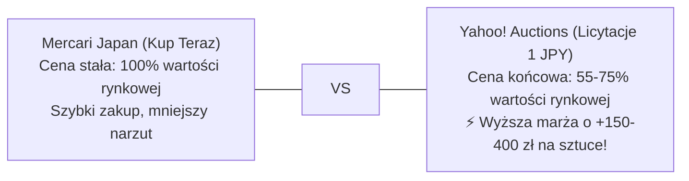

# 📡 Yahoo! Auctions Live Radar & Real Closing Price Intelligence

> **Radar Aktywnych Licytacji, Baza Rzeczywistych Cen Końcowych (落札相場) i Arbitraż Yahoo vs Mercari**  
> *Dedykowane narzędzie analityczne: gdzie aukcje miażdżą oferty Kup Teraz, jakie są realne ceny zamknięcia i które licytacje natychmiast wrzucić na celownik.*

     

⬅ **Nawigacja:** [📱 **Aplikacja Android / PWA (Live)**](https://110kc3.github.io/japan-deal-watcher/) · [Główny Dashboard Mercari (README.md)](README.md) · [🎯 Poradnik Snajpera i Limity (AUCTION_SNIPING_GUIDE.md)](AUCTION_SNIPING_GUIDE.md) · [🔨 Katalog Alternatywnych Ofert (YAHOO_AUCTIONS_DEALS.md)](YAHOO_AUCTIONS_DEALS.md) · [📈 Historia Sprzedaży (MARKET_SALES_HISTORY.md)](MARKET_SALES_HISTORY.md) · [💰 Audyt Opłacalności (REAL_PROFITABILITY_AUDIT.md)](REAL_PROFITABILITY_AUDIT.md)

---

## 💡 Dlaczego na Aukcjach Yahoo Kupisz Taniej Niż na Mercari? (Fakty i Liczby)

> [!NOTE]
> **Mercari Japan vs Yahoo! Auctions Japan – Dwa Różne Światy Handlu:**
> - **Mercari (Kup Teraz / BIN):** Sprzedawcy wyceniają towar na podstawie innych aktywnych ofert. Ceny są sztywne. Jeśli ktoś wystawi tanio, boty i resellerzy wykupują to w 2–15 minut. Zostają tylko oferty w cenach rynkowych.
> - **Yahoo! Auctions (Licytacje od 1 JPY):** Japończycy wystawiający spadki, likwidacje strychów czy szaf wystawiają towar od 1 JPY na 5–7 dni bez ceny minimalnej. **Aukcje hurtowe i nieprzetestowane zamykają się średnio 25%–55% taniej niż oferty Kup Teraz na Mercari!**
> - **Magia Ostatnich 120 Sekund:** Ponad 75% licytacji w dni robocze kończy się w godzinach, gdy w Japonii trwa praca lub sen. Wykorzystując automatycznego Snajpera ZenMarket z twardym limitem kapitałowym, wygrywasz aukcje poniżej ceny detalicznej!

---

## 📊 Matryca Arbitrażu: Rzeczywiste Ceny Końcowe Yahoo (落札相場) vs Mercari vs Polska

Poniższa tabela zestawia **rzeczywiste dane transakcyjne z zakończonych aukcji na Yahoo Japan** (zakresy cen zamknięcia dla sprawnych egzemplarzy), ceny Buy-It-Now z Mercari, wycenę rynkową w Polsce oraz wyliczony **Twardy Limit Snajpera (Hard Sniping Cap)** z gwarantowanym zyskiem w PLN.

| Model / Przedmiot | Rzeczywista Cena Zamknięcia Yahoo (落札相場) | Mercari Kup Teraz (BIN) | Przewaga Yahoo | Cena w Polsce (Allegro/OLX) | 🎯 Twardy Limit Snajpera | Zysk Netto przy Limicie | Bateria IATA |
|---|:---:|:---:|:---:|---:|:---:|---:|:---:|
| **New Nintendo 3DS LL (New 3DS XL)** <small>Metallic Blue / Metallic Black (RED-001)</small> | **13,000 – 25,000 JPY** <small>(~459 zł | śr: 18,500 JPY)</small> | ~23,500 JPY <small>(~583 zł)</small> | <strong style='color:#10b981;'>-21% taniej</strong> <small>(zyskujesz +124 zł)</small> | **920.00 zł** | **`19,800 JPY`** <small>(~491 zł)</small> | <strong style='color:#10b981;'>+224.64 zł</strong> <small>(+32.3%)</small> | 🔴 1 Li-Ion |
| **New Nintendo 3DS (Kisekae Cover Plates)** <small>White / Black (KTR-001)</small> | **11,000 – 19,000 JPY** <small>(~360 zł | śr: 14,500 JPY)</small> | ~19,500 JPY <small>(~484 zł)</small> | <strong style='color:#10b981;'>-26% taniej</strong> <small>(zyskujesz +124 zł)</small> | **750.00 zł** | **`15,700 JPY`** <small>(~389 zł)</small> | <strong style='color:#10b981;'>+183.28 zł</strong> <small>(+32.3%)</small> | 🔴 1 Li-Ion |
| **Nintendo 3DS LL (Old 3DS XL)** <small>Blue / Black lub Red / Black (SPR-001)</small> | **6,500 – 12,000 JPY** <small>(~211 zł | śr: 8,500 JPY)</small> | ~11,000 JPY <small>(~273 zł)</small> | <strong style='color:#10b981;'>-23% taniej</strong> <small>(zyskujesz +62 zł)</small> | **580.00 zł** | **`11,600 JPY`** <small>(~288 zł)</small> | <strong style='color:#10b981;'>+141.92 zł</strong> <small>(+32.4%)</small> | 🔴 1 Li-Ion |
| **Nintendo 3DS (CTR-001)** <small>Aqua Blue</small> | **4,500 – 7,500 JPY** <small>(~144 zł | śr: 5,800 JPY)</small> | ~7,500 JPY <small>(~186 zł)</small> | <strong style='color:#10b981;'>-23% taniej</strong> <small>(zyskujesz +42 zł)</small> | **460.00 zł** | **`8,100 JPY`** <small>(~201 zł)</small> | <strong style='color:#10b981;'>+131.72 zł</strong> <small>(+40.1%)</small> | 🔴 1 Li-Ion |
| **Nintendo DSi LL (XL)** <small>Wine Red / Dark Brown (Matryce IPS)</small> | **3,500 – 7,500 JPY** <small>(~129 zł | śr: 5,200 JPY)</small> | ~7,200 JPY <small>(~179 zł)</small> | <strong style='color:#10b981;'>-28% taniej</strong> <small>(zyskujesz +50 zł)</small> | **380.00 zł** | **`6,200 JPY`** <small>(~154 zł)</small> | <strong style='color:#10b981;'>+111.34 zł</strong> <small>(+41.4%)</small> | 🔴 1 Li-Ion |
| **Nintendo DS Lite (USG-001)** <small>Metallic Silver</small> | **1,800 – 3,200 JPY** <small>(~60 zł | śr: 2,400 JPY)</small> | ~3,500 JPY <small>(~87 zł)</small> | <strong style='color:#10b981;'>-31% taniej</strong> <small>(zyskujesz +27 zł)</small> | **260.00 zł** | **`3,500 JPY`** <small>(~87 zł)</small> | <strong style='color:#10b981;'>+76.04 zł</strong> <small>(+41.3%)</small> | 🔴 1 Li-Ion |
| **Nintendo DS Lite (Dwukolorowy)** <small>Crimson / Black</small> | **2,200 – 3,800 JPY** <small>(~69 zł | śr: 2,800 JPY)</small> | ~3,900 JPY <small>(~97 zł)</small> | <strong style='color:#10b981;'>-28% taniej</strong> <small>(zyskujesz +27 zł)</small> | **290.00 zł** | **`4,200 JPY`** <small>(~104 zł)</small> | <strong style='color:#10b981;'>+84.08 zł</strong> <small>(+40.8%)</small> | 🔴 1 Li-Ion |
| **Nintendo DS Lite Final Fantasy III Crystal Edition** <small>Crystal White (Limited)</small> | **5,000 – 9,500 JPY** <small>(~169 zł | śr: 6,800 JPY)</small> | ~10,500 JPY <small>(~260 zł)</small> | <strong style='color:#10b981;'>-35% taniej</strong> <small>(zyskujesz +92 zł)</small> | **580.00 zł** | **`11,600 JPY`** <small>(~288 zł)</small> | <strong style='color:#10b981;'>+141.92 zł</strong> <small>(+32.4%)</small> | 🔴 1 Li-Ion |
| **Game Boy Advance SP Famicom 20th Anniversary Edition** <small>Famicom Red / Gold (Limited)</small> | **8,500 – 16,000 JPY** <small>(~285 zł | śr: 11,500 JPY)</small> | ~15,500 JPY <small>(~384 zł)</small> | <strong style='color:#10b981;'>-26% taniej</strong> <small>(zyskujesz +99 zł)</small> | **720.00 zł** | **`15,200 JPY`** <small>(~377 zł)</small> | <strong style='color:#10b981;'>+175.29 zł</strong> <small>(+32.2%)</small> | 🔴 1 Li-Ion |
| **Game Boy Advance SP (AGS-101 Brighter LCD)** <small>Pearl Blue (Podświetlenie II Generacji)</small> | **13,000 – 22,000 JPY** <small>(~409 zł | śr: 16,500 JPY)</small> | ~21,000 JPY <small>(~521 zł)</small> | <strong style='color:#10b981;'>-21% taniej</strong> <small>(zyskujesz +112 zł)</small> | **780.00 zł** | **`16,600 JPY`** <small>(~412 zł)</small> | <strong style='color:#10b981;'>+191.37 zł</strong> <small>(+32.5%)</small> | 🔴 1 Li-Ion |
| **Game Boy Color CGB-001** <small>Atomic Purple (Przezroczysty Fiolet)</small> | **5,000 – 8,500 JPY** <small>(~161 zł | śr: 6,500 JPY)</small> | ~8,800 JPY <small>(~218 zł)</small> | <strong style='color:#10b981;'>-26% taniej</strong> <small>(zyskujesz +57 zł)</small> | **450.00 zł** | **`8,000 JPY`** <small>(~198 zł)</small> | <strong style='color:#10b981;'>+131.18 zł</strong> <small>(+41.1%)</small> | 🟢 0% Li-Ion |
| **Game Boy Advance (AGB-001 Poziomy)** <small>Glacier (Przezroczysty Błękit)</small> | **4,000 – 7,000 JPY** <small>(~129 zł | śr: 5,200 JPY)</small> | ~7,200 JPY <small>(~179 zł)</small> | <strong style='color:#10b981;'>-28% taniej</strong> <small>(zyskujesz +50 zł)</small> | **390.00 zł** | **`6,700 JPY`** <small>(~166 zł)</small> | <strong style='color:#10b981;'>+111.98 zł</strong> <small>(+40.3%)</small> | 🟢 0% Li-Ion |
| **PCH-2000 Slim** <small>Aqua Blue (ZA23)</small> | **12,000 – 17,000 JPY** <small>(~360 zł | śr: 14,500 JPY)</small> | ~17,500 JPY <small>(~434 zł)</small> | <strong style='color:#10b981;'>-17% taniej</strong> <small>(zyskujesz +74 zł)</small> | **890.00 zł** | **`18,900 JPY`** <small>(~469 zł)</small> | <strong style='color:#10b981;'>+216.55 zł</strong> <small>(+32.2%)</small> | 🔴 1 Li-Ion |
| **PCH-1000 OLED** <small>Sapphire Blue (ZA04)</small> | **11,500 – 16,500 JPY** <small>(~342 zł | śr: 13,800 JPY)</small> | ~16,800 JPY <small>(~417 zł)</small> | <strong style='color:#10b981;'>-18% taniej</strong> <small>(zyskujesz +74 zł)</small> | **850.00 zł** | **`17,900 JPY`** <small>(~444 zł)</small> | <strong style='color:#10b981;'>+207.93 zł</strong> <small>(+32.4%)</small> | 🔴 1 Li-Ion |
| **PCH-2000 Slim** <small>Metallic Red (ZA26)</small> | **12,500 – 17,500 JPY** <small>(~367 zł | śr: 14,800 JPY)</small> | ~18,000 JPY <small>(~446 zł)</small> | <strong style='color:#10b981;'>-18% taniej</strong> <small>(zyskujesz +79 zł)</small> | **880.00 zł** | **`18,600 JPY`** <small>(~461 zł)</small> | <strong style='color:#10b981;'>+215.97 zł</strong> <small>(+32.5%)</small> | 🔴 1 Li-Ion |
| **PCH-2000 Slim** <small>Glacier White (ZA22)</small> | **11,500 – 16,000 JPY** <small>(~335 zł | śr: 13,500 JPY)</small> | ~16,500 JPY <small>(~409 zł)</small> | <strong style='color:#10b981;'>-18% taniej</strong> <small>(zyskujesz +74 zł)</small> | **850.00 zł** | **`17,900 JPY`** <small>(~444 zł)</small> | <strong style='color:#10b981;'>+207.93 zł</strong> <small>(+32.4%)</small> | 🔴 1 Li-Ion |
| **PCH-2000 Slim** <small>Neon Orange (ZA24)</small> | **16,000 – 23,000 JPY** <small>(~471 zł | śr: 19,000 JPY)</small> | ~24,000 JPY <small>(~595 zł)</small> | <strong style='color:#10b981;'>-21% taniej</strong> <small>(zyskujesz +124 zł)</small> | **1050.00 zł** | **`22,700 JPY`** <small>(~563 zł)</small> | <strong style='color:#10b981;'>+257.33 zł</strong> <small>(+32.5%)</small> | 🔴 1 Li-Ion |
| **PSP-3000 Vibrant Blue** <small>Vibrant Blue (Metaliczny Błękit)</small> | **6,500 – 11,000 JPY** <small>(~211 zł | śr: 8,500 JPY)</small> | ~11,000 JPY <small>(~273 zł)</small> | <strong style='color:#10b981;'>-23% taniej</strong> <small>(zyskujesz +62 zł)</small> | **490.00 zł** | **`8,700 JPY`** <small>(~216 zł)</small> | <strong style='color:#10b981;'>+142.90 zł</strong> <small>(+41.2%)</small> | 🔴 1 Li-Ion |
| **PSP-3000 Monster Hunter Portable 3rd Hunters Model** <small>MHB Matowa Czerń / Złote Emblematy</small> | **10,000 – 16,500 JPY** <small>(~322 zł | śr: 13,000 JPY)</small> | ~17,000 JPY <small>(~422 zł)</small> | <strong style='color:#10b981;'>-24% taniej</strong> <small>(zyskujesz +99 zł)</small> | **820.00 zł** | **`17,400 JPY`** <small>(~432 zł)</small> | <strong style='color:#10b981;'>+199.94 zł</strong> <small>(+32.2%)</small> | 🔴 1 Li-Ion |
| **Hurtowy Pakiet 50 Gier Retro (Nintendo DS / GBA / SFC / PS2)** <small>Mix 50 Gier Hurtowo</small> | **3,000 – 7,500 JPY** <small>(~119 zł | śr: 4,800 JPY)</small> | ~9,500 JPY <small>(~236 zł)</small> | <strong style='color:#10b981;'>-49% taniej</strong> <small>(zyskujesz +117 zł)</small> | **750.00 zł** | **`15,100 JPY`** <small>(~375 zł)</small> | <strong style='color:#10b981;'>+214.75 zł</strong> <small>(+40.1%)</small> | 🟢 0% Li-Ion |
| **Zestaw 30 Gier Nintendo DS / 3DS w Pudełkach (CIB Lot)** <small>Mix 30 Gier DS / 3DS</small> | **2,800 – 6,500 JPY** <small>(~104 zł | śr: 4,200 JPY)</small> | ~8,500 JPY <small>(~211 zł)</small> | <strong style='color:#10b981;'>-51% taniej</strong> <small>(zyskujesz +107 zł)</small> | **680.00 zł** | **`13,500 JPY`** <small>(~335 zł)</small> | <strong style='color:#10b981;'>+194.95 zł</strong> <small>(+40.2%)</small> | 🟢 0% Li-Ion |
| **Hurtowy Pakiet 40 Gier PlayStation 1 & 2 (RPG & Akcja)** <small>Mix 40 Gier PS1 / PS2</small> | **2,500 – 5,500 JPY** <small>(~94 zł | śr: 3,800 JPY)</small> | ~7,500 JPY <small>(~186 zł)</small> | <strong style='color:#10b981;'>-49% taniej</strong> <small>(zyskujesz +92 zł)</small> | **720.00 zł** | **`14,400 JPY`** <small>(~357 zł)</small> | <strong style='color:#10b981;'>+206.72 zł</strong> <small>(+40.3%)</small> | 🟢 0% Li-Ion |
| **PSone COMBO SCPH-130 (Zintegrowany 5" LCD Sony)** <small>Biały Mini + Doczepiany Ekran LCD</small> | **16,000 – 26,000 JPY** <small>(~521 zł | śr: 21,000 JPY)</small> | ~28,000 JPY <small>(~694 zł)</small> | <strong style='color:#10b981;'>-25% taniej</strong> <small>(zyskujesz +174 zł)</small> | **1600.00 zł** | **`36,000 JPY`** <small>(~893 zł)</small> | <strong style='color:#10b981;'>+352.10 zł</strong> <small>(+28.2%)</small> | 🟢 0% Li-Ion |
| **PlayStation 4 Pro Monster Hunter World Rathalos (1TB)** <small>Rathalos Red & Black + Pad</small> | **22,000 – 32,000 JPY** <small>(~657 zł | śr: 26,500 JPY)</small> | ~34,000 JPY <small>(~843 zł)</small> | <strong style='color:#10b981;'>-22% taniej</strong> <small>(zyskujesz +186 zł)</small> | **1550.00 zł** | **`34,800 JPY`** <small>(~863 zł)</small> | <strong style='color:#10b981;'>+339.74 zł</strong> <small>(+28.1%)</small> | 🟢 0% Li-Ion |
| **Nintendo GameCube DOL-001 Zestaw** <small>Spice Orange + Pad + Kable</small> | **4,000 – 7,800 JPY** <small>(~144 zł | śr: 5,800 JPY)</small> | ~8,500 JPY <small>(~211 zł)</small> | <strong style='color:#10b981;'>-32% taniej</strong> <small>(zyskujesz +67 zł)</small> | **650.00 zł** | **`11,900 JPY`** <small>(~295 zł)</small> | <strong style='color:#10b981;'>+158.23 zł</strong> <small>(+32.2%)</small> | 🟢 0% Li-Ion |
| **PlayStation 4 Metal Gear Solid V Limited Edition** <small>Bordowo-Złota Diamond Dogs</small> | **18,000 – 25,000 JPY** <small>(~533 zł | śr: 21,500 JPY)</small> | ~27,000 JPY <small>(~670 zł)</small> | <strong style='color:#10b981;'>-20% taniej</strong> <small>(zyskujesz +136 zł)</small> | **1350.00 zł** | **`29,800 JPY`** <small>(~739 zł)</small> | <strong style='color:#10b981;'>+296.63 zł</strong> <small>(+28.2%)</small> | 🟢 0% Li-Ion |
| **DualSense 30th Anniversary Limited Edition** <small>Classic PS1 Grey w Pudełku</small> | **12,000 – 17,000 JPY** <small>(~347 zł | śr: 14,000 JPY)</small> | ~17,500 JPY <small>(~434 zł)</small> | <strong style='color:#10b981;'>-20% taniej</strong> <small>(zyskujesz +87 zł)</small> | **850.00 zł** | **`18,100 JPY`** <small>(~449 zł)</small> | <strong style='color:#10b981;'>+207.98 zł</strong> <small>(+32.4%)</small> | 🔴 1 Li-Ion |
| **DualSense Astro Bot Limited Edition** <small>Astro Bot Blue & White</small> | **7,500 – 11,000 JPY** <small>(~223 zł | śr: 9,000 JPY)</small> | ~11,500 JPY <small>(~285 zł)</small> | <strong style='color:#10b981;'>-22% taniej</strong> <small>(zyskujesz +62 zł)</small> | **600.00 zł** | **`12,100 JPY`** <small>(~300 zł)</small> | <strong style='color:#10b981;'>+146.24 zł</strong> <small>(+32.2%)</small> | 🔴 1 Li-Ion |
| **DualShock 4 500 Million Limited (CUH-ZCT2J50)** <small>Translucent Dark Blue + Złote Logo</small> | **7,000 – 11,000 JPY** <small>(~211 zł | śr: 8,500 JPY)</small> | ~11,000 JPY <small>(~273 zł)</small> | <strong style='color:#10b981;'>-23% taniej</strong> <small>(zyskujesz +62 zł)</small> | **580.00 zł** | **`11,600 JPY`** <small>(~288 zł)</small> | <strong style='color:#10b981;'>+141.92 zł</strong> <small>(+32.4%)</small> | 🔴 1 Li-Ion |
| **HORI Dragon Quest Slime Controller PS2 (HP2-177)** <small>Niebieski Kropelka Slime</small> | **3,500 – 6,000 JPY** <small>(~112 zł | śr: 4,500 JPY)</small> | ~6,500 JPY <small>(~161 zł)</small> | <strong style='color:#10b981;'>-31% taniej</strong> <small>(zyskujesz +50 zł)</small> | **450.00 zł** | **`7,800 JPY`** <small>(~193 zł)</small> | <strong style='color:#10b981;'>+131.13 zł</strong> <small>(+41.1%)</small> | 🟢 0% Li-Ion |
| **DualShock 4 Monster Hunter World Rathalos Edition** <small>Głęboka Czerwień / Złoty Herb</small> | **3,000 – 5,500 JPY** <small>(~104 zł | śr: 4,200 JPY)</small> | ~5,500 JPY <small>(~136 zł)</small> | <strong style='color:#10b981;'>-24% taniej</strong> <small>(zyskujesz +32 zł)</small> | **380.00 zł** | **`6,200 JPY`** <small>(~154 zł)</small> | <strong style='color:#10b981;'>+111.34 zł</strong> <small>(+41.4%)</small> | 🔴 1 Li-Ion |
| **Minolta Riva Zoom 70 Date (35-70mm AF)** <small>Black Classic</small> | **800 – 2,200 JPY** <small>(~35 zł | śr: 1,400 JPY)</small> | ~2,000 JPY <small>(~50 zł)</small> | <strong style='color:#10b981;'>-30% taniej</strong> <small>(zyskujesz +15 zł)</small> | **220.00 zł** | **`2,800 JPY`** <small>(~69 zł)</small> | <strong style='color:#10b981;'>+64.33 zł</strong> <small>(+41.3%)</small> | 🟢 0% Li-Ion |
| **Fuji Cardia Travel Mini Dual-P (28mm/45mm)** <small>Tytanowy Szampański</small> | **1,000 – 2,500 JPY** <small>(~40 zł | śr: 1,600 JPY)</small> | ~2,400 JPY <small>(~60 zł)</small> | <strong style='color:#10b981;'>-33% taniej</strong> <small>(zyskujesz +20 zł)</small> | **260.00 zł** | **`3,700 JPY`** <small>(~92 zł)</small> | <strong style='color:#10b981;'>+76.09 zł</strong> <small>(+41.4%)</small> | 🟢 0% Li-Ion |
| **Canon Autoboy 3 Quartz Date (38mm f/2.8 Prime)** <small>Czarny / Czerwona Linia</small> | **2,500 – 3,900 JPY** <small>(~79 zł | śr: 3,200 JPY)</small> | ~4,800 JPY <small>(~119 zł)</small> | <strong style='color:#10b981;'>-33% taniej</strong> <small>(zyskujesz +40 zł)</small> | **480.00 zł** | **`4,000 JPY`** <small>(~99 zł)</small> | <strong style='color:#10b981;'>+286.68 zł</strong> <small>(+148.3%)</small> | 🟢 0% Li-Ion |
| **Pentax Espio 80 Date (38-80mm SMC)** <small>Czarny Mat</small> | **1,000 – 2,400 JPY** <small>(~40 zł | śr: 1,600 JPY)</small> | ~2,200 JPY <small>(~55 zł)</small> | <strong style='color:#10b981;'>-27% taniej</strong> <small>(zyskujesz +15 zł)</small> | **250.00 zł** | **`3,500 JPY`** <small>(~87 zł)</small> | <strong style='color:#10b981;'>+72.37 zł</strong> <small>(+40.7%)</small> | 🟢 0% Li-Ion |
| **Olympus AF-10 Twin (35mm/70mm Dwuogniskowy)** <small>Czarny Clamshell</small> | **1,500 – 3,200 JPY** <small>(~55 zł | śr: 2,200 JPY)</small> | ~3,200 JPY <small>(~79 zł)</small> | <strong style='color:#10b981;'>-31% taniej</strong> <small>(zyskujesz +25 zł)</small> | **280.00 zł** | **`4,000 JPY`** <small>(~99 zł)</small> | <strong style='color:#10b981;'>+86.68 zł</strong> <small>(+44.8%)</small> | 🟢 0% Li-Ion |
| **Nikon TW2D Dual Lens 35mm/70mm** <small>Czarny Klasyczny Nikon</small> | **1,000 – 2,200 JPY** <small>(~37 zł | śr: 1,500 JPY)</small> | ~2,200 JPY <small>(~55 zł)</small> | <strong style='color:#10b981;'>-32% taniej</strong> <small>(zyskujesz +17 zł)</small> | **280.00 zł** | **`4,000 JPY`** <small>(~99 zł)</small> | <strong style='color:#10b981;'>+86.68 zł</strong> <small>(+44.8%)</small> | 🟢 0% Li-Ion |
| **Canon Prima Super 28V (28-48mm Wide)** <small>Srebrno-Czarny</small> | **1,500 – 3,000 JPY** <small>(~55 zł | śr: 2,200 JPY)</small> | ~3,000 JPY <small>(~74 zł)</small> | <strong style='color:#10b981;'>-27% taniej</strong> <small>(zyskujesz +20 zł)</small> | **300.00 zł** | **`4,000 JPY`** <small>(~99 zł)</small> | <strong style='color:#10b981;'>+106.68 zł</strong> <small>(+55.2%)</small> | 🟢 0% Li-Ion |
| **Konica Big Mini NEO-R z etui** <small>Tytanowy Szary</small> | **2,200 – 3,800 JPY** <small>(~72 zł | śr: 2,900 JPY)</small> | ~4,200 JPY <small>(~104 zł)</small> | <strong style='color:#10b981;'>-31% taniej</strong> <small>(zyskujesz +32 zł)</small> | **420.00 zł** | **`4,000 JPY`** <small>(~99 zł)</small> | <strong style='color:#10b981;'>+226.68 zł</strong> <small>(+117.3%)</small> | 🟢 0% Li-Ion |
| **SMC Pentax-M 50mm f/1.4** <small>Mocowanie K</small> | **2,000 – 3,800 JPY** <small>(~69 zł | śr: 2,800 JPY)</small> | ~4,200 JPY <small>(~104 zł)</small> | <strong style='color:#10b981;'>-33% taniej</strong> <small>(zyskujesz +35 zł)</small> | **420.00 zł** | **`4,000 JPY`** <small>(~99 zł)</small> | <strong style='color:#10b981;'>+226.68 zł</strong> <small>(+117.3%)</small> | 🟢 0% Li-Ion |
| **SMC Pentax-M 50mm f/2 (K-mount)** <small>Mocowanie Bagnet K</small> | **1,200 – 2,500 JPY** <small>(~42 zł | śr: 1,700 JPY)</small> | ~2,500 JPY <small>(~62 zł)</small> | <strong style='color:#10b981;'>-32% taniej</strong> <small>(zyskujesz +20 zł)</small> | **260.00 zł** | **`3,700 JPY`** <small>(~92 zł)</small> | <strong style='color:#10b981;'>+76.09 zł</strong> <small>(+41.4%)</small> | 🟢 0% Li-Ion |
| **Super-Takumar 55mm f/1.8** <small>Mocowanie M42</small> | **1,500 – 3,200 JPY** <small>(~55 zł | śr: 2,200 JPY)</small> | ~3,000 JPY <small>(~74 zł)</small> | <strong style='color:#10b981;'>-27% taniej</strong> <small>(zyskujesz +20 zł)</small> | **320.00 zł** | **`4,000 JPY`** <small>(~99 zł)</small> | <strong style='color:#10b981;'>+126.68 zł</strong> <small>(+65.5%)</small> | 🟢 0% Li-Ion |

---

## 🎯 Top 12 Wyselekcjonowanych Celów do Obserwacji (Bezpośrednie Linki i Snajper)

Poniższe pozycje to absolutna czołówka opłacalności na Yahoo! Auctions. Kliknij `[⏰ Kończące się Aukcje]`, aby zobaczyć trwające licytacje w kolejności wygasania (gotowe do snajpingu w T-2m), lub `[💰 Świeże od 1 JPY]`, aby dodać do obserwowanych nowe wystawienia!

| # | Model / Przedmiot | Kategoria | Kluczowa Wskazówka Snajpera | 🎯 Limit JPY | Zysk w PL | Linki Aktywne (1-Click) |
|:---:|---|---|---|---:|---:|---|
| **1** | **New Nintendo 3DS LL (New 3DS XL)** <small>Metallic Blue / Metallic Black (RED-001)</small> | `Królowie Płynności` | <small>Szukaj egzemplarzy z ekranami IPS (górny ekran ma głębszą czerń pod kątem).</small> | **`19,800 JPY`** <small>(~491 zł)</small> | <strong style='color:#10b981;'>+224.64 zł</strong> | [⏰ Kończące się](https://zenmarket.jp/pl/yahoo.aspx?q=New%E3%83%8B%E3%83%B3%E3%83%86%E3%83%B3%E3%83%89%E3%83%BC3DS%20LL%20%E6%9C%AC%E4%BD%93&sort=end&order=asc) [💰 Od 1 JPY](https://zenmarket.jp/pl/yahoo.aspx?q=New%E3%83%8B%E3%83%B3%E3%83%86%E3%83%B3%E3%83%89%E3%83%BC3DS%20LL%20%E6%9C%AC%E4%BD%93&sort=price&order=asc) [📊 Archiwum Cen Yahoo](https://auctions.yahoo.co.jp/closedsearch/closedsearch?p=New%E3%83%8B%E3%83%B3%E3%83%86%E3%83%B3%E3%83%89%E3%83%BC3DS%20LL%20%E6%9C%AC%E4%BD%93) |
| **2** | **Game Boy Advance SP Famicom 20th Anniversary Edition** <small>Famicom Red / Gold (Limited)</small> | `Rarytas Kolekcjonerski` | <small>Możliwość Dry Shippingu (usunięcie baterii = 0% Li-Ion).</small> | **`15,200 JPY`** <small>(~377 zł)</small> | <strong style='color:#10b981;'>+175.29 zł</strong> | [⏰ Kończące się](https://zenmarket.jp/pl/yahoo.aspx?q=%E3%82%B2%E3%83%BC%E3%83%A0%E3%83%9C%E3%83%BC%E3%82%A4%E3%82%A2%E3%83%89%E3%83%90%E3%83%B3%E3%82%B9SP%20%E3%83%95%E3%82%A1%E3%83%9F%E3%82%B3%E3%83%B3%E3%82%AB%E3%83%A9%E3%83%BC&sort=end&order=asc) [💰 Od 1 JPY](https://zenmarket.jp/pl/yahoo.aspx?q=%E3%82%B2%E3%83%BC%E3%83%A0%E3%83%9C%E3%83%BC%E3%82%A4%E3%82%A2%E3%83%89%E3%83%90%E3%83%B3%E3%82%B9SP%20%E3%83%95%E3%82%A1%E3%83%9F%E3%82%B3%E3%83%B3%E3%82%AB%E3%83%A9%E3%83%BC&sort=price&order=asc) [📊 Archiwum Cen Yahoo](https://auctions.yahoo.co.jp/closedsearch/closedsearch?p=%E3%82%B2%E3%83%BC%E3%83%A0%E3%83%9C%E3%83%BC%E3%82%A4%E3%82%A2%E3%83%89%E3%83%90%E3%83%B3%E3%82%B9SP%20%E3%83%95%E3%82%A1%E3%83%9F%E3%82%B3%E3%83%B3%E3%82%AB%E3%83%A9%E3%83%BC) |
| **3** | **Hurtowy Pakiet 50 Gier Retro (Nintendo DS / GBA / SFC / PS2)** <small>Mix 50 Gier Hurtowo</small> | `0% Li-Ion Maszyna Marży` | <small>W paczkach hurtowych gry wychodzą po ~3-5 zł za sztukę w zakupie!</small> | **`16,100 JPY`** <small>(~399 zł)</small> | <strong style='color:#10b981;'>+183.38 zł</strong> | [⏰ Kończące się](https://zenmarket.jp/pl/yahoo.aspx?q=%E3%82%B2%E3%83%BC%E3%83%A0%20%E3%82%BD%E3%83%95%E3%83%88%20%E3%81%BE%E3%81%A8%E3%82%81%20%E5%A4%A7%E9%87%8F&sort=end&order=asc) [💰 Od 1 JPY](https://zenmarket.jp/pl/yahoo.aspx?q=%E3%82%B2%E3%83%BC%E3%83%A0%20%E3%82%BD%E3%83%95%E3%83%88%20%E3%81%BE%E3%81%A8%E3%82%81%20%E5%A4%A7%E9%87%8F&sort=price&order=asc) [📊 Archiwum Cen Yahoo](https://auctions.yahoo.co.jp/closedsearch/closedsearch?p=%E3%82%B2%E3%83%BC%E3%83%A0%20%E3%82%BD%E3%83%95%E3%83%88%20%E3%81%BE%E3%81%A8%E3%82%81%20%E5%A4%A7%E9%87%8F) |
| **4** | **PSone COMBO SCPH-130 (Zintegrowany 5" LCD Sony)** <small>Biały Mini + Doczepiany Ekran LCD</small> | `Wyselekcjonowana Stacjonarna` | <small>Sprawdź czy w zestawie jest zasilacz SCPH-10130 i brak pęknięć zawiasu LCD.</small> | **`34,800 JPY`** <small>(~863 zł)</small> | <strong style='color:#10b981;'>+389.74 zł</strong> | [⏰ Kończące się](https://zenmarket.jp/pl/yahoo.aspx?q=PSone%20%E3%82%B3%E3%83%B3%E3%83%9C%20SCPH-130%20%E6%B6%B2%E6%99%B6&sort=end&order=asc) [💰 Od 1 JPY](https://zenmarket.jp/pl/yahoo.aspx?q=PSone%20%E3%82%B3%E3%83%B3%E3%83%9C%20SCPH-130%20%E6%B6%B2%E6%99%B6&sort=price&order=asc) [📊 Archiwum Cen Yahoo](https://auctions.yahoo.co.jp/closedsearch/closedsearch?p=PSone%20%E3%82%B3%E3%83%B3%E3%83%9C%20SCPH-130%20%E6%B6%B2%E6%99%B6) |
| **5** | **Nintendo DSi LL (XL)** <small>Wine Red / Dark Brown (Matryce IPS)</small> | `Fabryczne Ekrany IPS` | <small>Każdy DSi LL ma fabrycznie montowane matryce IPS o szerokim kącie widzenia.</small> | **`6,800 JPY`** <small>(~169 zł)</small> | <strong style='color:#10b981;'>+92.52 zł</strong> | [⏰ Kończące się](https://zenmarket.jp/pl/yahoo.aspx?q=Nintendo%20DSi%20LL%20%E6%9C%AC%E4%BD%93&sort=end&order=asc) [💰 Od 1 JPY](https://zenmarket.jp/pl/yahoo.aspx?q=Nintendo%20DSi%20LL%20%E6%9C%AC%E4%BD%93&sort=price&order=asc) [📊 Archiwum Cen Yahoo](https://auctions.yahoo.co.jp/closedsearch/closedsearch?p=Nintendo%20DSi%20LL%20%E6%9C%AC%E4%BD%93) |
| **6** | **PCH-2000 Slim** <small>Aqua Blue (ZA23)</small> | `Najpopularniejszy Kolor PL` | <small>Sprawdź brak driftu gałek analogowych w opisie.</small> | **`18,900 JPY`** <small>(~469 zł)</small> | <strong style='color:#10b981;'>+216.55 zł</strong> | [⏰ Kończące się](https://zenmarket.jp/pl/yahoo.aspx?q=PS%20Vita%20PCH-2000%20%E3%82%A2%E3%82%AF%E3%82%A2%E3%83%96%E3%83%AB%E3%83%BC&sort=end&order=asc) [💰 Od 1 JPY](https://zenmarket.jp/pl/yahoo.aspx?q=PS%20Vita%20PCH-2000%20%E3%82%A2%E3%82%AF%E3%82%A2%E3%83%96%E3%83%AB%E3%83%BC&sort=price&order=asc) [📊 Archiwum Cen Yahoo](https://auctions.yahoo.co.jp/closedsearch/closedsearch?p=PS%20Vita%20PCH-2000%20%E3%82%A2%E3%82%AF%E3%82%A2%E3%83%96%E3%83%AB%E3%83%BC) |
| **7** | **Nintendo GameCube DOL-001 Zestaw** <small>Spice Orange + Pad + Kable</small> | `Wyselekcjonowana Stacjonarna` | <small>Upewnij się, że z tyłu jest cyfrowy port Digital AV Out.</small> | **`11,900 JPY`** <small>(~295 zł)</small> | <strong style='color:#10b981;'>+158.23 zł</strong> | [⏰ Kończące się](https://zenmarket.jp/pl/yahoo.aspx?q=%E3%82%B2%E3%83%BC%E3%83%A0%E3%82%AD%E3%83%A5%E3%83%BC%E3%83%96%20%E6%9C%AC%E4%BD%93%20DOL-001&sort=end&order=asc) [💰 Od 1 JPY](https://zenmarket.jp/pl/yahoo.aspx?q=%E3%82%B2%E3%83%BC%E3%83%A0%E3%82%AD%E3%83%A5%E3%83%BC%E3%83%96%20%E6%9C%AC%E4%BD%93%20DOL-001&sort=price&order=asc) [📊 Archiwum Cen Yahoo](https://auctions.yahoo.co.jp/closedsearch/closedsearch?p=%E3%82%B2%E3%83%BC%E3%83%A0%E3%82%AD%E3%83%A5%E3%83%BC%E3%83%96%20%E6%9C%AC%E4%BD%93%20DOL-001) |
| **8** | **PSP-3000 Vibrant Blue** <small>Vibrant Blue (Metaliczny Błękit)</small> | `Płynny Handheld` | <small>Metaliczny lakier – sprawdź brak wytarć na tylnym okręgu.</small> | **`9,400 JPY`** <small>(~233 zł)</small> | <strong style='color:#10b981;'>+120.94 zł</strong> | [⏰ Kończące się](https://zenmarket.jp/pl/yahoo.aspx?q=PSP-3000%20%E3%83%90%E3%82%A4%E3%83%96%E3%83%A9%E3%83%B3%E3%83%88%E3%83%96%E3%83%AB%E3%83%BC&sort=end&order=asc) [💰 Od 1 JPY](https://zenmarket.jp/pl/yahoo.aspx?q=PSP-3000%20%E3%83%90%E3%82%A4%E3%83%96%E3%83%A9%E3%83%B3%E3%83%88%E3%83%96%E3%83%AB%E3%83%BC&sort=price&order=asc) [📊 Archiwum Cen Yahoo](https://auctions.yahoo.co.jp/closedsearch/closedsearch?p=PSP-3000%20%E3%83%90%E3%82%A4%E3%83%96%E3%83%A9%E3%83%B3%E3%83%88%E3%83%96%E3%83%AB%E3%83%BC) |
| **9** | **Zestaw 30 Gier Nintendo DS / 3DS w Pudełkach (CIB Lot)** <small>Mix 30 Gier DS / 3DS</small> | `0% Li-Ion Kartridże` | <small>Gry DS w plastikowych pudełkach – wysoka marża jednostkowa.</small> | **`14,400 JPY`** <small>(~357 zł)</small> | <strong style='color:#10b981;'>+166.72 zł</strong> | [⏰ Kończące się](https://zenmarket.jp/pl/yahoo.aspx?q=DS%20%E3%82%BD%E3%83%95%E3%83%88%20%E3%81%BE%E3%81%A8%E3%82%81%E5%A3%B2%E3%82%8A%20%E3%82%BB%E3%83%83%E3%83%88&sort=end&order=asc) [💰 Od 1 JPY](https://zenmarket.jp/pl/yahoo.aspx?q=DS%20%E3%82%BD%E3%83%95%E3%83%88%20%E3%81%BE%E3%81%A8%E3%82%81%E5%A3%B2%E3%82%8A%20%E3%82%BB%E3%83%83%E3%83%88&sort=price&order=asc) [📊 Archiwum Cen Yahoo](https://auctions.yahoo.co.jp/closedsearch/closedsearch?p=DS%20%E3%82%BD%E3%83%95%E3%83%88%20%E3%81%BE%E3%81%A8%E3%82%81%E5%A3%B2%E3%82%8A%20%E3%82%BB%E3%83%83%E3%83%88) |
| **10** | **PlayStation 4 Pro Monster Hunter World Rathalos (1TB)** <small>Rathalos Red & Black + Pad</small> | `Kolekcjonerski Box` | <small>Sprawdź czy w zestawie jest limitowany czerwony pad Rathalos.</small> | **`33,600 JPY`** <small>(~833 zł)</small> | <strong style='color:#10b981;'>+377.40 zł</strong> | [⏰ Kończące się](https://zenmarket.jp/pl/yahoo.aspx?q=PS4%20Pro%20%E3%83%AA%E3%82%AA%E3%83%AC%E3%82%A6%E3%82%B9%20%E3%82%A8%E3%83%87%E3%82%A3%E3%82%B7%E3%83%A7%E3%83%B3&sort=end&order=asc) [💰 Od 1 JPY](https://zenmarket.jp/pl/yahoo.aspx?q=PS4%20Pro%20%E3%83%AA%E3%82%AA%E3%83%AC%E3%82%A6%E3%82%B9%20%E3%82%A8%E3%83%87%E3%82%A3%E3%82%B7%E3%83%A7%E3%83%B3&sort=price&order=asc) [📊 Archiwum Cen Yahoo](https://auctions.yahoo.co.jp/closedsearch/closedsearch?p=PS4%20Pro%20%E3%83%AA%E3%82%AA%E3%83%AC%E3%82%A6%E3%82%B9%20%E3%82%A8%E3%83%87%E3%82%A3%E3%82%B7%E3%83%A7%E3%83%B3) |
| **11** | **SMC Pentax-M 50mm f/1.4** <small>Mocowanie K</small> | `Jasny Obiektyw Manualny` | <small>Sprawdź czystość szkieł (brak zamglenia / grzyba), limit <= 100 zł.</small> | **`4,000 JPY`** <small>(~99 zł)</small> | <strong style='color:#10b981;'>+226.68 zł</strong> | [⏰ Kończące się](https://zenmarket.jp/pl/yahoo.aspx?q=SMC%20PENTAX-M%2050mm%20F1.4&sort=end&order=asc) [💰 Od 1 JPY](https://zenmarket.jp/pl/yahoo.aspx?q=SMC%20PENTAX-M%2050mm%20F1.4&sort=price&order=asc) [📊 Archiwum Cen Yahoo](https://auctions.yahoo.co.jp/closedsearch/closedsearch?p=SMC%20PENTAX-M%2050mm%20F1.4) |
| **12** | **Canon Autoboy 3 Quartz Date (38mm f/2.8 Prime)** <small>Czarny / Czerwona Linia</small> | `Analogowy Hit Instagrama` | <small>Jasny obiektyw stałoogniskowy f/2.8, automatyczny AF, limit <= 100 zł.</small> | **`4,000 JPY`** <small>(~99 zł)</small> | <strong style='color:#10b981;'>+286.68 zł</strong> | [⏰ Kończące się](https://zenmarket.jp/pl/yahoo.aspx?q=Canon%20%E3%82%AA%E3%83%BC%E3%83%88%E3%83%9C%E3%83%BC%E3%82%A4%203%2038mm%20F2.8&sort=end&order=asc) [💰 Od 1 JPY](https://zenmarket.jp/pl/yahoo.aspx?q=Canon%20%E3%82%AA%E3%83%BC%E3%83%88%E3%83%9C%E3%83%BC%E3%82%A4%203%2038mm%20F2.8&sort=price&order=asc) [📊 Archiwum Cen Yahoo](https://auctions.yahoo.co.jp/closedsearch/closedsearch?p=Canon%20%E3%82%AA%E3%83%BC%E3%83%88%E3%83%9C%E3%83%BC%E3%82%A4%203%2038mm%20F2.8) |

---

## 🛰️ Terminal Wyszukiwania Licytacji (Wszystkie 11 Kategorii)

Wybierz kategorię i kliknij odpowiedni filtr, aby natychmiast załadować w panelu ZenMarket trwające japońskie aukcje przefiltrowane przez oficjalny silnik proxy:

| Kategoria | Egzemplarze / Cele | ⏰ Kończące Się (Sniping) | 💰 Od 1 JPY (Tanie) | 🔥 Najwięcej Ofert | 📊 Rzeczywiste Ceny Zamknięcia |
|---|---|:---:|:---:|:---:|:---:|
| **Nintendo 3DS & New 3DS** | <small>New 3DS XL, New 3DS Kisekae, 3DS XL</small> | [⏰ Kończące się](https://zenmarket.jp/pl/yahoo.aspx?q=New%E3%83%8B%E3%83%B3%E3%83%86%E3%83%B3%E3%83%89%E3%83%BC3DS%20LL%20%E6%9C%AC%E4%BD%93&sort=end&order=asc) | [💰 Od 1 JPY](https://zenmarket.jp/pl/yahoo.aspx?q=New%E3%83%8B%E3%83%B3%E3%83%86%E3%83%B3%E3%83%89%E3%83%BC3DS%20LL%20%E6%9C%AC%E4%BD%93&sort=price&order=asc) | [🔥 Najwięcej Ofert](https://zenmarket.jp/pl/yahoo.aspx?q=New%E3%83%8B%E3%83%B3%E3%83%86%E3%83%B3%E3%83%89%E3%83%BC3DS%20LL%20%E6%9C%AC%E4%BD%93&sort=bids&order=desc) | [📊 Sprawdź Ceny](https://auctions.yahoo.co.jp/closedsearch/closedsearch?p=New%E3%83%8B%E3%83%B3%E3%83%86%E3%83%B3%E3%83%89%E3%83%BC3DS%20LL%20%E6%9C%AC%E4%BD%93) |
| **Nintendo DS & DSi LL** | <small>DSi LL IPS, DS Lite Crimson, FF3 Limited</small> | [⏰ Kończące się](https://zenmarket.jp/pl/yahoo.aspx?q=Nintendo%20DSi%20LL%20%E6%9C%AC%E4%BD%93&sort=end&order=asc) | [💰 Od 1 JPY](https://zenmarket.jp/pl/yahoo.aspx?q=Nintendo%20DSi%20LL%20%E6%9C%AC%E4%BD%93&sort=price&order=asc) | [🔥 Najwięcej Ofert](https://zenmarket.jp/pl/yahoo.aspx?q=Nintendo%20DSi%20LL%20%E6%9C%AC%E4%BD%93&sort=bids&order=desc) | [📊 Sprawdź Ceny](https://auctions.yahoo.co.jp/closedsearch/closedsearch?p=Nintendo%20DSi%20LL%20%E6%9C%AC%E4%BD%93) |
| **Game Boy Advance & Retro** | <small>GBA SP Famicom, AGS-101, GBC Atomic Purple</small> | [⏰ Kończące się](https://zenmarket.jp/pl/yahoo.aspx?q=%E3%82%B2%E3%83%BC%E3%83%A0%E3%83%9C%E3%83%BC%E3%82%A4%E3%82%A2%E3%83%89%E3%83%90%E3%83%B3%E3%82%B9SP%20%E6%9C%AC%E4%BD%93&sort=end&order=asc) | [💰 Od 1 JPY](https://zenmarket.jp/pl/yahoo.aspx?q=%E3%82%B2%E3%83%BC%E3%83%A0%E3%83%9C%E3%83%BC%E3%82%A4%E3%82%A2%E3%83%89%E3%83%90%E3%83%B3%E3%82%B9SP%20%E6%9C%AC%E4%BD%93&sort=price&order=asc) | [🔥 Najwięcej Ofert](https://zenmarket.jp/pl/yahoo.aspx?q=%E3%82%B2%E3%83%BC%E3%83%A0%E3%83%9C%E3%83%BC%E3%82%A4%E3%82%A2%E3%83%89%E3%83%90%E3%83%B3%E3%82%B9SP%20%E6%9C%AC%E4%BD%93&sort=bids&order=desc) | [📊 Sprawdź Ceny](https://auctions.yahoo.co.jp/closedsearch/closedsearch?p=%E3%82%B2%E3%83%BC%E3%83%A0%E3%83%9C%E3%83%BC%E3%82%A4%E3%82%A2%E3%83%89%E3%83%90%E3%83%B3%E3%82%B9SP%20%E6%9C%AC%E4%BD%93) |
| **PlayStation Vita Handhelds** | <small>PCH-2000 Slim Aqua Blue, Neon Orange, OLED</small> | [⏰ Kończące się](https://zenmarket.jp/pl/yahoo.aspx?q=PS%20Vita%20PCH-2000%20%E6%9C%AC%E4%BD%93&sort=end&order=asc) | [💰 Od 1 JPY](https://zenmarket.jp/pl/yahoo.aspx?q=PS%20Vita%20PCH-2000%20%E6%9C%AC%E4%BD%93&sort=price&order=asc) | [🔥 Najwięcej Ofert](https://zenmarket.jp/pl/yahoo.aspx?q=PS%20Vita%20PCH-2000%20%E6%9C%AC%E4%BD%93&sort=bids&order=desc) | [📊 Sprawdź Ceny](https://auctions.yahoo.co.jp/closedsearch/closedsearch?p=PS%20Vita%20PCH-2000%20%E6%9C%AC%E4%BD%93) |
| **Sony PSP Handhelds** | <small>PSP-3000 Vibrant Blue, Monster Hunter 3rd</small> | [⏰ Kończące się](https://zenmarket.jp/pl/yahoo.aspx?q=PSP-3000%20%E6%9C%AC%E4%BD%93&sort=end&order=asc) | [💰 Od 1 JPY](https://zenmarket.jp/pl/yahoo.aspx?q=PSP-3000%20%E6%9C%AC%E4%BD%93&sort=price&order=asc) | [🔥 Najwięcej Ofert](https://zenmarket.jp/pl/yahoo.aspx?q=PSP-3000%20%E6%9C%AC%E4%BD%93&sort=bids&order=desc) | [📊 Sprawdź Ceny](https://auctions.yahoo.co.jp/closedsearch/closedsearch?p=PSP-3000%20%E6%9C%AC%E4%BD%93) |
| **Retro Gry Hurtowe Pakiety** | <small>Pakiety 30-50 gier DS, GBA, PS1, PS2 (0% Baterii)</small> | [⏰ Kończące się](https://zenmarket.jp/pl/yahoo.aspx?q=%E3%82%B2%E3%83%BC%E3%83%A0%20%E3%81%BE%E3%81%A8%E3%82%81%20%E3%82%BB%E3%83%83%E3%83%88&sort=end&order=asc) | [💰 Od 1 JPY](https://zenmarket.jp/pl/yahoo.aspx?q=%E3%82%B2%E3%83%BC%E3%83%A0%20%E3%81%BE%E3%81%A8%E3%82%81%20%E3%82%BB%E3%83%83%E3%83%88&sort=price&order=asc) | [🔥 Najwięcej Ofert](https://zenmarket.jp/pl/yahoo.aspx?q=%E3%82%B2%E3%83%BC%E3%83%A0%20%E3%81%BE%E3%81%A8%E3%82%81%20%E3%82%BB%E3%83%83%E3%83%88&sort=bids&order=desc) | [📊 Sprawdź Ceny](https://auctions.yahoo.co.jp/closedsearch/closedsearch?p=%E3%82%B2%E3%83%BC%E3%83%A0%20%E3%81%BE%E3%81%A8%E3%82%81%20%E3%82%BB%E3%83%83%E3%83%88) |
| **Wyselekcjonowane Stacjonarne** | <small>PSone Combo LCD, GameCube Orange, PS4 Pro CIB</small> | [⏰ Kończące się](https://zenmarket.jp/pl/yahoo.aspx?q=PS%20one%20COMBO%20SCPH-130&sort=end&order=asc) | [💰 Od 1 JPY](https://zenmarket.jp/pl/yahoo.aspx?q=PS%20one%20COMBO%20SCPH-130&sort=price&order=asc) | [🔥 Najwięcej Ofert](https://zenmarket.jp/pl/yahoo.aspx?q=PS%20one%20COMBO%20SCPH-130&sort=bids&order=desc) | [📊 Sprawdź Ceny](https://auctions.yahoo.co.jp/closedsearch/closedsearch?p=PS%20one%20COMBO%20SCPH-130) |
| **Kontrolery Limitowane PS5** | <small>DualSense 30th Anniversary, Astro Bot</small> | [⏰ Kończące się](https://zenmarket.jp/pl/yahoo.aspx?q=DualSense%2030th&sort=end&order=asc) | [💰 Od 1 JPY](https://zenmarket.jp/pl/yahoo.aspx?q=DualSense%2030th&sort=price&order=asc) | [🔥 Najwięcej Ofert](https://zenmarket.jp/pl/yahoo.aspx?q=DualSense%2030th&sort=bids&order=desc) | [📊 Sprawdź Ceny](https://auctions.yahoo.co.jp/closedsearch/closedsearch?p=DualSense%2030th) |
| **Kontrolery Limitowane PS Retro** | <small>DualShock 4 500M, Hori Slime Dragon Quest</small> | [⏰ Kończące się](https://zenmarket.jp/pl/yahoo.aspx?q=%E3%82%B9%E3%83%A9%E3%82%A4%E3%83%A0%20%E3%82%B3%E3%83%B3%E3%83%88%E3%83%AD%E3%83%BC%E3%83%A9%E3%83%BC%20PS2&sort=end&order=asc) | [💰 Od 1 JPY](https://zenmarket.jp/pl/yahoo.aspx?q=%E3%82%B9%E3%83%A9%E3%82%A4%E3%83%A0%20%E3%82%B3%E3%83%B3%E3%83%88%E3%83%AD%E3%83%BC%E3%83%A9%E3%83%BC%20PS2&sort=price&order=asc) | [🔥 Najwięcej Ofert](https://zenmarket.jp/pl/yahoo.aspx?q=%E3%82%B9%E3%83%A9%E3%82%A4%E3%83%A0%20%E3%82%B3%E3%83%B3%E3%83%88%E3%83%AD%E3%83%BC%E3%83%A9%E3%83%BC%20PS2&sort=bids&order=desc) | [📊 Sprawdź Ceny](https://auctions.yahoo.co.jp/closedsearch/closedsearch?p=%E3%82%B9%E3%83%A9%E3%82%A4%E3%83%A0%20%E3%82%B3%E3%83%B3%E3%83%88%E3%83%AD%E3%83%BC%E3%83%A9%E3%83%BC%20PS2) |
| **Aparaty Kompaktowe 35mm** | <small>Autoboy 3, Espio 80, Big Mini, AF-10 (<= 100 zł)</small> | [⏰ Kończące się](https://zenmarket.jp/pl/yahoo.aspx?q=%E3%82%B3%E3%83%B3%E3%83%91%E3%82%AF%E3%83%88%E3%83%95%E3%82%A3%E3%83%AB%E3%83%A0%E3%82%AB%E3%83%A1%E3%83%A9&sort=end&order=asc) | [💰 Od 1 JPY](https://zenmarket.jp/pl/yahoo.aspx?q=%E3%82%B3%E3%83%B3%E3%83%91%E3%82%AF%E3%83%88%E3%83%95%E3%82%A3%E3%83%AB%E3%83%A0%E3%82%AB%E3%83%A1%E3%83%A9&sort=price&order=asc) | [🔥 Najwięcej Ofert](https://zenmarket.jp/pl/yahoo.aspx?q=%E3%82%B3%E3%83%B3%E3%83%91%E3%82%AF%E3%83%88%E3%83%95%E3%82%A3%E3%83%AB%E3%83%A0%E3%82%AB%E3%83%A1%E3%83%A9&sort=bids&order=desc) | [📊 Sprawdź Ceny](https://auctions.yahoo.co.jp/closedsearch/closedsearch?p=%E3%82%B3%E3%83%B3%E3%83%91%E3%82%AF%E3%83%88%E3%83%95%E3%82%A3%E3%83%AB%E3%83%A0%E3%82%AB%E3%83%A1%E3%83%A9) |
| **Obiektywy Manualne** | <small>Pentax 50/1.4, Super-Takumar 55/1.8 (<= 100 zł)</small> | [⏰ Kończące się](https://zenmarket.jp/pl/yahoo.aspx?q=%E3%82%AA%E3%83%BC%E3%83%AB%E3%83%89%E3%83%AC%E3%83%B3%E3%82%BA%2050mm&sort=end&order=asc) | [💰 Od 1 JPY](https://zenmarket.jp/pl/yahoo.aspx?q=%E3%82%AA%E3%83%BC%E3%83%AB%E3%83%89%E3%83%AC%E3%83%B3%E3%82%BA%2050mm&sort=price&order=asc) | [🔥 Najwięcej Ofert](https://zenmarket.jp/pl/yahoo.aspx?q=%E3%82%AA%E3%83%BC%E3%83%AB%E3%83%89%E3%83%AC%E3%83%B3%E3%82%BA%2050mm&sort=bids&order=desc) | [📊 Sprawdź Ceny](https://auctions.yahoo.co.jp/closedsearch/closedsearch?p=%E3%82%AA%E3%83%BC%E3%83%AB%E3%83%89%E3%83%AC%E3%83%B3%E3%82%BA%2050mm) |

---

## 🛡️ Praktyczna Instrukcja: Jak Ustawić Snajpera w ZenMarket?

1. **Zaloguj się do ZenMarket i doładuj saldo:**
   - Snajper wymaga, abyś posiadał na saldzie kwotę równą Twojemu maksymalnemu limitowi.
   - Pamiętaj: Jeśli wygrasz taniej (np. Twój limit to 15,000 JPY, a aukcja zakończy się na 9,200 JPY), **nadwyżka (5,800 JPY) natychmiast wraca na Twoje wolne saldo!**
2. **Otwórz wybraną aukcję z tabeli powyżej:**
   - Kliknij zielony przycisk **`Dodaj do Snajpera`** (zamiast standardowego 'Licytuj teraz').
3. **Wpisz Twardy Limit Snajpera z tabeli:**
   - System ZenMarket złoży Twoją ofertę dokładnie **2 minuty przed końcem aukcji**.
   - Jeśli nikt Cię nie przebije, wygrywasz za minimalną możliwą stawkę.
   - Jeśli cena przebije Twój limit – **system automatycznie odpuści**, chroniąc Twój budżet przed stratą.
4. **Zarządzanie Bateriami IATA (Zasada 2x Li-Ion):**
   - W jednej paczce lotniczej możesz skonsolidować **maksymalnie 2 urządzenia z baterią Li-Ion** (np. 1x New 3DS XL + 1x PS Vita).
   - Dopełniaj każdą paczkę przedmiotami o zerowej zawartości baterii (**Pakiety Gier Retro, GameCube, Aparaty Analogowe, Obiektywy**), aby rozbić koszt wysyłki na 5–8 przedmiotów!

---
*Dashboard generated automatically by AuctionRadar & HistoryTracker. Last synchronization: 2026-11-09 15:47 UTC.*