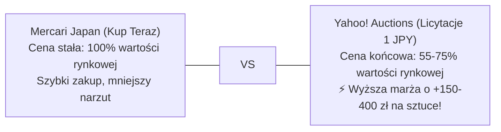

# 📡 Yahoo! Auctions Live Radar & Real Closing Price Intelligence

> **Radar Aktywnych Licytacji, Baza Rzeczywistych Cen Końcowych (落札相場) i Arbitraż Yahoo vs Mercari**  
> *Dedykowane narzędzie analityczne: gdzie aukcje miażdżą oferty Kup Teraz, jakie są realne ceny zamknięcia i które licytacje natychmiast wrzucić na celownik.*

     

⬅ **Nawigacja:** [📱 **Aplikacja Android / PWA (Live)**](https://110kc3.github.io/japan-deal-watcher/) · [Główny Dashboard Mercari (README.md)](README.md) · [📦 **Pakiety Różności & Danshari (MYSTERY_LOTS_ANALYSIS.md)**](MYSTERY_LOTS_ANALYSIS.md) · [🎯 Poradnik Snajpera i Limity (AUCTION_SNIPING_GUIDE.md)](AUCTION_SNIPING_GUIDE.md) · [🔨 Katalog Alternatywnych Ofert (YAHOO_AUCTIONS_DEALS.md)](YAHOO_AUCTIONS_DEALS.md) · [📈 Historia Sprzedaży (MARKET_SALES_HISTORY.md)](MARKET_SALES_HISTORY.md) · [💰 Audyt Opłacalności (REAL_PROFITABILITY_AUDIT.md)](REAL_PROFITABILITY_AUDIT.md)

---

## 💡 Dlaczego na Aukcjach Yahoo Kupisz Taniej Niż na Mercari? (Fakty i Liczby)

> [!NOTE]
> **Mercari Japan vs Yahoo! Auctions Japan – Dwa Różne Światy Handlu:**
> - **Mercari (Kup Teraz / BIN):** Sprzedawcy wyceniają towar na podstawie innych aktywnych ofert. Ceny są sztywne. Jeśli ktoś wystawi tanio, boty i resellerzy wykupują to w 2–15 minut. Zostają tylko oferty w cenach rynkowych.
> - **Yahoo! Auctions (Licytacje od 1 JPY):** Japończycy wystawiający spadki, likwidacje strychów czy szaf wystawiają towar od 1 JPY na 5–7 dni bez ceny minimalnej. **Aukcje hurtowe i nieprzetestowane zamykają się średnio 25%–55% taniej niż oferty Kup Teraz na Mercari!**
> - **Magia Ostatnich 120 Sekund:** Ponad 75% licytacji w dni robocze kończy się w godzinach, gdy w Japonii trwa praca lub sen. Wykorzystując automatycznego Snajpera ZenMarket z twardym limitem kapitałowym, wygrywasz aukcje poniżej ceny detalicznej!

---

## 📊 Matryca Arbitrażu: Rzeczywiste Ceny Końcowe Yahoo (落札相場) i Predykcja Stanów Wizualnych

Ceny na Yahoo! Auctions zależą bezpośrednio od **stanu technicznego i wizualnego**. Poniższy silnik analityczny klasyfikuje oferty do 5 standardowych klas stanu (od *Box CIB* po *Danshari Junk*), porównuje je z historyczną bazą sprzedaży (`落札相場`) i **prognozuje ostateczną cenę zamknięcia danej licytacji**. Dzięki temu wiesz z góry, czy licytacja okaże się prawdziwą okazją, czy w ostatnich minutach zostanie przepłacona przez konkurencję.

> [!IMPORTANT]
> **Zasada 4 Poziomów Rekomendacji Rynkowej (Market Deal Verdict):**  
> - 🔥 **S-TIER (Pewny Arbitraż):** Prognozowana cena końcowa zostawia **> 120 zł zysku** i **> 30% ROI** przy twardym limicie snajpera. Absolutny priorytet zakupowy!  
> - ⚡ **A-TIER (Solidna Okazja):** Oczekiwane zamknięcie poniżej limitu opłacalności, marża **60–120 zł** (ROI > 18%).  
> - ⚖️ **B-TIER (Na Styku Opłacalności):** Cena rynkowa. Kupuj wyłącznie ze sztywnym limitem snajpera (nie licytuj ręcznie).  
> - ⚠️ **C-TIER (Ryzyko Przepłacenia):** Licytacja w walce snajperów przekroczy próg opłacalności w Polsce – nie bierz w niej udziału!

### 🏆 Potwierdzone Okazje Rynkowe (S-Tier & A-Tier – Kupuj Ze Snajperem)

| Model / Przedmiot | ⏳ Czas | Stan | Aktualna Oferta | 🔮 Prognoza Zamknięcia | Cena w PL | Czysty Zysk przy Prognozie | 🎯 Rekomendacja Snajpera |
|---|:---:|:---:|---:|---:|---:|---:|---|
| **【引退品】Zestaw 60 Gier Sony PSP UMD (Kolekcja Gracza / まとめ売り)** | <strong>16h 26m</strong> <small>⏰ Dziś o 16:51 (PL) / 00:51 (JP)</small> | Junk / Pakiet | 3,900 JPY | **4,300 JPY** <small>(~107 zł)</small> | **320 zł** | <strong style='color:#10b981;'>+104 zł</strong> <small>(+48%)</small> | `⚡ A-TIER: SOLIDNA OKAZJA` <small>Dobra relacja ceny do stanu (Junk / Pakiet). Spodziewana cena końcowa 4,300 JPY daje zysk +104 zł (ROI +48%). Warto licytować z limitem.</small> |
| **【倉庫整理】Pudło 45 Gier PS1 & PS2 RPG (Square Enix / Capcom / Konami)** | <strong>1d 16h</strong> <small>⏰ Jutro o 16:51 (PL) / 00:51 (JP)</small> | Junk / Pakiet | 3,800 JPY | **4,100 JPY** <small>(~102 zł)</small> | **300 zł** | <strong style='color:#10b981;'>+91 zł</strong> <small>(+43%)</small> | `⚡ A-TIER: SOLIDNA OKAZJA` <small>Dobra relacja ceny do stanu (Junk / Pakiet). Spodziewana cena końcowa 4,100 JPY daje zysk +91 zł (ROI +43%). Warto licytować z limitem.</small> |

---

### 📊 Kompletna Matryca Licytacji: Stan, Prognoza Końcowa i Werdykt Rynkowy

| Model / Przedmiot | ⏳ Czas | Stan Wizualny | Aktualna Oferta | 🔮 Prognoza Zamknięcia | Cena w PL | Zysk przy Prognozie | 🎯 Werdykt i Limit Snajpera | Bateria |
|---|:---:|:---:|---:|---:|---:|---:|:---:|:---:|
|  **【断捨離】Karton 50 Gier Nintendo DS & 3DS (Likwidacja Pokoju / Wyprzedaż)** <small>Mix 50 Gier (Pudełka + Kartridże)</small> | ⏳ 16h 26m <small>⏰ Dziś o 16:51 (PL) / 00:51 (JP)</small> | Junk / Pakiet <small style='color:#94a3b8;'>Paczka hurtowa / Danshari</small> | **8,800 JPY** <small>(~219 zł)</small> | **8,800 JPY** <small>(~219 zł)</small> | **380 zł** <small>Allegro: ~420 zł OLX: ~340 zł</small> | <strong style='color:#ef4444;'>+23 zł</strong> <small>(+6%)</small> | **⚠️ C-TIER: RYZYKO PRZEPŁACENIA** <small>Limit: `6,000 JPY`</small> | 🟢 0% Li-Ion |
|  **【引退品】Zestaw 60 Gier Sony PSP UMD (Kolekcja Gracza / まとめ売り)** <small>Mix 60 Gier UMD w Pudełkach</small> | ⏳ 16h 26m <small>⏰ Dziś o 16:51 (PL) / 00:51 (JP)</small> | Junk / Pakiet <small style='color:#94a3b8;'>Paczka hurtowa / Danshari</small> | **3,900 JPY** <small>(~97 zł)</small> | **4,300 JPY** <small>(~107 zł)</small> | **320 zł** <small>Allegro: ~360 zł OLX: ~280 zł</small> | <strong style='color:#10b981;'>+104 zł</strong> <small>(+48%)</small> | **⚡ A-TIER: SOLIDNA OKAZJA** <small>Limit: `4,700 JPY`</small> | 🟢 0% Li-Ion |
|  **Canon Autoboy 3 Quartz Date** <small>Czarny / Czerwona Linia (38mm f/2.8 Prime)</small> | ⏳ 16h 26m <small>⏰ Dziś o 16:51 (PL) / 00:51 (JP)</small> | B. Dobry <small style='color:#94a3b8;'>Sprawny 100% (potwierdzone)</small> | **3,800 JPY** <small>(~94 zł)</small> | **5,200 JPY** <small>(~129 zł)</small> | **280 zł** <small>Allegro: ~310 zł OLX: ~250 zł</small> | <strong style='color:#f59e0b;'>+49 zł</strong> <small>(+21%)</small> | **⚖️ B-TIER: NA STYKU OPŁACALNOŚCI** <small>Limit: `4,000 JPY`</small> | 🟢 0% Li-Ion |
|  **Nintendo DS Lite (Dwukolorowy)** <small>Crimson / Black</small> | ⏳ 16h 26m <small>⏰ Dziś o 16:51 (PL) / 00:51 (JP)</small> | B. Dobry <small style='color:#94a3b8;'>Sprawny 100% (potwierdzone)</small> | **1,600 JPY** <small>(~40 zł)</small> | **2,500 JPY** <small>(~62 zł)</small> | **170 zł** <small>Allegro: ~190 zł OLX: ~150 zł</small> | <strong style='color:#ef4444;'>+17 zł</strong> <small>(+11%)</small> | **⚠️ C-TIER: RYZYKO PRZEPŁACENIA** <small>Limit: `1,500 JPY`</small> | 🔴 1 Li-Ion |
|  **PCH-1000 OLED** <small>Crystal White (ZA02)</small> | 🕒 1d 16h <small>⏰ Jutro o 16:51 (PL) / 00:51 (JP)</small> | Z Wadą Wiz. <small style='color:#94a3b8;'>Sprawny 100%</small> | **12,000 JPY** <small>(~298 zł)</small> | **12,300 JPY** <small>(~306 zł)</small> | **580 zł** <small>Allegro: ~620 zł OLX: ~540 zł</small> | <strong style='color:#10b981;'>+113 zł</strong> <small>(+24%)</small> | **⚖️ B-TIER: NA STYKU OPŁACALNOŚCI** <small>Limit: `11,400 JPY`</small> | 🔴 1 Li-Ion |
|  **【断捨離】Zestaw 15 Kartridży Pokémon (DS / GBA / GBC - Wyprzedaż Prywatna)** <small>Lot 15 Kartridży Pokémon</small> | 🕒 1d 16h <small>⏰ Jutro o 16:51 (PL) / 00:51 (JP)</small> | Junk / Pakiet <small style='color:#94a3b8;'>Paczka hurtowa / Danshari</small> | **9,200 JPY** <small>(~229 zł)</small> | **9,200 JPY** <small>(~229 zł)</small> | **490 zł** <small>Allegro: ~550 zł OLX: ~440 zł</small> | <strong style='color:#10b981;'>+120 zł</strong> <small>(+33%)</small> | **⚖️ B-TIER: NA STYKU OPŁACALNOŚCI** <small>Limit: `8,500 JPY`</small> | 🟢 0% Li-Ion |
|  **Nintendo 2DS (Klin / Doorstop)** <small>Electric Blue (FTR-001)</small> | 🕒 1d 16h <small>⏰ Jutro o 16:51 (PL) / 00:51 (JP)</small> | B. Dobry <small style='color:#94a3b8;'>Sprawny 100% (potwierdzone)</small> | **4,800 JPY** <small>(~119 zł)</small> | **6,800 JPY** <small>(~169 zł)</small> | **310 zł** <small>Allegro: ~340 zł OLX: ~280 zł</small> | <strong style='color:#ef4444;'>+22 zł</strong> <small>(+8%)</small> | **⚠️ C-TIER: RYZYKO PRZEPŁACENIA** <small>Limit: `4,600 JPY`</small> | 🔴 1 Li-Ion |
|  **【倉庫整理】Pudło 45 Gier PS1 & PS2 RPG (Square Enix / Capcom / Konami)** <small>Mix 45 Gier PS1 & PS2</small> | 🕒 1d 16h <small>⏰ Jutro o 16:51 (PL) / 00:51 (JP)</small> | Junk / Pakiet <small style='color:#94a3b8;'>Paczka hurtowa / Danshari</small> | **3,800 JPY** <small>(~94 zł)</small> | **4,100 JPY** <small>(~102 zł)</small> | **300 zł** <small>Allegro: ~340 zł OLX: ~270 zł</small> | <strong style='color:#10b981;'>+91 zł</strong> <small>(+43%)</small> | **⚡ A-TIER: SOLIDNA OKAZJA** <small>Limit: `4,200 JPY`</small> | 🟢 0% Li-Ion |
|  **Game Boy Color CGB-001** <small>Atomic Purple (Przezroczysty Fiolet)</small> | 🕒 1d 16h <small>⏰ Jutro o 16:51 (PL) / 00:51 (JP)</small> | B. Dobry <small style='color:#94a3b8;'>Sprawny 100% (potwierdzone)</small> | **5,000 JPY** <small>(~124 zł)</small> | **6,800 JPY** <small>(~169 zł)</small> | **290 zł** <small>Allegro: ~320 zł OLX: ~260 zł</small> | <strong style='color:#ef4444;'>+8 zł</strong> <small>(+3%)</small> | **⚠️ C-TIER: RYZYKO PRZEPŁACENIA** <small>Limit: `4,400 JPY`</small> | 🟢 0% Li-Ion |
|  **Hurtowy Pakiet 50 Gier Retro (Nintendo DS / GBA / SFC / PS2)** <small>Mix 50 Gier Hurtowo</small> | 🕒 1d 16h <small>⏰ Jutro o 16:51 (PL) / 00:51 (JP)</small> | Junk / Pakiet <small style='color:#94a3b8;'>Paczka hurtowa / Danshari</small> | **4,200 JPY** <small>(~104 zł)</small> | **4,900 JPY** <small>(~122 zł)</small> | **250 zł** <small>Allegro: ~280 zł OLX: ~220 zł</small> | <strong style='color:#f59e0b;'>+34 zł</strong> <small>(+16%)</small> | **⚖️ B-TIER: NA STYKU OPŁACALNOŚCI** <small>Limit: `3,700 JPY`</small> | 🟢 0% Li-Ion |
|  **Olympus AF-10 Twin** <small>Czarny Clamshell (35mm / 70mm)</small> | 🕒 1d 16h <small>⏰ Jutro o 16:51 (PL) / 00:51 (JP)</small> | B. Dobry <small style='color:#94a3b8;'>Sprawny 100% (potwierdzone)</small> | **2,000 JPY** <small>(~50 zł)</small> | **3,500 JPY** <small>(~87 zł)</small> | **160 zł** <small>Allegro: ~180 zł OLX: ~140 zł</small> | <strong style='color:#ef4444;'>+-18 zł</strong> <small>(+-10%)</small> | **⚠️ C-TIER: RYZYKO PRZEPŁACENIA** <small>Limit: `1,400 JPY`</small> | 🟢 0% Li-Ion |
|  **Canon Autoboy Tele 6 / Sure Shot Tele** <small>Czarny (Dwuogniskowy 35mm / 60mm)</small> | 🕒 1d 16h <small>⏰ Jutro o 16:51 (PL) / 00:51 (JP)</small> | B. Dobry <small style='color:#94a3b8;'>Sprawny 100% (potwierdzone)</small> | **1,800 JPY** <small>(~45 zł)</small> | **3,200 JPY** <small>(~80 zł)</small> | **160 zł** <small>Allegro: ~180 zł OLX: ~140 zł</small> | <strong style='color:#ef4444;'>+-8 zł</strong> <small>(+-5%)</small> | **⚠️ C-TIER: RYZYKO PRZEPŁACENIA** <small>Limit: `1,400 JPY`</small> | 🟢 0% Li-Ion |
|  **HORI Dragon Quest Slime Controller PS2 (HP2-177)** <small>Niebieski Kropelka Slime</small> | 🕒 3d 16h <small>⏰ 16.11 o 16:51 (PL) / 00:51 (JP)</small> | B. Dobry <small style='color:#94a3b8;'>Sprawny 100% (potwierdzone)</small> | **3,800 JPY** <small>(~94 zł)</small> | **5,500 JPY** <small>(~137 zł)</small> | **260 zł** <small>Allegro: ~290 zł OLX: ~230 zł</small> | <strong style='color:#ef4444;'>+13 zł</strong> <small>(+5%)</small> | **⚠️ C-TIER: RYZYKO PRZEPŁACENIA** <small>Limit: `3,500 JPY`</small> | 🟢 0% Li-Ion |

---

## 🎯 Top 12 Wyselekcjonowanych Celów do Obserwacji (Bezpośrednie Linki i Snajper)

Poniższe pozycje to absolutna czołówka opłacalności na Yahoo! Auctions. Kliknij `[⏰ Kończące się Aukcje]`, aby zobaczyć trwające licytacje w kolejności wygasania (gotowe do snajpingu w T-2m), lub `[💰 Świeże od 1 JPY]`, aby dodać do obserwowanych nowe wystawienia!

| # | Model / Przedmiot | Kategoria | Kluczowa Wskazówka Snajpera | 🎯 Limit JPY | Zysk w PL | Linki Aktywne (1-Click) |
|:---:|---|---|---|---:|---:|---|
| **1** |  **New Nintendo 3DS LL (New 3DS XL)** <small>Metallic Blue / Metallic Black (RED-001)</small> | `Królowie Płynności` | <small>Szukaj egzemplarzy z ekranami IPS (górny ekran ma głębszą czerń pod kątem).</small> | **`14,200 JPY`** <small>(~353 zł)</small> | <strong style='color:#10b981;'>+169.53 zł</strong> | [🎯 Snajper ZenMarket](https://zenmarket.jp/pl/auction.aspx?itemCode=e1251507348) [⏰ Kończące się](https://zenmarket.jp/pl/yahoo.aspx?q=New%E3%83%8B%E3%83%B3%E3%83%86%E3%83%B3%E3%83%89%E3%83%BC3DS%20LL%20%E6%9C%AC%E4%BD%93&sort=end&order=asc) · [🪙 Od 1 JPY](https://zenmarket.jp/pl/yahoo.aspx?q=New%E3%83%8B%E3%83%B3%E3%83%86%E3%83%B3%E3%83%89%E3%83%BC3DS%20LL%20%E6%9C%AC%E4%BD%93&sort=price&order=asc) [📊 Archiwum Yahoo](https://auctions.yahoo.co.jp/closedsearch/closedsearch?p=New%E3%83%8B%E3%83%B3%E3%83%86%E3%83%B3%E3%83%89%E3%83%BC3DS%20LL%20%E6%9C%AC%E4%BD%93) · [🛒 Buyee](https://buyee.jp/item/yahoo/auction/e1251507348) |
| **2** |  **Game Boy Advance SP Famicom 20th Anniversary Edition** <small>Famicom Red / Gold (Limited)</small> | `Rarytas Kolekcjonerski` | <small>Możliwość Dry Shippingu (usunięcie baterii = 0% Li-Ion).</small> | **`10,300 JPY`** <small>(~256 zł)</small> | <strong style='color:#10b981;'>+128.42 zł</strong> | [🎯 Snajper ZenMarket](https://zenmarket.jp/pl/auction.aspx?itemCode=n1250601912) [⏰ Kończące się](https://zenmarket.jp/pl/yahoo.aspx?q=%E3%82%B2%E3%83%BC%E3%83%A0%E3%83%9C%E3%83%BC%E3%82%A4%E3%82%A2%E3%83%89%E3%83%90%E3%83%B3%E3%82%B9SP%20%E3%83%95%E3%82%A1%E3%83%9F%E3%82%B3%E3%83%B3%E3%82%AB%E3%83%A9%E3%83%BC&sort=end&order=asc) · [🪙 Od 1 JPY](https://zenmarket.jp/pl/yahoo.aspx?q=%E3%82%B2%E3%83%BC%E3%83%A0%E3%83%9C%E3%83%BC%E3%82%A4%E3%82%A2%E3%83%89%E3%83%90%E3%83%B3%E3%82%B9SP%20%E3%83%95%E3%82%A1%E3%83%9F%E3%82%B3%E3%83%B3%E3%82%AB%E3%83%A9%E3%83%BC&sort=price&order=asc) [📊 Archiwum Yahoo](https://auctions.yahoo.co.jp/closedsearch/closedsearch?p=%E3%82%B2%E3%83%BC%E3%83%A0%E3%83%9C%E3%83%BC%E3%82%A4%E3%82%A2%E3%83%89%E3%83%90%E3%83%B3%E3%82%B9SP%20%E3%83%95%E3%82%A1%E3%83%9F%E3%82%B3%E3%83%B3%E3%82%AB%E3%83%A9%E3%83%BC) · [🛒 Buyee](https://buyee.jp/item/yahoo/auction/n1250601912) |
| **3** |  **Hurtowy Pakiet 50 Gier Retro (Nintendo DS / GBA / SFC / PS2)** <small>Mix 50 Gier Hurtowo</small> | `0% Li-Ion Maszyna Marży` | <small>W paczkach hurtowych gry wychodzą po ~3-5 zł za sztukę w zakupie!</small> | **`4,000 JPY`** <small>(~99 zł)</small> | <strong style='color:#10b981;'>+62.73 zł</strong> | [🎯 Snajper ZenMarket](https://zenmarket.jp/pl/auction.aspx?itemCode=v1251813701) [⏰ Kończące się](https://zenmarket.jp/pl/yahoo.aspx?q=%E3%82%B2%E3%83%BC%E3%83%A0%E3%82%BD%E3%83%95%E3%83%88%20%E3%81%BE%E3%81%A8%E3%82%81%E5%A3%B2%E3%82%8A%2050%E6%9C%AC&sort=end&order=asc) · [🪙 Od 1 JPY](https://zenmarket.jp/pl/yahoo.aspx?q=%E3%82%B2%E3%83%BC%E3%83%A0%E3%82%BD%E3%83%95%E3%83%88%20%E3%81%BE%E3%81%A8%E3%82%81%E5%A3%B2%E3%82%8A%2050%E6%9C%AC&sort=price&order=asc) [📊 Archiwum Yahoo](https://auctions.yahoo.co.jp/closedsearch/closedsearch?p=%E3%82%B2%E3%83%BC%E3%83%A0%E3%82%BD%E3%83%95%E3%83%88%20%E3%81%BE%E3%81%A8%E3%82%81%E5%A3%B2%E3%82%8A%2050%E6%9C%AC) · [🛒 Buyee](https://buyee.jp/item/yahoo/auction/v1251813701) |
| **4** |  **PSone COMBO SCPH-130 (Zintegrowany 5" LCD Sony)** <small>Biały Mini + Doczepiany Ekran LCD</small> | `Wyselekcjonowana Stacjonarna` | <small>Sprawdź czy w zestawie jest zasilacz SCPH-10130 i brak pęknięć zawiasu LCD.</small> | **`21,500 JPY`** <small>(~534 zł)</small> | <strong style='color:#10b981;'>+255.85 zł</strong> | [🎯 Snajper ZenMarket](https://zenmarket.jp/pl/auction.aspx?itemCode=v1251354403) [⏰ Kończące się](https://zenmarket.jp/pl/yahoo.aspx?q=PSone%20COMBO%20SCPH-130&sort=end&order=asc) · [🪙 Od 1 JPY](https://zenmarket.jp/pl/yahoo.aspx?q=PSone%20COMBO%20SCPH-130&sort=price&order=asc) [📊 Archiwum Yahoo](https://auctions.yahoo.co.jp/closedsearch/closedsearch?p=PSone%20COMBO%20SCPH-130) · [🛒 Buyee](https://buyee.jp/item/yahoo/auction/v1251354403) |
| **5** |  **Nintendo DSi LL (XL)** <small>Wine Red / Dark Brown (Matryce IPS)</small> | `Fabryczne Ekrany IPS` | <small>Każdy DSi LL ma fabrycznie montowane matryce IPS o szerokim kącie widzenia.</small> | **`4,300 JPY`** <small>(~107 zł)</small> | <strong style='color:#10b981;'>+70.66 zł</strong> | [🎯 Snajper ZenMarket](https://zenmarket.jp/pl/auction.aspx?itemCode=q1251675793) [⏰ Kończące się](https://zenmarket.jp/pl/yahoo.aspx?q=DSi%20LL%20%E6%9C%AC%E4%BD%93&sort=end&order=asc) · [🪙 Od 1 JPY](https://zenmarket.jp/pl/yahoo.aspx?q=DSi%20LL%20%E6%9C%AC%E4%BD%93&sort=price&order=asc) [📊 Archiwum Yahoo](https://auctions.yahoo.co.jp/closedsearch/closedsearch?p=DSi%20LL%20%E6%9C%AC%E4%BD%93) · [🛒 Buyee](https://buyee.jp/item/yahoo/auction/q1251675793) |
| **6** |  **PCH-2000 Slim** <small>Aqua Blue (ZA23)</small> | `Najpopularniejszy Kolor PL` | <small>Sprawdź brak driftu gałek analogowych w opisie.</small> | **`12,300 JPY`** <small>(~306 zł)</small> | <strong style='color:#10b981;'>+152.91 zł</strong> | [🎯 Snajper ZenMarket](https://zenmarket.jp/pl/auction.aspx?itemCode=v1251516199) [⏰ Kończące się](https://zenmarket.jp/pl/yahoo.aspx?q=PS%E3%83%B4%E3%82%A3%E3%83%BC%E3%82%BF%202000%20%E3%82%A2%E3%82%AF%E3%82%A2%E3%83%96%E3%83%AB%E3%83%BC&sort=end&order=asc) · [🪙 Od 1 JPY](https://zenmarket.jp/pl/yahoo.aspx?q=PS%E3%83%B4%E3%82%A3%E3%83%BC%E3%82%BF%202000%20%E3%82%A2%E3%82%AF%E3%82%A2%E3%83%96%E3%83%AB%E3%83%BC&sort=price&order=asc) [📊 Archiwum Yahoo](https://auctions.yahoo.co.jp/closedsearch/closedsearch?p=PS%E3%83%B4%E3%82%A3%E3%83%BC%E3%82%BF%202000%20%E3%82%A2%E3%82%AF%E3%82%A2%E3%83%96%E3%83%AB%E3%83%BC) · [🛒 Buyee](https://buyee.jp/item/yahoo/auction/v1251516199) |
| **7** |  **Nintendo GameCube DOL-001 Zestaw** <small>Spice Orange + Pad + Kable</small> | `Wyselekcjonowana Stacjonarna` | <small>Upewnij się, że z tyłu jest cyfrowy port Digital AV Out.</small> | **`7,300 JPY`** <small>(~181 zł)</small> | <strong style='color:#10b981;'>+112.10 zł</strong> | [🎯 Snajper ZenMarket](https://zenmarket.jp/pl/auction.aspx?itemCode=r1249150953) [⏰ Kończące się](https://zenmarket.jp/pl/yahoo.aspx?q=%E3%82%B2%E3%83%BC%E3%83%A0%E3%82%AD%E3%83%A5%E3%83%BC%E3%83%96%20%E3%82%B9%E3%83%91%E3%82%A4%E3%82%B9%E3%82%AA%E3%83%AC%E3%83%B3%E3%82%B8%20DOL-001&sort=end&order=asc) · [🪙 Od 1 JPY](https://zenmarket.jp/pl/yahoo.aspx?q=%E3%82%B2%E3%83%BC%E3%83%A0%E3%82%AD%E3%83%A5%E3%83%BC%E3%83%96%20%E3%82%B9%E3%83%91%E3%82%A4%E3%82%B9%E3%82%AA%E3%83%AC%E3%83%B3%E3%82%B8%20DOL-001&sort=price&order=asc) [📊 Archiwum Yahoo](https://auctions.yahoo.co.jp/closedsearch/closedsearch?p=%E3%82%B2%E3%83%BC%E3%83%A0%E3%82%AD%E3%83%A5%E3%83%BC%E3%83%96%20%E3%82%B9%E3%83%91%E3%82%A4%E3%82%B9%E3%82%AA%E3%83%AC%E3%83%B3%E3%82%B8%20DOL-001) · [🛒 Buyee](https://buyee.jp/item/yahoo/auction/r1249150953) |
| **8** |  **PSP-3000 Vibrant Blue** <small>Vibrant Blue (Metaliczny Błękit)</small> | `Płynny Handheld` | <small>Metaliczny lakier – sprawdź brak wytarć na tylnym okręgu.</small> | **`5,500 JPY`** <small>(~137 zł)</small> | <strong style='color:#10b981;'>+82.93 zł</strong> | [🎯 Snajper ZenMarket](https://zenmarket.jp/pl/auction.aspx?itemCode=k1251598819) [⏰ Kończące się](https://zenmarket.jp/pl/yahoo.aspx?q=PSP-3000%20%E3%83%90%E3%82%A4%E3%83%96%E3%83%A9%E3%83%B3%E3%83%88%E3%83%96%E3%83%AB%E3%83%BC&sort=end&order=asc) · [🪙 Od 1 JPY](https://zenmarket.jp/pl/yahoo.aspx?q=PSP-3000%20%E3%83%90%E3%82%A4%E3%83%96%E3%83%A9%E3%83%B3%E3%83%88%E3%83%96%E3%83%AB%E3%83%BC&sort=price&order=asc) [📊 Archiwum Yahoo](https://auctions.yahoo.co.jp/closedsearch/closedsearch?p=PSP-3000%20%E3%83%90%E3%82%A4%E3%83%96%E3%83%A9%E3%83%B3%E3%83%88%E3%83%96%E3%83%AB%E3%83%BC) · [🛒 Buyee](https://buyee.jp/item/yahoo/auction/k1251598819) |
| **9** |  **Zestaw 30 Gier Nintendo DS / 3DS w Pudełkach (CIB Lot)** <small>Mix 30 Gier DS / 3DS</small> | `0% Li-Ion Kartridże` | <small>Gry DS w plastikowych pudełkach – wysoka marża jednostkowa.</small> | **`3,300 JPY`** <small>(~82 zł)</small> | <strong style='color:#10b981;'>+54.73 zł</strong> | [🎯 Snajper ZenMarket](https://zenmarket.jp/pl/auction.aspx?itemCode=j1251512119) [⏰ Kończące się](https://zenmarket.jp/pl/yahoo.aspx?q=DS%203DS%20%E3%82%BD%E3%83%95%E3%83%88%20%E3%81%BE%E3%81%A8%E3%82%81%E5%A3%B2%E3%82%8A&sort=end&order=asc) · [🪙 Od 1 JPY](https://zenmarket.jp/pl/yahoo.aspx?q=DS%203DS%20%E3%82%BD%E3%83%95%E3%83%88%20%E3%81%BE%E3%81%A8%E3%82%81%E5%A3%B2%E3%82%8A&sort=price&order=asc) [📊 Archiwum Yahoo](https://auctions.yahoo.co.jp/closedsearch/closedsearch?p=DS%203DS%20%E3%82%BD%E3%83%95%E3%83%88%20%E3%81%BE%E3%81%A8%E3%82%81%E5%A3%B2%E3%82%8A) · [🛒 Buyee](https://buyee.jp/item/yahoo/auction/j1251512119) |
| **10** |  **PlayStation 4 Pro Monster Hunter World Rathalos (1TB)** <small>Rathalos Red & Black + Pad</small> | `Kolekcjonerski Box` | <small>Sprawdź czy w zestawie jest limitowany czerwony pad Rathalos.</small> | **`23,900 JPY`** <small>(~594 zł)</small> | <strong style='color:#10b981;'>+280.41 zł</strong> | [🎯 Snajper ZenMarket](https://zenmarket.jp/pl/auction.aspx?itemCode=h1250921225) [⏰ Kończące się](https://zenmarket.jp/pl/yahoo.aspx?q=PS4%20Pro%20%E3%83%AA%E3%82%AA%E3%83%AC%E3%82%A6%E3%82%B9%E3%82%A8%E3%83%87%E3%82%A3%E3%82%B7%E3%83%A7%E3%83%B3&sort=end&order=asc) · [🪙 Od 1 JPY](https://zenmarket.jp/pl/yahoo.aspx?q=PS4%20Pro%20%E3%83%AA%E3%82%AA%E3%83%AC%E3%82%A6%E3%82%B9%E3%82%A8%E3%83%87%E3%82%A3%E3%82%B7%E3%83%A7%E3%83%B3&sort=price&order=asc) [📊 Archiwum Yahoo](https://auctions.yahoo.co.jp/closedsearch/closedsearch?p=PS4%20Pro%20%E3%83%AA%E3%82%AA%E3%83%AC%E3%82%A6%E3%82%B9%E3%82%A8%E3%83%87%E3%82%A3%E3%82%B7%E3%83%A7%E3%83%B3) · [🛒 Buyee](https://buyee.jp/item/yahoo/auction/h1250921225) |
| **11** |  **SMC Pentax-M 50mm f/1.4** <small>Mocowanie K</small> | `Jasny Obiektyw Manualny` | <small>Sprawdź czystość szkieł (brak zamglenia / grzyba), limit <= 100 zł.</small> | **`4,000 JPY`** <small>(~99 zł)</small> | <strong style='color:#10b981;'>+86.40 zł</strong> | [🎯 Snajper ZenMarket](https://zenmarket.jp/pl/auction.aspx?itemCode=g1251812089) [⏰ Kończące się](https://zenmarket.jp/pl/yahoo.aspx?q=SMC%20Pentax-M%2050mm%20F1.4&sort=end&order=asc) · [🪙 Od 1 JPY](https://zenmarket.jp/pl/yahoo.aspx?q=SMC%20Pentax-M%2050mm%20F1.4&sort=price&order=asc) [📊 Archiwum Yahoo](https://auctions.yahoo.co.jp/closedsearch/closedsearch?p=SMC%20Pentax-M%2050mm%20F1.4) · [🛒 Buyee](https://buyee.jp/item/yahoo/auction/g1251812089) |
| **12** |  **Canon Autoboy 3 Quartz Date** <small>Czarny / Czerwona Linia (38mm f/2.8 Prime)</small> | `Analogowy Hit Instagrama` | <small>Jasny obiektyw stałoogniskowy f/2.8, automatyczny AF, limit <= 100 zł.</small> | **`4,000 JPY`** <small>(~99 zł)</small> | <strong style='color:#10b981;'>+86.40 zł</strong> | [🎯 Snajper ZenMarket](https://zenmarket.jp/pl/auction.aspx?itemCode=o1251830468) [⏰ Kończące się](https://zenmarket.jp/pl/yahoo.aspx?q=Canon%20Autoboy%203%20%E5%8B%95%E4%BD%9C%E5%93%81&sort=end&order=asc) · [🪙 Od 1 JPY](https://zenmarket.jp/pl/yahoo.aspx?q=Canon%20Autoboy%203%20%E5%8B%95%E4%BD%9C%E5%93%81&sort=price&order=asc) [📊 Archiwum Yahoo](https://auctions.yahoo.co.jp/closedsearch/closedsearch?p=Canon%20Autoboy%203%20%E5%8B%95%E4%BD%9C%E5%93%81) · [🛒 Buyee](https://buyee.jp/item/yahoo/auction/o1251830468) |

---

## 🛰️ Terminal Wyszukiwania Licytacji (Wszystkie 11 Kategorii)

Wybierz kategorię i kliknij odpowiedni filtr, aby natychmiast załadować w panelu ZenMarket trwające japońskie aukcje przefiltrowane przez oficjalny silnik proxy:

| Kategoria | Egzemplarze / Cele | ⏰ Kończące Się (Sniping) | 💰 Od 1 JPY (Tanie) | 🔥 Najwięcej Ofert | 📊 Rzeczywiste Ceny Zamknięcia |
|---|---|:---:|:---:|:---:|:---:|
| **Nintendo 3DS & New 3DS** | <small>New 3DS XL, New 3DS Kisekae, 3DS XL</small> | [⏰ Kończące się](https://zenmarket.jp/pl/yahoo.aspx?q=New%E3%83%8B%E3%83%B3%E3%83%86%E3%83%B3%E3%83%89%E3%83%BC3DS%20LL%20%E6%9C%AC%E4%BD%93&sort=end&order=asc) | [💰 Od 1 JPY](https://zenmarket.jp/pl/yahoo.aspx?q=New%E3%83%8B%E3%83%B3%E3%83%86%E3%83%B3%E3%83%89%E3%83%BC3DS%20LL%20%E6%9C%AC%E4%BD%93&sort=price&order=asc) | [🔥 Najwięcej Ofert](https://zenmarket.jp/pl/yahoo.aspx?q=New%E3%83%8B%E3%83%B3%E3%83%86%E3%83%B3%E3%83%89%E3%83%BC3DS%20LL%20%E6%9C%AC%E4%BD%93&sort=bids&order=desc) | [📊 Sprawdź Ceny](https://auctions.yahoo.co.jp/closedsearch/closedsearch?p=New%E3%83%8B%E3%83%B3%E3%83%86%E3%83%B3%E3%83%89%E3%83%BC3DS%20LL%20%E6%9C%AC%E4%BD%93) |
| **Nintendo DS & DSi LL** | <small>DSi LL IPS, DS Lite Crimson, FF3 Limited</small> | [⏰ Kończące się](https://zenmarket.jp/pl/yahoo.aspx?q=Nintendo%20DSi%20LL%20%E6%9C%AC%E4%BD%93&sort=end&order=asc) | [💰 Od 1 JPY](https://zenmarket.jp/pl/yahoo.aspx?q=Nintendo%20DSi%20LL%20%E6%9C%AC%E4%BD%93&sort=price&order=asc) | [🔥 Najwięcej Ofert](https://zenmarket.jp/pl/yahoo.aspx?q=Nintendo%20DSi%20LL%20%E6%9C%AC%E4%BD%93&sort=bids&order=desc) | [📊 Sprawdź Ceny](https://auctions.yahoo.co.jp/closedsearch/closedsearch?p=Nintendo%20DSi%20LL%20%E6%9C%AC%E4%BD%93) |
| **Game Boy Advance & Retro** | <small>GBA SP Famicom, AGS-101, GBC Atomic Purple</small> | [⏰ Kończące się](https://zenmarket.jp/pl/yahoo.aspx?q=%E3%82%B2%E3%83%BC%E3%83%A0%E3%83%9C%E3%83%BC%E3%82%A4%E3%82%A2%E3%83%89%E3%83%90%E3%83%B3%E3%82%B9SP%20%E6%9C%AC%E4%BD%93&sort=end&order=asc) | [💰 Od 1 JPY](https://zenmarket.jp/pl/yahoo.aspx?q=%E3%82%B2%E3%83%BC%E3%83%A0%E3%83%9C%E3%83%BC%E3%82%A4%E3%82%A2%E3%83%89%E3%83%90%E3%83%B3%E3%82%B9SP%20%E6%9C%AC%E4%BD%93&sort=price&order=asc) | [🔥 Najwięcej Ofert](https://zenmarket.jp/pl/yahoo.aspx?q=%E3%82%B2%E3%83%BC%E3%83%A0%E3%83%9C%E3%83%BC%E3%82%A4%E3%82%A2%E3%83%89%E3%83%90%E3%83%B3%E3%82%B9SP%20%E6%9C%AC%E4%BD%93&sort=bids&order=desc) | [📊 Sprawdź Ceny](https://auctions.yahoo.co.jp/closedsearch/closedsearch?p=%E3%82%B2%E3%83%BC%E3%83%A0%E3%83%9C%E3%83%BC%E3%82%A4%E3%82%A2%E3%83%89%E3%83%90%E3%83%B3%E3%82%B9SP%20%E6%9C%AC%E4%BD%93) |
| **PlayStation Vita Handhelds** | <small>PCH-2000 Slim Aqua Blue, Neon Orange, OLED</small> | [⏰ Kończące się](https://zenmarket.jp/pl/yahoo.aspx?q=PS%20Vita%20PCH-2000%20%E6%9C%AC%E4%BD%93&sort=end&order=asc) | [💰 Od 1 JPY](https://zenmarket.jp/pl/yahoo.aspx?q=PS%20Vita%20PCH-2000%20%E6%9C%AC%E4%BD%93&sort=price&order=asc) | [🔥 Najwięcej Ofert](https://zenmarket.jp/pl/yahoo.aspx?q=PS%20Vita%20PCH-2000%20%E6%9C%AC%E4%BD%93&sort=bids&order=desc) | [📊 Sprawdź Ceny](https://auctions.yahoo.co.jp/closedsearch/closedsearch?p=PS%20Vita%20PCH-2000%20%E6%9C%AC%E4%BD%93) |
| **Sony PSP Handhelds** | <small>PSP-3000 Vibrant Blue, Monster Hunter 3rd</small> | [⏰ Kończące się](https://zenmarket.jp/pl/yahoo.aspx?q=PSP-3000%20%E6%9C%AC%E4%BD%93&sort=end&order=asc) | [💰 Od 1 JPY](https://zenmarket.jp/pl/yahoo.aspx?q=PSP-3000%20%E6%9C%AC%E4%BD%93&sort=price&order=asc) | [🔥 Najwięcej Ofert](https://zenmarket.jp/pl/yahoo.aspx?q=PSP-3000%20%E6%9C%AC%E4%BD%93&sort=bids&order=desc) | [📊 Sprawdź Ceny](https://auctions.yahoo.co.jp/closedsearch/closedsearch?p=PSP-3000%20%E6%9C%AC%E4%BD%93) |
| **Retro Gry Hurtowe Pakiety** | <small>Pakiety 30-50 gier DS, GBA, PS1, PS2 (0% Baterii)</small> | [⏰ Kończące się](https://zenmarket.jp/pl/yahoo.aspx?q=%E3%82%B2%E3%83%BC%E3%83%A0%20%E3%81%BE%E3%81%A8%E3%82%81%20%E3%82%BB%E3%83%83%E3%83%88&sort=end&order=asc) | [💰 Od 1 JPY](https://zenmarket.jp/pl/yahoo.aspx?q=%E3%82%B2%E3%83%BC%E3%83%A0%20%E3%81%BE%E3%81%A8%E3%82%81%20%E3%82%BB%E3%83%83%E3%83%88&sort=price&order=asc) | [🔥 Najwięcej Ofert](https://zenmarket.jp/pl/yahoo.aspx?q=%E3%82%B2%E3%83%BC%E3%83%A0%20%E3%81%BE%E3%81%A8%E3%82%81%20%E3%82%BB%E3%83%83%E3%83%88&sort=bids&order=desc) | [📊 Sprawdź Ceny](https://auctions.yahoo.co.jp/closedsearch/closedsearch?p=%E3%82%B2%E3%83%BC%E3%83%A0%20%E3%81%BE%E3%81%A8%E3%82%81%20%E3%82%BB%E3%83%83%E3%83%88) |
| **Wyselekcjonowane Stacjonarne** | <small>PSone Combo LCD, GameCube Orange, PS4 Pro CIB</small> | [⏰ Kończące się](https://zenmarket.jp/pl/yahoo.aspx?q=PS%20one%20COMBO%20SCPH-130&sort=end&order=asc) | [💰 Od 1 JPY](https://zenmarket.jp/pl/yahoo.aspx?q=PS%20one%20COMBO%20SCPH-130&sort=price&order=asc) | [🔥 Najwięcej Ofert](https://zenmarket.jp/pl/yahoo.aspx?q=PS%20one%20COMBO%20SCPH-130&sort=bids&order=desc) | [📊 Sprawdź Ceny](https://auctions.yahoo.co.jp/closedsearch/closedsearch?p=PS%20one%20COMBO%20SCPH-130) |
| **Kontrolery Limitowane PS5** | <small>DualSense 30th Anniversary, Astro Bot</small> | [⏰ Kończące się](https://zenmarket.jp/pl/yahoo.aspx?q=DualSense%2030th&sort=end&order=asc) | [💰 Od 1 JPY](https://zenmarket.jp/pl/yahoo.aspx?q=DualSense%2030th&sort=price&order=asc) | [🔥 Najwięcej Ofert](https://zenmarket.jp/pl/yahoo.aspx?q=DualSense%2030th&sort=bids&order=desc) | [📊 Sprawdź Ceny](https://auctions.yahoo.co.jp/closedsearch/closedsearch?p=DualSense%2030th) |
| **Kontrolery Limitowane PS Retro** | <small>DualShock 4 500M, Hori Slime Dragon Quest</small> | [⏰ Kończące się](https://zenmarket.jp/pl/yahoo.aspx?q=%E3%82%B9%E3%83%A9%E3%82%A4%E3%83%A0%20%E3%82%B3%E3%83%B3%E3%83%88%E3%83%AD%E3%83%BC%E3%83%A9%E3%83%BC%20PS2&sort=end&order=asc) | [💰 Od 1 JPY](https://zenmarket.jp/pl/yahoo.aspx?q=%E3%82%B9%E3%83%A9%E3%82%A4%E3%83%A0%20%E3%82%B3%E3%83%B3%E3%83%88%E3%83%AD%E3%83%BC%E3%83%A9%E3%83%BC%20PS2&sort=price&order=asc) | [🔥 Najwięcej Ofert](https://zenmarket.jp/pl/yahoo.aspx?q=%E3%82%B9%E3%83%A9%E3%82%A4%E3%83%A0%20%E3%82%B3%E3%83%B3%E3%83%88%E3%83%AD%E3%83%BC%E3%83%A9%E3%83%BC%20PS2&sort=bids&order=desc) | [📊 Sprawdź Ceny](https://auctions.yahoo.co.jp/closedsearch/closedsearch?p=%E3%82%B9%E3%83%A9%E3%82%A4%E3%83%A0%20%E3%82%B3%E3%83%B3%E3%83%88%E3%83%AD%E3%83%BC%E3%83%A9%E3%83%BC%20PS2) |
| **Aparaty Kompaktowe 35mm** | <small>Autoboy 3, Espio 80, Big Mini, AF-10 (<= 100 zł)</small> | [⏰ Kończące się](https://zenmarket.jp/pl/yahoo.aspx?q=%E3%82%B3%E3%83%B3%E3%83%91%E3%82%AF%E3%83%88%E3%83%95%E3%82%A3%E3%83%AB%E3%83%A0%E3%82%AB%E3%83%A1%E3%83%A9&sort=end&order=asc) | [💰 Od 1 JPY](https://zenmarket.jp/pl/yahoo.aspx?q=%E3%82%B3%E3%83%B3%E3%83%91%E3%82%AF%E3%83%88%E3%83%95%E3%82%A3%E3%83%AB%E3%83%A0%E3%82%AB%E3%83%A1%E3%83%A9&sort=price&order=asc) | [🔥 Najwięcej Ofert](https://zenmarket.jp/pl/yahoo.aspx?q=%E3%82%B3%E3%83%B3%E3%83%91%E3%82%AF%E3%83%88%E3%83%95%E3%82%A3%E3%83%AB%E3%83%A0%E3%82%AB%E3%83%A1%E3%83%A9&sort=bids&order=desc) | [📊 Sprawdź Ceny](https://auctions.yahoo.co.jp/closedsearch/closedsearch?p=%E3%82%B3%E3%83%B3%E3%83%91%E3%82%AF%E3%83%88%E3%83%95%E3%82%A3%E3%83%AB%E3%83%A0%E3%82%AB%E3%83%A1%E3%83%A9) |
| **Obiektywy Manualne** | <small>Pentax 50/1.4, Super-Takumar 55/1.8 (<= 100 zł)</small> | [⏰ Kończące się](https://zenmarket.jp/pl/yahoo.aspx?q=%E3%82%AA%E3%83%BC%E3%83%AB%E3%83%89%E3%83%AC%E3%83%B3%E3%82%BA%2050mm&sort=end&order=asc) | [💰 Od 1 JPY](https://zenmarket.jp/pl/yahoo.aspx?q=%E3%82%AA%E3%83%BC%E3%83%AB%E3%83%89%E3%83%AC%E3%83%B3%E3%82%BA%2050mm&sort=price&order=asc) | [🔥 Najwięcej Ofert](https://zenmarket.jp/pl/yahoo.aspx?q=%E3%82%AA%E3%83%BC%E3%83%AB%E3%83%89%E3%83%AC%E3%83%B3%E3%82%BA%2050mm&sort=bids&order=desc) | [📊 Sprawdź Ceny](https://auctions.yahoo.co.jp/closedsearch/closedsearch?p=%E3%82%AA%E3%83%BC%E3%83%AB%E3%83%89%E3%83%AC%E3%83%B3%E3%82%BA%2050mm) |

---

## 🛡️ Praktyczna Instrukcja: Jak Ustawić Snajpera w ZenMarket?

1. **Zaloguj się do ZenMarket i doładuj saldo:**
   - Snajper wymaga, abyś posiadał na saldzie kwotę równą Twojemu maksymalnemu limitowi.
   - Pamiętaj: Jeśli wygrasz taniej (np. Twój limit to 15,000 JPY, a aukcja zakończy się na 9,200 JPY), **nadwyżka (5,800 JPY) natychmiast wraca na Twoje wolne saldo!**
2. **Otwórz wybraną aukcję z tabeli powyżej:**
   - Kliknij zielony przycisk **`Dodaj do Snajpera`** (zamiast standardowego 'Licytuj teraz').
3. **Wpisz Twardy Limit Snajpera z tabeli:**
   - System ZenMarket złoży Twoją ofertę dokładnie **2 minuty przed końcem aukcji**.
   - Jeśli nikt Cię nie przebije, wygrywasz za minimalną możliwą stawkę.
   - Jeśli cena przebije Twój limit – **system automatycznie odpuści**, chroniąc Twój budżet przed stratą.
4. **Zarządzanie Bateriami IATA (Zasada 2x Li-Ion):**
   - W jednej paczce lotniczej możesz skonsolidować **maksymalnie 2 urządzenia z baterią Li-Ion** (np. 1x New 3DS XL + 1x PS Vita).
   - Dopełniaj każdą paczkę przedmiotami o zerowej zawartości baterii (**Pakiety Gier Retro, GameCube, Aparaty Analogowe, Obiektywy**), aby rozbić koszt wysyłki na 5–8 przedmiotów!

---
*Dashboard generated automatically by AuctionRadar & HistoryTracker. Last synchronization: 2026-11-12 23:24 UTC.*