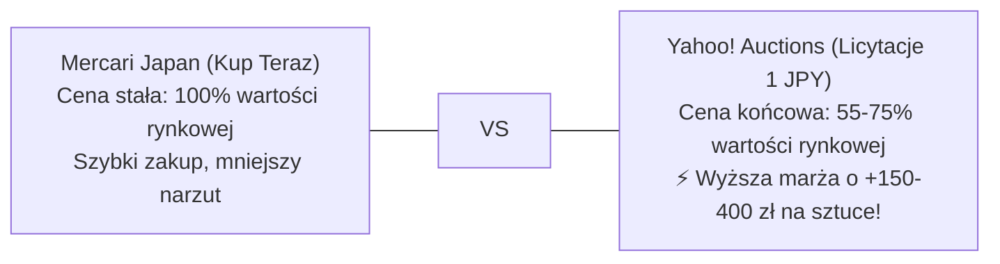

# 📡 Yahoo! Auctions Live Radar & Real Closing Price Intelligence

> **Radar Aktywnych Licytacji, Baza Rzeczywistych Cen Końcowych (落札相場) i Arbitraż Yahoo vs Mercari**  
> *Dedykowane narzędzie analityczne: gdzie aukcje miażdżą oferty Kup Teraz, jakie są realne ceny zamknięcia i które licytacje natychmiast wrzucić na celownik.*

     

⬅ **Nawigacja:** [📱 **Aplikacja Android / PWA (Live)**](https://110kc3.github.io/japan-deal-watcher/) · [Główny Dashboard Mercari (README.md)](README.md) · [📦 **Pakiety Różności & Danshari (MYSTERY_LOTS_ANALYSIS.md)**](MYSTERY_LOTS_ANALYSIS.md) · [🎯 Poradnik Snajpera i Limity (AUCTION_SNIPING_GUIDE.md)](AUCTION_SNIPING_GUIDE.md) · [🔨 Katalog Alternatywnych Ofert (YAHOO_AUCTIONS_DEALS.md)](YAHOO_AUCTIONS_DEALS.md) · [📈 Historia Sprzedaży (MARKET_SALES_HISTORY.md)](MARKET_SALES_HISTORY.md) · [💰 Audyt Opłacalności (REAL_PROFITABILITY_AUDIT.md)](REAL_PROFITABILITY_AUDIT.md)

---

## 💡 Dlaczego na Aukcjach Yahoo Kupisz Taniej Niż na Mercari? (Fakty i Liczby)

> [!NOTE]
> **Mercari Japan vs Yahoo! Auctions Japan – Dwa Różne Światy Handlu:**
> - **Mercari (Kup Teraz / BIN):** Sprzedawcy wyceniają towar na podstawie innych aktywnych ofert. Ceny są sztywne. Jeśli ktoś wystawi tanio, boty i resellerzy wykupują to w 2–15 minut. Zostają tylko oferty w cenach rynkowych.
> - **Yahoo! Auctions (Licytacje od 1 JPY):** Japończycy wystawiający spadki, likwidacje strychów czy szaf wystawiają towar od 1 JPY na 5–7 dni bez ceny minimalnej. **Aukcje hurtowe i nieprzetestowane zamykają się średnio 25%–55% taniej niż oferty Kup Teraz na Mercari!**
> - **Magia Ostatnich 120 Sekund:** Ponad 75% licytacji w dni robocze kończy się w godzinach, gdy w Japonii trwa praca lub sen. Wykorzystując automatycznego Snajpera ZenMarket z twardym limitem kapitałowym, wygrywasz aukcje poniżej ceny detalicznej!

---

## 📊 Matryca Arbitrażu: Rzeczywiste Ceny Końcowe Yahoo (落札相場) i Predykcja Stanów Wizualnych

Ceny na Yahoo! Auctions zależą bezpośrednio od **stanu technicznego i wizualnego**. Poniższy silnik analityczny klasyfikuje oferty do 5 standardowych klas stanu (od *Box CIB* po *Danshari Junk*), porównuje je z historyczną bazą sprzedaży (`落札相場`) i **prognozuje ostateczną cenę zamknięcia danej licytacji**. Dzięki temu wiesz z góry, czy licytacja okaże się prawdziwą okazją, czy w ostatnich minutach zostanie przepłacona przez konkurencję.

> [!IMPORTANT]
> **Zasada 4 Poziomów Rekomendacji Rynkowej (Market Deal Verdict):**  
> - 🔥 **S-TIER (Pewny Arbitraż):** Prognozowana cena końcowa zostawia **> 120 zł zysku** i **> 30% ROI** przy twardym limicie snajpera. Absolutny priorytet zakupowy!  
> - ⚡ **A-TIER (Solidna Okazja):** Oczekiwane zamknięcie poniżej limitu opłacalności, marża **60–120 zł** (ROI > 18%).  
> - ⚖️ **B-TIER (Na Styku Opłacalności):** Cena rynkowa. Kupuj wyłącznie ze sztywnym limitem snajpera (nie licytuj ręcznie).  
> - ⚠️ **C-TIER (Ryzyko Przepłacenia):** Licytacja w walce snajperów przekroczy próg opłacalności w Polsce – nie bierz w niej udziału!

### 🏆 Potwierdzone Okazje Rynkowe (S-Tier & A-Tier – Kupuj Ze Snajperem)

| Model / Przedmiot | ⏳ Czas | Stan | Aktualna Oferta | 🔮 Prognoza Zamknięcia | Cena w PL | Czysty Zysk przy Prognozie | 🎯 Rekomendacja Snajpera |
|---|:---:|:---:|---:|---:|---:|---:|---|
| **Olympus [mju:]-II (μ-II 35mm f/2.8 Prime - Czarny)** | <strong style='color:#ef4444;'>🔥 1 min</strong> <small style='color:#fca5a5;'>⏰ Dziś o 13:43 (PL) / 21:43 (JP)</small> | Junk / Pakiet | 3,800 JPY | **4,000 JPY** <small>(~99 zł)</small> | **850 zł** | <strong style='color:#10b981;'>+657 zł</strong> <small>(+341%)</small> | `🔥 S-TIER: PEWNY ARBITRAŻ` <small>Znakomity stan (Junk / Pakiet). Oczekiwane zamknięcie w okolicy 4,000 JPY (~99 zł) zostawia aż +657 zł zysku netto w PL! Ustaw snajpera na 4,000 JPY.</small> |
| **PCH-2000 Slim** | <strong style='color:#ef4444;'>🔥 16 min</strong> <small style='color:#fca5a5;'>⏰ Dziś o 13:58 (PL) / 21:58 (JP)</small> | B. Dobry | 10,200 JPY | **11,016 JPY** <small>(~272 zł)</small> | **620 zł** | <strong style='color:#10b981;'>+195 zł</strong> <small>(+46%)</small> | `🔥 S-TIER: PEWNY ARBITRAŻ` <small>Znakomity stan (B. Dobry). Oczekiwane zamknięcie w okolicy 11,016 JPY (~272 zł) zostawia aż +195 zł zysku netto w PL! Ustaw snajpera na 12,400 JPY.</small> |
| **SMC Pentax-M 50mm f/1.4** | <strong style='color:#ef4444;'>🔥 29 min</strong> <small style='color:#fca5a5;'>⏰ Dziś o 14:11 (PL) / 22:11 (JP)</small> | B. Dobry | 2,500 JPY | **2,700 JPY** <small>(~67 zł)</small> | **280 zł** | <strong style='color:#10b981;'>+128 zł</strong> <small>(+84%)</small> | `🔥 S-TIER: PEWNY ARBITRAŻ` <small>Znakomity stan (B. Dobry). Oczekiwane zamknięcie w okolicy 2,700 JPY (~67 zł) zostawia aż +128 zł zysku netto w PL! Ustaw snajpera na 4,000 JPY.</small> |
| **PSone COMBO SCPH-130 (Zintegrowany 5" LCD Sony)** | <strong style='color:#ef4444;'>🔥 41 min</strong> <small style='color:#fca5a5;'>⏰ Dziś o 14:23 (PL) / 22:23 (JP)</small> | Box CIB | 14,800 JPY | **15,984 JPY** <small>(~395 zł)</small> | **1050 zł** | <strong style='color:#10b981;'>+432 zł</strong> <small>(+70%)</small> | `🔥 S-TIER: PEWNY ARBITRAŻ` <small>Znakomity stan (Box CIB). Oczekiwane zamknięcie w okolicy 15,984 JPY (~395 zł) zostawia aż +432 zł zysku netto w PL! Ustaw snajpera na 21,600 JPY.</small> |
| **Pentax PC35AF (Manual Thumbwheel 35mm f/2.8 - Bez PC35AF-M)** | <strong>1h 07m</strong> <small>⏰ Dziś o 14:49 (PL) / 22:49 (JP)</small> | B. Dobry | 3,200 JPY | **4,000 JPY** <small>(~99 zł)</small> | **420 zł** | <strong style='color:#10b981;'>+227 zł</strong> <small>(+118%)</small> | `🔥 S-TIER: PEWNY ARBITRAŻ` <small>Znakomity stan (B. Dobry). Oczekiwane zamknięcie w okolicy 4,000 JPY (~99 zł) zostawia aż +227 zł zysku netto w PL! Ustaw snajpera na 4,000 JPY.</small> |
| **Canon Autoboy 3 Quartz Date** | <strong>1h 22m</strong> <small>⏰ Dziś o 15:04 (PL) / 23:04 (JP)</small> | B. Dobry | 3,800 JPY | **4,000 JPY** <small>(~99 zł)</small> | **280 zł** | <strong style='color:#10b981;'>+87 zł</strong> <small>(+45%)</small> | `⚡ A-TIER: SOLIDNA OKAZJA` <small>Dobra relacja ceny do stanu (B. Dobry). Spodziewana cena końcowa 4,000 JPY daje zysk +87 zł (ROI +45%). Warto licytować z limitem.</small> |
| **【断捨離】Zestaw 15 Kartridży Pokémon (DS / GBA / GBC - Wyprzedaż Prywatna)** | <strong>2h 22m</strong> <small>⏰ Dziś o 16:04 (PL) / 00:04 (JP)</small> | Junk / Pakiet | 9,200 JPY | **9,200 JPY** <small>(~228 zł)</small> | **490 zł** | <strong style='color:#10b981;'>+122 zł</strong> <small>(+33%)</small> | `⚡ A-TIER: SOLIDNA OKAZJA` <small>Dobra relacja ceny do stanu (Junk / Pakiet). Spodziewana cena końcowa 9,200 JPY daje zysk +122 zł (ROI +33%). Warto licytować z limitem.</small> |
| **Olympus Trip 35** | <strong>1d 1h</strong> <small>⏰ Jutro o 15:29 (PL) / 23:29 (JP)</small> | B. Dobry | 2,500 JPY | **4,000 JPY** <small>(~99 zł)</small> | **260 zł** | <strong style='color:#10b981;'>+67 zł</strong> <small>(+35%)</small> | `⚡ A-TIER: SOLIDNA OKAZJA` <small>Dobra relacja ceny do stanu (B. Dobry). Spodziewana cena końcowa 4,000 JPY daje zysk +67 zł (ROI +35%). Warto licytować z limitem.</small> |
| **【実家整理】Karton 40 Kartridży Game Boy & GBA (Strych / Pamiątki z Dzieciństwa)** | <strong>1d 22h</strong> <small>⏰ Pojutrze o 12:19 (PL) / 20:19 (JP)</small> | Junk / Pakiet | 4,500 JPY | **4,600 JPY** <small>(~114 zł)</small> | **390 zł** | <strong style='color:#10b981;'>+166 zł</strong> <small>(+74%)</small> | `🔥 S-TIER: PEWNY ARBITRAŻ` <small>Znakomity stan (Junk / Pakiet). Oczekiwane zamknięcie w okolicy 4,600 JPY (~114 zł) zostawia aż +166 zł zysku netto w PL! Ustaw snajpera na 6,300 JPY.</small> |
| **【引退品】Zestaw 60 Gier Sony PSP UMD (Kolekcja Gracza / まとめ売り)** | <strong>1d 22h</strong> <small>⏰ Pojutrze o 12:39 (PL) / 20:39 (JP)</small> | Junk / Pakiet | 3,900 JPY | **4,300 JPY** <small>(~106 zł)</small> | **320 zł** | <strong style='color:#10b981;'>+105 zł</strong> <small>(+49%)</small> | `⚡ A-TIER: SOLIDNA OKAZJA` <small>Dobra relacja ceny do stanu (Junk / Pakiet). Spodziewana cena końcowa 4,300 JPY daje zysk +105 zł (ROI +49%). Warto licytować z limitem.</small> |

---

### 📊 Kompletna Matryca Licytacji: Stan, Prognoza Końcowa i Werdykt Rynkowy

| Model / Przedmiot | ⏳ Czas | Stan Wizualny | Aktualna Oferta | 🔮 Prognoza Zamknięcia | Cena w PL | Zysk przy Prognozie | 🎯 Werdykt i Limit Snajpera | Bateria |
|---|:---:|:---:|---:|---:|---:|---:|:---:|:---:|
|  **Olympus [mju:]-II (μ-II 35mm f/2.8 Prime - Czarny)** <small>Czarny Weatherproof (Oryginalny 35mm f/2.8)</small> | <strong style='color:#ef4444;'>🔥 1 min</strong> <small style='color:#fca5a5;'>⏰ Dziś o 13:43 (PL) / 21:43 (JP)</small> | Junk / Pakiet <small style='color:#94a3b8;'>Paczka hurtowa / Danshari</small> | **3,800 JPY** <small>(~94 zł)</small> | **4,000 JPY** <small>(~99 zł)</small> | **850 zł** <small>Allegro: ~920 zł OLX: ~780 zł</small> | <strong style='color:#10b981;'>+657 zł</strong> <small>(+341%)</small> | **🔥 S-TIER: PEWNY ARBITRAŻ** <small>Limit: `4,000 JPY`</small> | 🟢 0% Li-Ion |
|  **New Nintendo 3DS LL (New 3DS XL)** <small>Metallic Blue / Metallic Black (RED-001)</small> | <strong style='color:#ef4444;'>🔥 5 min</strong> <small style='color:#fca5a5;'>⏰ Dziś o 13:47 (PL) / 21:47 (JP)</small> | B. Dobry <small style='color:#94a3b8;'>Sprawny 100% (potwierdzone)</small> | **16,800 JPY** <small>(~415 zł)</small> | **18,144 JPY** <small>(~449 zł)</small> | **690 zł** <small>Allegro: ~740 zł OLX: ~630 zł</small> | <strong style='color:#f59e0b;'>+48 zł</strong> <small>(+8%)</small> | **⚠️ C-TIER: RYZYKO PRZEPŁACENIA** <small>Limit: `14,300 JPY`</small> | 🔴 1 Li-Ion |
|  **【断捨離】Karton 50 Gier Nintendo DS & 3DS (Likwidacja Pokoju / Wyprzedaż)** <small>Mix 50 Gier (Pudełka + Kartridże)</small> | <strong style='color:#ef4444;'>🔥 11 min</strong> <small style='color:#fca5a5;'>⏰ Dziś o 13:53 (PL) / 21:53 (JP)</small> | Junk / Pakiet <small style='color:#94a3b8;'>Paczka hurtowa / Danshari</small> | **8,800 JPY** <small>(~218 zł)</small> | **8,800 JPY** <small>(~218 zł)</small> | **380 zł** <small>Allegro: ~420 zł OLX: ~340 zł</small> | <strong style='color:#ef4444;'>+24 zł</strong> <small>(+7%)</small> | **⚠️ C-TIER: RYZYKO PRZEPŁACENIA** <small>Limit: `6,100 JPY`</small> | 🟢 0% Li-Ion |
|  **PCH-2000 Slim** <small>Aqua Blue (ZA23)</small> | <strong style='color:#ef4444;'>🔥 16 min</strong> <small style='color:#fca5a5;'>⏰ Dziś o 13:58 (PL) / 21:58 (JP)</small> | B. Dobry <small style='color:#94a3b8;'>Sprawny 100% (potwierdzone)</small> | **10,200 JPY** <small>(~252 zł)</small> | **11,016 JPY** <small>(~272 zł)</small> | **620 zł** <small>Allegro: ~660 zł OLX: ~570 zł</small> | <strong style='color:#10b981;'>+195 zł</strong> <small>(+46%)</small> | **🔥 S-TIER: PEWNY ARBITRAŻ** <small>Limit: `12,400 JPY`</small> | 🔴 1 Li-Ion |
|  **Hurtowy Pakiet 50 Gier Retro (Nintendo DS / GBA / SFC / PS2)** <small>Mix 50 Gier Hurtowo</small> | <strong style='color:#ef4444;'>🔥 22 min</strong> <small style='color:#fca5a5;'>⏰ Dziś o 14:04 (PL) / 22:04 (JP)</small> | Junk / Pakiet <small style='color:#94a3b8;'>Paczka hurtowa / Danshari</small> | **4,200 JPY** <small>(~104 zł)</small> | **4,536 JPY** <small>(~112 zł)</small> | **250 zł** <small>Allegro: ~280 zł OLX: ~220 zł</small> | <strong style='color:#f59e0b;'>+47 zł</strong> <small>(+23%)</small> | **⚖️ B-TIER: NA STYKU OPŁACALNOŚCI** <small>Limit: `3,700 JPY`</small> | 🟢 0% Li-Ion |
|  **SMC Pentax-M 50mm f/1.4** <small>Mocowanie K</small> | <strong style='color:#ef4444;'>🔥 29 min</strong> <small style='color:#fca5a5;'>⏰ Dziś o 14:11 (PL) / 22:11 (JP)</small> | B. Dobry <small style='color:#94a3b8;'>Sprawny 100% (potwierdzone)</small> | **2,500 JPY** <small>(~62 zł)</small> | **2,700 JPY** <small>(~67 zł)</small> | **280 zł** <small>Allegro: ~310 zł OLX: ~250 zł</small> | <strong style='color:#10b981;'>+128 zł</strong> <small>(+84%)</small> | **🔥 S-TIER: PEWNY ARBITRAŻ** <small>Limit: `4,000 JPY`</small> | 🟢 0% Li-Ion |
|  **Nintendo DSi LL (XL)** <small>Wine Red / Dark Brown (Matryce IPS)</small> | <strong style='color:#ef4444;'>🔥 35 min</strong> <small style='color:#fca5a5;'>⏰ Dziś o 14:17 (PL) / 22:17 (JP)</small> | B. Dobry <small style='color:#94a3b8;'>Sprawny 100% (potwierdzone)</small> | **4,300 JPY** <small>(~106 zł)</small> | **4,644 JPY** <small>(~115 zł)</small> | **280 zł** <small>Allegro: ~300 zł OLX: ~250 zł</small> | <strong style='color:#10b981;'>+61 zł</strong> <small>(+28%)</small> | **⚖️ B-TIER: NA STYKU OPŁACALNOŚCI** <small>Limit: `4,000 JPY`</small> | 🔴 1 Li-Ion |
|  **PSone COMBO SCPH-130 (Zintegrowany 5" LCD Sony)** <small>Biały Mini + Doczepiany Ekran LCD</small> | <strong style='color:#ef4444;'>🔥 41 min</strong> <small style='color:#fca5a5;'>⏰ Dziś o 14:23 (PL) / 22:23 (JP)</small> | Box CIB <small style='color:#94a3b8;'>Oryginalne pudełko (CIB)</small> | **14,800 JPY** <small>(~366 zł)</small> | **15,984 JPY** <small>(~395 zł)</small> | **1050 zł** <small>Allegro: ~1150 zł OLX: ~950 zł</small> | <strong style='color:#10b981;'>+432 zł</strong> <small>(+70%)</small> | **🔥 S-TIER: PEWNY ARBITRAŻ** <small>Limit: `21,600 JPY`</small> | 🟢 0% Li-Ion |
|  **DualSense Astro Bot Limited Edition** <small>Astro Bot Blue & White</small> | <strong style='color:#ef4444;'>🔥 45 min</strong> <small style='color:#fca5a5;'>⏰ Dziś o 14:27 (PL) / 22:27 (JP)</small> | B. Dobry <small style='color:#94a3b8;'>Sprawny 100% (potwierdzone)</small> | **8,800 JPY** <small>(~218 zł)</small> | **9,504 JPY** <small>(~235 zł)</small> | **450 zł** <small>Allegro: ~480 zł OLX: ~410 zł</small> | <strong style='color:#10b981;'>+79 zł</strong> <small>(+21%)</small> | **⚖️ B-TIER: NA STYKU OPŁACALNOŚCI** <small>Limit: `7,900 JPY`</small> | 🔴 1 Li-Ion |
|  **Game Boy Advance SP Famicom 20th Anniversary Edition** <small>Famicom Red / Gold (Limited)</small> | <strong style='color:#ef4444;'>🔥 55 min</strong> <small style='color:#fca5a5;'>⏰ Dziś o 14:37 (PL) / 22:37 (JP)</small> | B. Dobry <small style='color:#94a3b8;'>Sprawny 100% (potwierdzone)</small> | **11,500 JPY** <small>(~284 zł)</small> | **12,500 JPY** <small>(~309 zł)</small> | **520 zł** <small>Allegro: ~560 zł OLX: ~480 zł</small> | <strong style='color:#10b981;'>+61 zł</strong> <small>(+13%)</small> | **⚖️ B-TIER: NA STYKU OPŁACALNOŚCI** <small>Limit: `10,400 JPY`</small> | 🔴 1 Li-Ion |
|  **Pentax PC35AF (Manual Thumbwheel 35mm f/2.8 - Bez PC35AF-M)** <small>Czarny z Czerwonym Paskiem (Seria 1)</small> | <strong style='color:#f59e0b;'>⚡ 1h 07m</strong> <small style='color:#fcd34d;'>⏰ Dziś o 14:49 (PL) / 22:49 (JP)</small> | B. Dobry <small style='color:#94a3b8;'>Sprawny 100% (potwierdzone)</small> | **3,200 JPY** <small>(~79 zł)</small> | **4,000 JPY** <small>(~99 zł)</small> | **420 zł** <small>Allegro: ~460 zł OLX: ~380 zł</small> | <strong style='color:#10b981;'>+227 zł</strong> <small>(+118%)</small> | **🔥 S-TIER: PEWNY ARBITRAŻ** <small>Limit: `4,000 JPY`</small> | 🟢 0% Li-Ion |
|  **Canon Autoboy 3 Quartz Date** <small>Czarny / Czerwona Linia (38mm f/2.8 Prime)</small> | <strong style='color:#f59e0b;'>⚡ 1h 22m</strong> <small style='color:#fcd34d;'>⏰ Dziś o 15:04 (PL) / 23:04 (JP)</small> | B. Dobry <small style='color:#94a3b8;'>Sprawny 100% (potwierdzone)</small> | **3,800 JPY** <small>(~94 zł)</small> | **4,000 JPY** <small>(~99 zł)</small> | **280 zł** <small>Allegro: ~310 zł OLX: ~250 zł</small> | <strong style='color:#10b981;'>+87 zł</strong> <small>(+45%)</small> | **⚡ A-TIER: SOLIDNA OKAZJA** <small>Limit: `4,000 JPY`</small> | 🟢 0% Li-Ion |
|  **PSP-3000 Vibrant Blue** <small>Vibrant Blue (Metaliczny Błękit)</small> | <strong style='color:#f59e0b;'>⚡ 1h 37m</strong> <small style='color:#fcd34d;'>⏰ Dziś o 15:19 (PL) / 23:19 (JP)</small> | B. Dobry <small style='color:#94a3b8;'>Sprawny 100% (potwierdzone)</small> | **6,800 JPY** <small>(~168 zł)</small> | **7,800 JPY** <small>(~193 zł)</small> | **330 zł** <small>Allegro: ~360 zł OLX: ~300 zł</small> | <strong style='color:#ef4444;'>+12 zł</strong> <small>(+4%)</small> | **⚠️ C-TIER: RYZYKO PRZEPŁACENIA** <small>Limit: `5,100 JPY`</small> | 🔴 1 Li-Ion |
|  **Nintendo GameCube DOL-001 Zestaw** <small>Spice Orange + Pad + Kable</small> | <strong style='color:#f59e0b;'>⚡ 1h 57m</strong> <small style='color:#fcd34d;'>⏰ Dziś o 15:39 (PL) / 23:39 (JP)</small> | B. Dobry <small style='color:#94a3b8;'>Sprawny 100% (potwierdzone)</small> | **8,900 JPY** <small>(~220 zł)</small> | **9,500 JPY** <small>(~235 zł)</small> | **460 zł** <small>Allegro: ~500 zł OLX: ~420 zł</small> | <strong style='color:#f59e0b;'>+44 zł</strong> <small>(+11%)</small> | **⚖️ B-TIER: NA STYKU OPŁACALNOŚCI** <small>Limit: `6,700 JPY`</small> | 🟢 0% Li-Ion |
|  **【断捨離】Zestaw 15 Kartridży Pokémon (DS / GBA / GBC - Wyprzedaż Prywatna)** <small>Lot 15 Kartridży Pokémon</small> | <strong style='color:#f59e0b;'>⚡ 2h 22m</strong> <small style='color:#fcd34d;'>⏰ Dziś o 16:04 (PL) / 00:04 (JP)</small> | Junk / Pakiet <small style='color:#94a3b8;'>Paczka hurtowa / Danshari</small> | **9,200 JPY** <small>(~228 zł)</small> | **9,200 JPY** <small>(~228 zł)</small> | **490 zł** <small>Allegro: ~550 zł OLX: ~440 zł</small> | <strong style='color:#10b981;'>+122 zł</strong> <small>(+33%)</small> | **⚡ A-TIER: SOLIDNA OKAZJA** <small>Limit: `8,600 JPY`</small> | 🟢 0% Li-Ion |
|  **Super-Takumar 55mm f/1.8** <small>Mocowanie M42</small> | <strong style='color:#f59e0b;'>⚡ 2h 52m</strong> <small style='color:#fcd34d;'>⏰ Dziś o 16:34 (PL) / 00:34 (JP)</small> | B. Dobry <small style='color:#94a3b8;'>Sprawny 100% (potwierdzone)</small> | **2,200 JPY** <small>(~54 zł)</small> | **3,200 JPY** <small>(~79 zł)</small> | **210 zł** <small>Allegro: ~230 zł OLX: ~180 zł</small> | <strong style='color:#f59e0b;'>+42 zł</strong> <small>(+25%)</small> | **⚖️ B-TIER: NA STYKU OPŁACALNOŚCI** <small>Limit: `2,600 JPY`</small> | 🟢 0% Li-Ion |
|  **Zestaw 30 Gier Nintendo DS / 3DS w Pudełkach (CIB Lot)** <small>Mix 30 Gier DS / 3DS</small> | <strong style='color:#f59e0b;'>⚡ 3h 27m</strong> <small style='color:#fcd34d;'>⏰ Dziś o 17:09 (PL) / 01:09 (JP)</small> | Junk / Pakiet <small style='color:#94a3b8;'>Paczka hurtowa / Danshari</small> | **3,600 JPY** <small>(~89 zł)</small> | **4,300 JPY** <small>(~106 zł)</small> | **220 zł** <small>Allegro: ~250 zł OLX: ~190 zł</small> | <strong style='color:#ef4444;'>+24 zł</strong> <small>(+12%)</small> | **⚠️ C-TIER: RYZYKO PRZEPŁACENIA** <small>Limit: `3,000 JPY`</small> | 🟢 0% Li-Ion |
|  **DualShock 4 500 Million Limited (CUH-ZCT2J50)** <small>Translucent Dark Blue + Złote Logo</small> | <strong style='color:#f59e0b;'>⚡ 4h 07m</strong> <small style='color:#fcd34d;'>⏰ Dziś o 17:49 (PL) / 01:49 (JP)</small> | B. Dobry <small style='color:#94a3b8;'>Sprawny 100% (potwierdzone)</small> | **5,200 JPY** <small>(~129 zł)</small> | **7,200 JPY** <small>(~178 zł)</small> | **310 zł** <small>Allegro: ~340 zł OLX: ~280 zł</small> | <strong style='color:#ef4444;'>+11 zł</strong> <small>(+4%)</small> | **⚠️ C-TIER: RYZYKO PRZEPŁACENIA** <small>Limit: `4,700 JPY`</small> | 🔴 1 Li-Ion |
|  **Nintendo DS Lite (USG-001)** <small>Metallic Silver</small> | <strong style='color:#f59e0b;'>⚡ 4h 42m</strong> <small style='color:#fcd34d;'>⏰ Dziś o 18:24 (PL) / 02:24 (JP)</small> | B. Dobry <small style='color:#94a3b8;'>Sprawny 100% (potwierdzone)</small> | **1,800 JPY** <small>(~45 zł)</small> | **2,200 JPY** <small>(~54 zł)</small> | **160 zł** <small>Allegro: ~180 zł OLX: ~140 zł</small> | <strong style='color:#ef4444;'>+17 zł</strong> <small>(+12%)</small> | **⚠️ C-TIER: RYZYKO PRZEPŁACENIA** <small>Limit: `1,200 JPY`</small> | 🔴 1 Li-Ion |
|  **New Nintendo 3DS (Kisekae Cover Plates)** <small>White / Black (KTR-001)</small> | <strong style='color:#f59e0b;'>⚡ 5h 17m</strong> <small style='color:#fcd34d;'>⏰ Dziś o 18:59 (PL) / 02:59 (JP)</small> | B. Dobry <small style='color:#94a3b8;'>Sprawny 100% (potwierdzone)</small> | **10,500 JPY** <small>(~260 zł)</small> | **13,000 JPY** <small>(~321 zł)</small> | **550 zł** <small>Allegro: ~590 zł OLX: ~500 zł</small> | <strong style='color:#10b981;'>+69 zł</strong> <small>(+14%)</small> | **⚖️ B-TIER: NA STYKU OPŁACALNOŚCI** <small>Limit: `10,900 JPY`</small> | 🔴 1 Li-Ion |
|  **PCH-1000 OLED** <small>Sapphire Blue (ZA04)</small> | <strong style='color:#f59e0b;'>⚡ 5h 42m</strong> <small style='color:#fcd34d;'>⏰ Dziś o 19:24 (PL) / 03:24 (JP)</small> | B. Dobry <small style='color:#94a3b8;'>Sprawny 100% (potwierdzone)</small> | **8,200 JPY** <small>(~203 zł)</small> | **15,500 JPY** <small>(~383 zł)</small> | **590 zł** <small>Allegro: ~630 zł OLX: ~540 zł</small> | <strong style='color:#ef4444;'>+25 zł</strong> <small>(+4%)</small> | **⚠️ C-TIER: RYZYKO PRZEPŁACENIA** <small>Limit: `11,700 JPY`</small> | 🔴 1 Li-Ion |
|  **Nintendo 3DS LL (Old 3DS XL)** <small>Blue / Black lub Red / Black (SPR-001)</small> | ⏳ 6h 07m <small>⏰ Dziś o 19:49 (PL) / 03:49 (JP)</small> | B. Dobry <small style='color:#94a3b8;'>Sprawny 100% (potwierdzone)</small> | **6,800 JPY** <small>(~168 zł)</small> | **9,500 JPY** <small>(~235 zł)</small> | **420 zł** <small>Allegro: ~450 zł OLX: ~380 zł</small> | <strong style='color:#f59e0b;'>+49 zł</strong> <small>(+13%)</small> | **⚖️ B-TIER: NA STYKU OPŁACALNOŚCI** <small>Limit: `7,200 JPY`</small> | 🔴 1 Li-Ion |
|  **Nintendo 3DS (CTR-001)** <small>Aqua Blue</small> | ⏳ 6h 37m <small>⏰ Dziś o 20:19 (PL) / 04:19 (JP)</small> | B. Dobry <small style='color:#94a3b8;'>Sprawny 100% (potwierdzone)</small> | **5,200 JPY** <small>(~129 zł)</small> | **7,200 JPY** <small>(~178 zł)</small> | **340 zł** <small>Allegro: ~360 zł OLX: ~310 zł</small> | <strong style='color:#f59e0b;'>+41 zł</strong> <small>(+14%)</small> | **⚖️ B-TIER: NA STYKU OPŁACALNOŚCI** <small>Limit: `5,300 JPY`</small> | 🔴 1 Li-Ion |
|  **Nintendo 3DS (CTR-001)** <small>Cosmo Black</small> | ⏳ 7h 07m <small>⏰ Dziś o 20:49 (PL) / 04:49 (JP)</small> | B. Dobry <small style='color:#94a3b8;'>Sprawny 100% (potwierdzone)</small> | **5,200 JPY** <small>(~129 zł)</small> | **7,200 JPY** <small>(~178 zł)</small> | **340 zł** <small>Allegro: ~360 zł OLX: ~310 zł</small> | <strong style='color:#f59e0b;'>+41 zł</strong> <small>(+14%)</small> | **⚖️ B-TIER: NA STYKU OPŁACALNOŚCI** <small>Limit: `5,300 JPY`</small> | 🔴 1 Li-Ion |
|  **New Nintendo 2DS LL (New 2DS XL)** <small>Black x Turquoise (JAN-001)</small> | ⏳ 7h 42m <small>⏰ Dziś o 21:24 (PL) / 05:24 (JP)</small> | B. Dobry <small style='color:#94a3b8;'>Sprawny 100% (potwierdzone)</small> | **11,000 JPY** <small>(~272 zł)</small> | **15,500 JPY** <small>(~383 zł)</small> | **620 zł** <small>Allegro: ~660 zł OLX: ~570 zł</small> | <strong style='color:#10b981;'>+61 zł</strong> <small>(+11%)</small> | **⚖️ B-TIER: NA STYKU OPŁACALNOŚCI** <small>Limit: `12,600 JPY`</small> | 🔴 1 Li-Ion |
|  **New Nintendo 3DS LL Super Famicom Edition** <small>Super Famicom Edition (Kolekcjonerska)</small> | ⏳ 8h 17m <small>⏰ Dziś o 21:59 (PL) / 05:59 (JP)</small> | B. Dobry <small style='color:#94a3b8;'>Sprawny 100% (potwierdzone)</small> | **28,000 JPY** <small>(~692 zł)</small> | **36,000 JPY** <small>(~890 zł)</small> | **1400 zł** <small>Allegro: ~1550 zł OLX: ~1300 zł</small> | <strong style='color:#10b981;'>+200 zł</strong> <small>(+17%)</small> | **⚖️ B-TIER: NA STYKU OPŁACALNOŚCI** <small>Limit: `31,500 JPY`</small> | 🔴 1 Li-Ion |
|  **Nintendo DSi LL (XL)** <small>Dark Brown (Podwójny IPS)</small> | ⏳ 8h 57m <small>⏰ Dziś o 22:39 (PL) / 06:39 (JP)</small> | B. Dobry <small style='color:#94a3b8;'>Sprawny 100% (potwierdzone)</small> | **3,500 JPY** <small>(~87 zł)</small> | **4,600 JPY** <small>(~114 zł)</small> | **270 zł** <small>Allegro: ~290 zł OLX: ~240 zł</small> | <strong style='color:#f59e0b;'>+52 zł</strong> <small>(+24%)</small> | **⚖️ B-TIER: NA STYKU OPŁACALNOŚCI** <small>Limit: `3,700 JPY`</small> | 🔴 1 Li-Ion |
|  **Nintendo DS Lite (Dwukolorowy)** <small>Crimson / Black</small> | ⏳ 9h 47m <small>⏰ Dziś o 23:29 (PL) / 07:29 (JP)</small> | B. Dobry <small style='color:#94a3b8;'>Sprawny 100% (potwierdzone)</small> | **1,600 JPY** <small>(~40 zł)</small> | **2,500 JPY** <small>(~62 zł)</small> | **170 zł** <small>Allegro: ~190 zł OLX: ~150 zł</small> | <strong style='color:#ef4444;'>+18 zł</strong> <small>(+12%)</small> | **⚠️ C-TIER: RYZYKO PRZEPŁACENIA** <small>Limit: `1,500 JPY`</small> | 🔴 1 Li-Ion |
|  **Nintendo DS Lite Final Fantasy III Crystal Edition** <small>Crystal White (Limited)</small> | ⏳ 10h 37m <small>⏰ Jutro o 00:19 (PL) / 08:19 (JP)</small> | B. Dobry <small style='color:#94a3b8;'>Sprawny 100% (potwierdzone)</small> | **5,500 JPY** <small>(~136 zł)</small> | **8,500 JPY** <small>(~210 zł)</small> | **380 zł** <small>Allegro: ~420 zł OLX: ~340 zł</small> | <strong style='color:#f59e0b;'>+40 zł</strong> <small>(+12%)</small> | **⚖️ B-TIER: NA STYKU OPŁACALNOŚCI** <small>Limit: `6,300 JPY`</small> | 🔴 1 Li-Ion |
|  **Game Boy Advance SP (AGS-101 Brighter LCD)** <small>Pearl Blue (Podświetlenie II Generacji)</small> | ⏳ 11h 27m <small>⏰ Jutro o 01:09 (PL) / 09:09 (JP)</small> | B. Dobry <small style='color:#94a3b8;'>Sprawny 100% (potwierdzone)</small> | **10,500 JPY** <small>(~260 zł)</small> | **14,500 JPY** <small>(~359 zł)</small> | **580 zł** <small>Allegro: ~620 zł OLX: ~530 zł</small> | <strong style='color:#f59e0b;'>+59 zł</strong> <small>(+11%)</small> | **⚖️ B-TIER: NA STYKU OPŁACALNOŚCI** <small>Limit: `11,800 JPY`</small> | 🔴 1 Li-Ion |
|  **Game Boy Color CGB-001** <small>Atomic Purple (Przezroczysty Fiolet)</small> | ⏳ 12h 27m <small>⏰ Jutro o 02:09 (PL) / 10:09 (JP)</small> | B. Dobry <small style='color:#94a3b8;'>Sprawny 100% (potwierdzone)</small> | **5,000 JPY** <small>(~124 zł)</small> | **6,800 JPY** <small>(~168 zł)</small> | **290 zł** <small>Allegro: ~320 zł OLX: ~260 zł</small> | <strong style='color:#ef4444;'>+10 zł</strong> <small>(+3%)</small> | **⚠️ C-TIER: RYZYKO PRZEPŁACENIA** <small>Limit: `4,400 JPY`</small> | 🟢 0% Li-Ion |
|  **Game Boy Micro (OXY-001)** <small>Famicom 20th Anniversary Edition</small> | ⏳ 13h 27m <small>⏰ Jutro o 03:09 (PL) / 11:09 (JP)</small> | B. Dobry <small style='color:#94a3b8;'>Sprawny 100% (potwierdzone)</small> | **13,000 JPY** <small>(~321 zł)</small> | **18,500 JPY** <small>(~457 zł)</small> | **720 zł** <small>Allegro: ~780 zł OLX: ~650 zł</small> | <strong style='color:#10b981;'>+74 zł</strong> <small>(+11%)</small> | **⚖️ B-TIER: NA STYKU OPŁACALNOŚCI** <small>Limit: `15,200 JPY`</small> | 🔴 1 Li-Ion |
|  **PCH-2000 Slim** <small>Metallic Red (ZA26)</small> | ⏳ 14h 27m <small>⏰ Jutro o 04:09 (PL) / 12:09 (JP)</small> | B. Dobry <small style='color:#94a3b8;'>Sprawny 100% (potwierdzone)</small> | **13,000 JPY** <small>(~321 zł)</small> | **16,200 JPY** <small>(~401 zł)</small> | **620 zł** <small>Allegro: ~660 zł OLX: ~570 zł</small> | <strong style='color:#f59e0b;'>+33 zł</strong> <small>(+6%)</small> | **⚠️ C-TIER: RYZYKO PRZEPŁACENIA** <small>Limit: `12,400 JPY`</small> | 🔴 1 Li-Ion |
|  **PCH-2000 Slim** <small>Neon Orange (ZA24)</small> | ⏳ 15h 37m <small>⏰ Jutro o 05:19 (PL) / 13:19 (JP)</small> | B. Dobry <small style='color:#94a3b8;'>Sprawny 100% (potwierdzone)</small> | **14,500 JPY** <small>(~359 zł)</small> | **19,500 JPY** <small>(~482 zł)</small> | **720 zł** <small>Allegro: ~780 zł OLX: ~660 zł</small> | <strong style='color:#f59e0b;'>+30 zł</strong> <small>(+4%)</small> | **⚠️ C-TIER: RYZYKO PRZEPŁACENIA** <small>Limit: `14,800 JPY`</small> | 🔴 1 Li-Ion |
|  **PCH-1000 OLED** <small>Crystal White (ZA02)</small> | ⏳ 16h 47m <small>⏰ Jutro o 06:29 (PL) / 14:29 (JP)</small> | Z Wadą Wiz. <small style='color:#94a3b8;'>Sprawny 100%</small> | **12,000 JPY** <small>(~297 zł)</small> | **12,300 JPY** <small>(~304 zł)</small> | **580 zł** <small>Allegro: ~620 zł OLX: ~540 zł</small> | <strong style='color:#10b981;'>+115 zł</strong> <small>(+25%)</small> | **⚖️ B-TIER: NA STYKU OPŁACALNOŚCI** <small>Limit: `11,400 JPY`</small> | 🔴 1 Li-Ion |
|  **PSP-3000 Monster Hunter Portable 3rd Hunters Model** <small>MHB Matowa Czerń / Złote Emblematy</small> | ⏳ 17h 57m <small>⏰ Jutro o 07:39 (PL) / 15:39 (JP)</small> | B. Dobry <small style='color:#94a3b8;'>Sprawny 100% (potwierdzone)</small> | **10,500 JPY** <small>(~260 zł)</small> | **13,500 JPY** <small>(~334 zł)</small> | **520 zł** <small>Allegro: ~560 zł OLX: ~480 zł</small> | <strong style='color:#ef4444;'>+24 zł</strong> <small>(+5%)</small> | **⚠️ C-TIER: RYZYKO PRZEPŁACENIA** <small>Limit: `10,200 JPY`</small> | 🔴 1 Li-Ion |
|  **PSP-3000 Blossom Pink** <small>Blossom Pink (Kwiat Wiśni)</small> | ⏳ 19h 07m <small>⏰ Jutro o 08:49 (PL) / 16:49 (JP)</small> | B. Dobry <small style='color:#94a3b8;'>Sprawny 100% (potwierdzone)</small> | **5,500 JPY** <small>(~136 zł)</small> | **7,500 JPY** <small>(~185 zł)</small> | **330 zł** <small>Allegro: ~360 zł OLX: ~300 zł</small> | <strong style='color:#ef4444;'>+21 zł</strong> <small>(+7%)</small> | **⚠️ C-TIER: RYZYKO PRZEPŁACENIA** <small>Limit: `5,100 JPY`</small> | 🔴 1 Li-Ion |
|  **Hurtowy Pakiet 40 Gier PlayStation 1 & 2 (RPG & Akcja)** <small>Mix 40 Gier PS1 / PS2</small> | ⏳ 20h 17m <small>⏰ Jutro o 09:59 (PL) / 17:59 (JP)</small> | Junk / Pakiet <small style='color:#94a3b8;'>Paczka hurtowa / Danshari</small> | **3,600 JPY** <small>(~89 zł)</small> | **4,600 JPY** <small>(~114 zł)</small> | **220 zł** <small>Allegro: ~250 zł OLX: ~190 zł</small> | <strong style='color:#ef4444;'>+15 zł</strong> <small>(+7%)</small> | **⚠️ C-TIER: RYZYKO PRZEPŁACENIA** <small>Limit: `3,000 JPY`</small> | 🟢 0% Li-Ion |
|  **PlayStation 4 Pro Monster Hunter World Rathalos (1TB)** <small>Rathalos Red & Black + Pad</small> | ⏳ 21h 27m <small>⏰ Jutro o 11:09 (PL) / 19:09 (JP)</small> | B. Dobry <small style='color:#94a3b8;'>Sprawny 100% (potwierdzone)</small> | **24,500 JPY** <small>(~606 zł)</small> | **29,000 JPY** <small>(~717 zł)</small> | **1150 zł** <small>Allegro: ~1250 zł OLX: ~1050 zł</small> | <strong style='color:#10b981;'>+124 zł</strong> <small>(+12%)</small> | **⚖️ B-TIER: NA STYKU OPŁACALNOŚCI** <small>Limit: `24,000 JPY`</small> | 🔴 1 Li-Ion |
|  **PlayStation 4 Metal Gear Solid V Limited Edition** <small>Bordowo-Złota Diamond Dogs</small> | ⏳ 22h 27m <small>⏰ Jutro o 12:09 (PL) / 20:09 (JP)</small> | B. Dobry <small style='color:#94a3b8;'>Sprawny 100% (potwierdzone)</small> | **19,500 JPY** <small>(~482 zł)</small> | **24,000 JPY** <small>(~594 zł)</small> | **950 zł** <small>Allegro: ~1050 zł OLX: ~880 zł</small> | <strong style='color:#10b981;'>+81 zł</strong> <small>(+9%)</small> | **⚠️ C-TIER: RYZYKO PRZEPŁACENIA** <small>Limit: `19,200 JPY`</small> | 🔴 1 Li-Ion |
|  **SMC Pentax-M 50mm f/2 (K-mount)** <small>Mocowanie Bagnet K</small> | ⏳ 23h 07m <small>⏰ Jutro o 12:49 (PL) / 20:49 (JP)</small> | B. Dobry <small style='color:#94a3b8;'>Sprawny 100% (potwierdzone)</small> | **1,400 JPY** <small>(~35 zł)</small> | **2,200 JPY** <small>(~54 zł)</small> | **140 zł** <small>Allegro: ~150 zł OLX: ~120 zł</small> | <strong style='color:#ef4444;'>+3 zł</strong> <small>(+2%)</small> | **⚠️ C-TIER: RYZYKO PRZEPŁACENIA** <small>Limit: `1,000 JPY`</small> | 🟢 0% Li-Ion |
|  **Auto-Chinon 50mm f/1.7 Multi-Coated** <small>Mocowanie Pentax K</small> | ⏳ 23h 27m <small>⏰ Jutro o 13:09 (PL) / 21:09 (JP)</small> | B. Dobry <small style='color:#94a3b8;'>Sprawny 100% (potwierdzone)</small> | **1,500 JPY** <small>(~37 zł)</small> | **2,400 JPY** <small>(~59 zł)</small> | **160 zł** <small>Allegro: ~180 zł OLX: ~140 zł</small> | <strong style='color:#ef4444;'>+17 zł</strong> <small>(+12%)</small> | **⚠️ C-TIER: RYZYKO PRZEPŁACENIA** <small>Limit: `1,400 JPY`</small> | 🟢 0% Li-Ion |
|  **Olympus AF-10 Twin** <small>Czarny Clamshell (35mm / 70mm)</small> | ⏳ 23h 42m <small>⏰ Jutro o 13:24 (PL) / 21:24 (JP)</small> | B. Dobry <small style='color:#94a3b8;'>Sprawny 100% (potwierdzone)</small> | **2,000 JPY** <small>(~49 zł)</small> | **3,500 JPY** <small>(~87 zł)</small> | **160 zł** <small>Allegro: ~180 zł OLX: ~140 zł</small> | <strong style='color:#ef4444;'>+-17 zł</strong> <small>(+-10%)</small> | **⚠️ C-TIER: RYZYKO PRZEPŁACENIA** <small>Limit: `1,400 JPY`</small> | 🟢 0% Li-Ion |
|  **Nikon TW2D Dual Lens** <small>Czarny Klasyczny (35mm / 70mm)</small> | 🕒 1d <small>⏰ Jutro o 13:59 (PL) / 21:59 (JP)</small> | B. Dobry <small style='color:#94a3b8;'>Sprawny 100% (potwierdzone)</small> | **1,200 JPY** <small>(~30 zł)</small> | **2,500 JPY** <small>(~62 zł)</small> | **160 zł** <small>Allegro: ~180 zł OLX: ~140 zł</small> | <strong style='color:#ef4444;'>+14 zł</strong> <small>(+10%)</small> | **⚠️ C-TIER: RYZYKO PRZEPŁACENIA** <small>Limit: `1,400 JPY`</small> | 🟢 0% Li-Ion |
|  **Minolta Riva Zoom 70 Date** <small>Black Classic (35-70mm AF)</small> | 🕒 1d <small>⏰ Jutro o 14:39 (PL) / 22:39 (JP)</small> | B. Dobry <small style='color:#94a3b8;'>Sprawny 100% (potwierdzone)</small> | **1,000 JPY** <small>(~25 zł)</small> | **1,800 JPY** <small>(~45 zł)</small> | **120 zł** <small>Allegro: ~130 zł OLX: ~100 zł</small> | <strong style='color:#ef4444;'>+-4 zł</strong> <small>(+-3%)</small> | **⚠️ C-TIER: RYZYKO PRZEPŁACENIA** <small>Limit: `500 JPY`</small> | 🟢 0% Li-Ion |
|  **Olympus Trip 35** <small>Srebrno-Czarny Klasyk (40mm f/2.8 Zuiko)</small> | 🕒 1d 1h <small>⏰ Jutro o 15:29 (PL) / 23:29 (JP)</small> | B. Dobry <small style='color:#94a3b8;'>Sprawny 100% (potwierdzone)</small> | **2,500 JPY** <small>(~62 zł)</small> | **4,000 JPY** <small>(~99 zł)</small> | **260 zł** <small>Allegro: ~290 zł OLX: ~230 zł</small> | <strong style='color:#10b981;'>+67 zł</strong> <small>(+35%)</small> | **⚡ A-TIER: SOLIDNA OKAZJA** <small>Limit: `3,700 JPY`</small> | 🟢 0% Li-Ion |
|  **DualSense 30th Anniversary Limited Edition** <small>Classic PS1 Grey w Pudełku</small> | 🕒 1d 2h <small>⏰ Jutro o 16:29 (PL) / 00:29 (JP)</small> | B. Dobry <small style='color:#94a3b8;'>Sprawny 100% (potwierdzone)</small> | **11,500 JPY** <small>(~284 zł)</small> | **14,500 JPY** <small>(~359 zł)</small> | **580 zł** <small>Allegro: ~630 zł OLX: ~530 zł</small> | <strong style='color:#f59e0b;'>+52 zł</strong> <small>(+10%)</small> | **⚠️ C-TIER: RYZYKO PRZEPŁACENIA** <small>Limit: `11,600 JPY`</small> | 🔴 1 Li-Ion |
|  **HORI Dragon Quest Slime Controller PS2 (HP2-177)** <small>Niebieski Kropelka Slime</small> | 🕒 1d 3h <small>⏰ Jutro o 17:29 (PL) / 01:29 (JP)</small> | B. Dobry <small style='color:#94a3b8;'>Sprawny 100% (potwierdzone)</small> | **3,800 JPY** <small>(~94 zł)</small> | **5,500 JPY** <small>(~136 zł)</small> | **260 zł** <small>Allegro: ~290 zł OLX: ~230 zł</small> | <strong style='color:#ef4444;'>+14 zł</strong> <small>(+6%)</small> | **⚠️ C-TIER: RYZYKO PRZEPŁACENIA** <small>Limit: `3,500 JPY`</small> | 🟢 0% Li-Ion |
|  **Nintendo 3DS (CTR-001)** <small>Flare Red (Głęboka Czerwień)</small> | 🕒 1d 4h <small>⏰ Jutro o 18:29 (PL) / 02:29 (JP)</small> | B. Dobry <small style='color:#94a3b8;'>Sprawny 100% (potwierdzone)</small> | **5,200 JPY** <small>(~129 zł)</small> | **7,200 JPY** <small>(~178 zł)</small> | **340 zł** <small>Allegro: ~360 zł OLX: ~310 zł</small> | <strong style='color:#f59e0b;'>+41 zł</strong> <small>(+14%)</small> | **⚖️ B-TIER: NA STYKU OPŁACALNOŚCI** <small>Limit: `5,300 JPY`</small> | 🔴 1 Li-Ion |
|  **Nintendo 3DS LL (Old 3DS XL)** <small>Silver x Black (SPR-001)</small> | 🕒 1d 5h <small>⏰ Jutro o 19:29 (PL) / 03:29 (JP)</small> | B. Dobry <small style='color:#94a3b8;'>Sprawny 100% (potwierdzone)</small> | **6,800 JPY** <small>(~168 zł)</small> | **9,200 JPY** <small>(~228 zł)</small> | **420 zł** <small>Allegro: ~450 zł OLX: ~380 zł</small> | <strong style='color:#f59e0b;'>+58 zł</strong> <small>(+16%)</small> | **⚖️ B-TIER: NA STYKU OPŁACALNOŚCI** <small>Limit: `7,200 JPY`</small> | 🔴 1 Li-Ion |
|  **Nintendo 2DS (Klin / Doorstop)** <small>Electric Blue (FTR-001)</small> | 🕒 1d 6h <small>⏰ Jutro o 20:29 (PL) / 04:29 (JP)</small> | B. Dobry <small style='color:#94a3b8;'>Sprawny 100% (potwierdzone)</small> | **4,800 JPY** <small>(~119 zł)</small> | **6,800 JPY** <small>(~168 zł)</small> | **310 zł** <small>Allegro: ~340 zł OLX: ~280 zł</small> | <strong style='color:#ef4444;'>+23 zł</strong> <small>(+8%)</small> | **⚠️ C-TIER: RYZYKO PRZEPŁACENIA** <small>Limit: `4,700 JPY`</small> | 🔴 1 Li-Ion |
|  **Nintendo DS Lite (USG-001)** <small>Enamel Navy (Granatowy Lakier)</small> | 🕒 1d 7h <small>⏰ Jutro o 21:29 (PL) / 05:29 (JP)</small> | B. Dobry <small style='color:#94a3b8;'>Sprawny 100% (potwierdzone)</small> | **1,500 JPY** <small>(~37 zł)</small> | **2,300 JPY** <small>(~57 zł)</small> | **160 zł** <small>Allegro: ~180 zł OLX: ~140 zł</small> | <strong style='color:#ef4444;'>+14 zł</strong> <small>(+10%)</small> | **⚠️ C-TIER: RYZYKO PRZEPŁACENIA** <small>Limit: `1,200 JPY`</small> | 🔴 1 Li-Ion |
|  **Nintendo DSi LL (XL)** <small>Natural White (Dual IPS + Rysik)</small> | 🕒 1d 8h <small>⏰ Jutro o 22:29 (PL) / 06:29 (JP)</small> | B. Dobry <small style='color:#94a3b8;'>Sprawny 100% (potwierdzone)</small> | **3,600 JPY** <small>(~89 zł)</small> | **4,800 JPY** <small>(~119 zł)</small> | **280 zł** <small>Allegro: ~300 zł OLX: ~250 zł</small> | <strong style='color:#f59e0b;'>+56 zł</strong> <small>(+25%)</small> | **⚖️ B-TIER: NA STYKU OPŁACALNOŚCI** <small>Limit: `4,000 JPY`</small> | 🔴 1 Li-Ion |
|  **Game Boy Advance SP Tribal Edition** <small>Srebrny z czarnym tatuażem Tribal</small> | 🕒 1d 9h <small>⏰ Jutro o 23:29 (PL) / 07:29 (JP)</small> | B. Dobry <small style='color:#94a3b8;'>Sprawny 100% (potwierdzone)</small> | **5,500 JPY** <small>(~136 zł)</small> | **7,800 JPY** <small>(~193 zł)</small> | **330 zł** <small>Allegro: ~360 zł OLX: ~300 zł</small> | <strong style='color:#ef4444;'>+18 zł</strong> <small>(+6%)</small> | **⚠️ C-TIER: RYZYKO PRZEPŁACENIA** <small>Limit: `5,300 JPY`</small> | 🔴 1 Li-Ion |
|  **Game Boy Micro (OXY-001)** <small>Silver Aluminum</small> | 🕒 1d 10h <small>⏰ Pojutrze o 00:29 (PL) / 08:29 (JP)</small> | B. Dobry <small style='color:#94a3b8;'>Sprawny 100% (potwierdzone)</small> | **12,000 JPY** <small>(~297 zł)</small> | **16,500 JPY** <small>(~408 zł)</small> | **680 zł** <small>Allegro: ~730 zł OLX: ~620 zł</small> | <strong style='color:#10b981;'>+96 zł</strong> <small>(+16%)</small> | **⚖️ B-TIER: NA STYKU OPŁACALNOŚCI** <small>Limit: `14,300 JPY`</small> | 🔴 1 Li-Ion |
|  **PCH-2000 Slim** <small>Silver (ZA25)</small> | 🕒 1d 11h <small>⏰ Pojutrze o 01:29 (PL) / 09:29 (JP)</small> | B. Dobry <small style='color:#94a3b8;'>Sprawny 100% (potwierdzone)</small> | **13,500 JPY** <small>(~334 zł)</small> | **17,000 JPY** <small>(~420 zł)</small> | **640 zł** <small>Allegro: ~680 zł OLX: ~590 zł</small> | <strong style='color:#f59e0b;'>+28 zł</strong> <small>(+4%)</small> | **⚠️ C-TIER: RYZYKO PRZEPŁACENIA** <small>Limit: `12,900 JPY`</small> | 🔴 1 Li-Ion |
|  **PCH-2000 Slim** <small>Khaki / Black (ZA16)</small> | 🕒 1d 12h <small>⏰ Pojutrze o 02:29 (PL) / 10:29 (JP)</small> | B. Dobry <small style='color:#94a3b8;'>Sprawny 100% (potwierdzone)</small> | **12,800 JPY** <small>(~317 zł)</small> | **15,800 JPY** <small>(~391 zł)</small> | **610 zł** <small>Allegro: ~650 zł OLX: ~560 zł</small> | <strong style='color:#f59e0b;'>+35 zł</strong> <small>(+6%)</small> | **⚠️ C-TIER: RYZYKO PRZEPŁACENIA** <small>Limit: `12,200 JPY`</small> | 🔴 1 Li-Ion |
|  **PSP-3000 Radiant Red** <small>Radiant Red (Karminowa Czerwień)</small> | 🕒 1d 13h <small>⏰ Pojutrze o 03:29 (PL) / 11:29 (JP)</small> | B. Dobry <small style='color:#94a3b8;'>Sprawny 100% (potwierdzone)</small> | **5,800 JPY** <small>(~143 zł)</small> | **7,600 JPY** <small>(~188 zł)</small> | **330 zł** <small>Allegro: ~360 zł OLX: ~300 zł</small> | <strong style='color:#ef4444;'>+18 zł</strong> <small>(+6%)</small> | **⚠️ C-TIER: RYZYKO PRZEPŁACENIA** <small>Limit: `5,100 JPY`</small> | 🔴 1 Li-Ion |
|  **PSP-3000 Spirited Green** <small>Spirited Green (Metaliczna Zieleń)</small> | 🕒 1d 14h <small>⏰ Pojutrze o 04:29 (PL) / 12:29 (JP)</small> | B. Dobry <small style='color:#94a3b8;'>Sprawny 100% (potwierdzone)</small> | **6,000 JPY** <small>(~148 zł)</small> | **8,000 JPY** <small>(~198 zł)</small> | **340 zł** <small>Allegro: ~370 zł OLX: ~310 zł</small> | <strong style='color:#ef4444;'>+16 zł</strong> <small>(+5%)</small> | **⚠️ C-TIER: RYZYKO PRZEPŁACENIA** <small>Limit: `5,300 JPY`</small> | 🔴 1 Li-Ion |
|  **PlayStation 2 Toy's Blue (SCPH-39000)** <small>Lazurowy Półprzezroczysty (Limited)</small> | 🕒 1d 15h <small>⏰ Pojutrze o 05:29 (PL) / 13:29 (JP)</small> | B. Dobry <small style='color:#94a3b8;'>Sprawny 100% (potwierdzone)</small> | **9,800 JPY** <small>(~242 zł)</small> | **13,500 JPY** <small>(~334 zł)</small> | **520 zł** <small>Allegro: ~580 zł OLX: ~480 zł</small> | <strong style='color:#ef4444;'>+-21 zł</strong> <small>(+-4%)</small> | **⚠️ C-TIER: RYZYKO PRZEPŁACENIA** <small>Limit: `8,800 JPY`</small> | 🟢 0% Li-Ion |
|  **Sega Dreamcast HKT-3000** <small>Biały Japoński (Kompatybilny z MIL-CD)</small> | 🕒 1d 16h <small>⏰ Pojutrze o 06:29 (PL) / 14:29 (JP)</small> | B. Dobry <small style='color:#94a3b8;'>Sprawny 100% (potwierdzone)</small> | **6,500 JPY** <small>(~161 zł)</small> | **8,500 JPY** <small>(~210 zł)</small> | **420 zł** <small>Allegro: ~460 zł OLX: ~380 zł</small> | <strong style='color:#f59e0b;'>+36 zł</strong> <small>(+9%)</small> | **⚠️ C-TIER: RYZYKO PRZEPŁACENIA** <small>Limit: `5,800 JPY`</small> | 🟢 0% Li-Ion |
|  **Olympus OM-System F.Zuiko 50mm f/1.8** <small>Mocowanie Olympus OM</small> | 🕒 1d 17h <small>⏰ Pojutrze o 07:29 (PL) / 15:29 (JP)</small> | B. Dobry <small style='color:#94a3b8;'>Sprawny 100% (potwierdzone)</small> | **1,800 JPY** <small>(~45 zł)</small> | **2,800 JPY** <small>(~69 zł)</small> | **190 zł** <small>Allegro: ~210 zł OLX: ~170 zł</small> | <strong style='color:#f59e0b;'>+35 zł</strong> <small>(+22%)</small> | **⚖️ B-TIER: NA STYKU OPŁACALNOŚCI** <small>Limit: `2,100 JPY`</small> | 🟢 0% Li-Ion |
|  **Canon FD 50mm f/1.8 S.C.** <small>Mocowanie Canon FD Breech-Lock</small> | 🕒 1d 18h <small>⏰ Pojutrze o 08:29 (PL) / 16:29 (JP)</small> | B. Dobry <small style='color:#94a3b8;'>Sprawny 100% (potwierdzone)</small> | **1,600 JPY** <small>(~40 zł)</small> | **2,600 JPY** <small>(~64 zł)</small> | **180 zł** <small>Allegro: ~200 zł OLX: ~160 zł</small> | <strong style='color:#f59e0b;'>+31 zł</strong> <small>(+21%)</small> | **⚖️ B-TIER: NA STYKU OPŁACALNOŚCI** <small>Limit: `1,900 JPY`</small> | 🟢 0% Li-Ion |
|  **Canon Autoboy Tele 6 / Sure Shot Tele** <small>Czarny (Dwuogniskowy 35mm / 60mm)</small> | 🕒 1d 19h <small>⏰ Pojutrze o 09:29 (PL) / 17:29 (JP)</small> | B. Dobry <small style='color:#94a3b8;'>Sprawny 100% (potwierdzone)</small> | **1,800 JPY** <small>(~45 zł)</small> | **3,200 JPY** <small>(~79 zł)</small> | **160 zł** <small>Allegro: ~180 zł OLX: ~140 zł</small> | <strong style='color:#ef4444;'>+-8 zł</strong> <small>(+-5%)</small> | **⚠️ C-TIER: RYZYKO PRZEPŁACENIA** <small>Limit: `1,400 JPY`</small> | 🟢 0% Li-Ion |
|  **Konica Big Mini NEO-R z etui** <small>Tytanowy Szary</small> | 🕒 1d 20h <small>⏰ Pojutrze o 10:29 (PL) / 18:29 (JP)</small> | B. Dobry <small style='color:#94a3b8;'>Sprawny 100% (potwierdzone)</small> | **2,800 JPY** <small>(~69 zł)</small> | **4,000 JPY** <small>(~99 zł)</small> | **220 zł** <small>Allegro: ~250 zł OLX: ~190 zł</small> | <strong style='color:#f59e0b;'>+27 zł</strong> <small>(+14%)</small> | **⚖️ B-TIER: NA STYKU OPŁACALNOŚCI** <small>Limit: `2,800 JPY`</small> | 🟢 0% Li-Ion |
|  **DualShock 4 Monster Hunter World Rathalos Edition** <small>Głęboka Czerwień / Złoty Herb</small> | 🕒 1d 21h <small>⏰ Pojutrze o 11:09 (PL) / 19:09 (JP)</small> | B. Dobry <small style='color:#94a3b8;'>Sprawny 100% (potwierdzone)</small> | **3,200 JPY** <small>(~79 zł)</small> | **4,800 JPY** <small>(~119 zł)</small> | **240 zł** <small>Allegro: ~260 zł OLX: ~210 zł</small> | <strong style='color:#ef4444;'>+16 zł</strong> <small>(+7%)</small> | **⚠️ C-TIER: RYZYKO PRZEPŁACENIA** <small>Limit: `3,100 JPY`</small> | 🔴 1 Li-Ion |
|  **DualShock 4 Sunset Orange Limited Edition** <small>Sunset Orange (Pomarańczowo-Granatowy)</small> | 🕒 1d 22h <small>⏰ Pojutrze o 11:49 (PL) / 19:49 (JP)</small> | B. Dobry <small style='color:#94a3b8;'>Sprawny 100% (potwierdzone)</small> | **3,800 JPY** <small>(~94 zł)</small> | **5,500 JPY** <small>(~136 zł)</small> | **270 zł** <small>Allegro: ~300 zł OLX: ~240 zł</small> | <strong style='color:#ef4444;'>+24 zł</strong> <small>(+10%)</small> | **⚠️ C-TIER: RYZYKO PRZEPŁACENIA** <small>Limit: `3,700 JPY`</small> | 🔴 1 Li-Ion |
|  **【実家整理】Karton 40 Kartridży Game Boy & GBA (Strych / Pamiątki z Dzieciństwa)** <small>Mix 40 Kartridży (GBA, GBC, GB)</small> | 🕒 1d 22h <small>⏰ Pojutrze o 12:19 (PL) / 20:19 (JP)</small> | Junk / Pakiet <small style='color:#94a3b8;'>Paczka hurtowa / Danshari</small> | **4,500 JPY** <small>(~111 zł)</small> | **4,600 JPY** <small>(~114 zł)</small> | **390 zł** <small>Allegro: ~440 zł OLX: ~350 zł</small> | <strong style='color:#10b981;'>+166 zł</strong> <small>(+74%)</small> | **🔥 S-TIER: PEWNY ARBITRAŻ** <small>Limit: `6,300 JPY`</small> | 🟢 0% Li-Ion |
|  **【引退品】Zestaw 60 Gier Sony PSP UMD (Kolekcja Gracza / まとめ売り)** <small>Mix 60 Gier UMD w Pudełkach</small> | 🕒 1d 22h <small>⏰ Pojutrze o 12:39 (PL) / 20:39 (JP)</small> | Junk / Pakiet <small style='color:#94a3b8;'>Paczka hurtowa / Danshari</small> | **3,900 JPY** <small>(~96 zł)</small> | **4,300 JPY** <small>(~106 zł)</small> | **320 zł** <small>Allegro: ~360 zł OLX: ~280 zł</small> | <strong style='color:#10b981;'>+105 zł</strong> <small>(+49%)</small> | **⚡ A-TIER: SOLIDNA OKAZJA** <small>Limit: `4,700 JPY`</small> | 🟢 0% Li-Ion |
|  **【倉庫整理】Pudło 45 Gier PS1 & PS2 RPG (Square Enix / Capcom / Konami)** <small>Mix 45 Gier PS1 & PS2</small> | 🕒 1d 23h <small>⏰ Pojutrze o 12:59 (PL) / 20:59 (JP)</small> | Junk / Pakiet <small style='color:#94a3b8;'>Paczka hurtowa / Danshari</small> | **3,800 JPY** <small>(~94 zł)</small> | **4,100 JPY** <small>(~101 zł)</small> | **300 zł** <small>Allegro: ~340 zł OLX: ~270 zł</small> | <strong style='color:#10b981;'>+91 zł</strong> <small>(+44%)</small> | **⚡ A-TIER: SOLIDNA OKAZJA** <small>Limit: `4,200 JPY`</small> | 🟢 0% Li-Ion |
|  **【処分】Kolekcja 25 Gier Zelda & Mario (DS, 3DS, GBA - まとめ)** <small>Lot 25 Gier Nintendo Franchise</small> | 🕒 1d 23h <small>⏰ Pojutrze o 13:14 (PL) / 21:14 (JP)</small> | Junk / Pakiet <small style='color:#94a3b8;'>Paczka hurtowa / Danshari</small> | **4,200 JPY** <small>(~104 zł)</small> | **4,500 JPY** <small>(~111 zł)</small> | **310 zł** <small>Allegro: ~350 zł OLX: ~275 zł</small> | <strong style='color:#10b981;'>+89 zł</strong> <small>(+40%)</small> | **⚡ A-TIER: SOLIDNA OKAZJA** <small>Limit: `4,500 JPY`</small> | 🟢 0% Li-Ion |
|  **【大処分】Mega Karton 80 Gier Mix (DS, PSP, PS2, SFC - Zatta Box)** <small>Karton 80 Gier Multiformat</small> | 🕒 1d 23h <small>⏰ Pojutrze o 13:24 (PL) / 21:24 (JP)</small> | Junk / Pakiet <small style='color:#94a3b8;'>Paczka hurtowa / Danshari</small> | **5,500 JPY** <small>(~136 zł)</small> | **6,100 JPY** <small>(~151 zł)</small> | **420 zł** <small>Allegro: ~480 zł OLX: ~370 zł</small> | <strong style='color:#10b981;'>+149 zł</strong> <small>(+55%)</small> | **🔥 S-TIER: PEWNY ARBITRAŻ** <small>Limit: `7,000 JPY`</small> | 🟢 0% Li-Ion |
|  **【福袋】Tajemniczy Karton 50 Gier Retro (Surugaya Fukubukuro / 箱詰め)** <small>Surugaya Lucky Bag (50 Gier)</small> | 🕒 1d 23h <small>⏰ Pojutrze o 13:29 (PL) / 21:29 (JP)</small> | Junk / Pakiet <small style='color:#94a3b8;'>Paczka hurtowa / Danshari</small> | **3,900 JPY** <small>(~96 zł)</small> | **4,400 JPY** <small>(~109 zł)</small> | **320 zł** <small>Allegro: ~360 zł OLX: ~280 zł</small> | <strong style='color:#10b981;'>+102 zł</strong> <small>(+47%)</small> | **⚡ A-TIER: SOLIDNA OKAZJA** <small>Limit: `4,700 JPY`</small> | 🟢 0% Li-Ion |

---

## 🎯 Top 12 Wyselekcjonowanych Celów do Obserwacji (Bezpośrednie Linki i Snajper)

Poniższe pozycje to absolutna czołówka opłacalności na Yahoo! Auctions. Kliknij `[⏰ Kończące się Aukcje]`, aby zobaczyć trwające licytacje w kolejności wygasania (gotowe do snajpingu w T-2m), lub `[💰 Świeże od 1 JPY]`, aby dodać do obserwowanych nowe wystawienia!

| # | Model / Przedmiot | Kategoria | Kluczowa Wskazówka Snajpera | 🎯 Limit JPY | Zysk w PL | Linki Aktywne (1-Click) |
|:---:|---|---|---|---:|---:|---|
| **1** |  **New Nintendo 3DS LL (New 3DS XL)** <small>Metallic Blue / Metallic Black (RED-001)</small> | `Królowie Płynności` | <small>Szukaj egzemplarzy z ekranami IPS (górny ekran ma głębszą czerń pod kątem).</small> | **`14,300 JPY`** <small>(~354 zł)</small> | <strong style='color:#10b981;'>+168.59 zł</strong> | [🎯 Snajper ZenMarket](https://zenmarket.jp/pl/yahoo.aspx?q=New%E3%83%8B%E3%83%B3%E3%83%86%E3%83%B3%E3%83%89%E3%83%BC3DS%20LL%20%E6%9C%AC%E4%BD%93&sort=end&order=asc) [⏰ Kończące się](https://zenmarket.jp/pl/yahoo.aspx?q=New%E3%83%8B%E3%83%B3%E3%83%86%E3%83%B3%E3%83%89%E3%83%BC3DS%20LL%20%E6%9C%AC%E4%BD%93&sort=end&order=asc) · [🪙 Od 1 JPY](https://zenmarket.jp/pl/yahoo.aspx?q=New%E3%83%8B%E3%83%B3%E3%83%86%E3%83%B3%E3%83%89%E3%83%BC3DS%20LL%20%E6%9C%AC%E4%BD%93&sort=price&order=asc) [📊 Archiwum Yahoo](https://auctions.yahoo.co.jp/closedsearch/closedsearch?p=New%E3%83%8B%E3%83%B3%E3%83%86%E3%83%B3%E3%83%89%E3%83%BC3DS%20LL%20%E6%9C%AC%E4%BD%93) · [🛒 Buyee](https://buyee.jp/item/search/query/New%E3%83%8B%E3%83%B3%E3%83%86%E3%83%B3%E3%83%89%E3%83%BC3DS%20LL%20%E6%9C%AC%E4%BD%93?translationType=1&sort=end&order=a) |
| **2** |  **Game Boy Advance SP Famicom 20th Anniversary Edition** <small>Famicom Red / Gold (Limited)</small> | `Rarytas Kolekcjonerski` | <small>Możliwość Dry Shippingu (usunięcie baterii = 0% Li-Ion).</small> | **`10,400 JPY`** <small>(~257 zł)</small> | <strong style='color:#10b981;'>+126.91 zł</strong> | [🎯 Snajper ZenMarket](https://zenmarket.jp/pl/yahoo.aspx?q=%E3%82%B2%E3%83%BC%E3%83%A0%E3%83%9C%E3%83%BC%E3%82%A4%E3%82%A2%E3%83%89%E3%83%90%E3%83%B3%E3%82%B9SP%20%E3%83%95%E3%82%A1%E3%83%9F%E3%82%B3%E3%83%B3%E3%82%AB%E3%83%A9%E3%83%BC&sort=end&order=asc) [⏰ Kończące się](https://zenmarket.jp/pl/yahoo.aspx?q=%E3%82%B2%E3%83%BC%E3%83%A0%E3%83%9C%E3%83%BC%E3%82%A4%E3%82%A2%E3%83%89%E3%83%90%E3%83%B3%E3%82%B9SP%20%E3%83%95%E3%82%A1%E3%83%9F%E3%82%B3%E3%83%B3%E3%82%AB%E3%83%A9%E3%83%BC&sort=end&order=asc) · [🪙 Od 1 JPY](https://zenmarket.jp/pl/yahoo.aspx?q=%E3%82%B2%E3%83%BC%E3%83%A0%E3%83%9C%E3%83%BC%E3%82%A4%E3%82%A2%E3%83%89%E3%83%90%E3%83%B3%E3%82%B9SP%20%E3%83%95%E3%82%A1%E3%83%9F%E3%82%B3%E3%83%B3%E3%82%AB%E3%83%A9%E3%83%BC&sort=price&order=asc) [📊 Archiwum Yahoo](https://auctions.yahoo.co.jp/closedsearch/closedsearch?p=%E3%82%B2%E3%83%BC%E3%83%A0%E3%83%9C%E3%83%BC%E3%82%A4%E3%82%A2%E3%83%89%E3%83%90%E3%83%B3%E3%82%B9SP%20%E3%83%95%E3%82%A1%E3%83%9F%E3%82%B3%E3%83%B3%E3%82%AB%E3%83%A9%E3%83%BC) · [🛒 Buyee](https://buyee.jp/item/search/query/%E3%82%B2%E3%83%BC%E3%83%A0%E3%83%9C%E3%83%BC%E3%82%A4%E3%82%A2%E3%83%89%E3%83%90%E3%83%B3%E3%82%B9SP%20%E3%83%95%E3%82%A1%E3%83%9F%E3%82%B3%E3%83%B3%E3%82%AB%E3%83%A9%E3%83%BC?translationType=1&sort=end&order=a) |
| **3** |  **Hurtowy Pakiet 50 Gier Retro (Nintendo DS / GBA / SFC / PS2)** <small>Mix 50 Gier Hurtowo</small> | `0% Li-Ion Maszyna Marży` | <small>W paczkach hurtowych gry wychodzą po ~3-5 zł za sztukę w zakupie!</small> | **`4,000 JPY`** <small>(~99 zł)</small> | <strong style='color:#10b981;'>+63.44 zł</strong> | [🎯 Snajper ZenMarket](https://zenmarket.jp/pl/yahoo.aspx?q=%E3%82%B2%E3%83%BC%E3%83%A0%E3%82%BD%E3%83%95%E3%83%88%20%E3%81%BE%E3%81%A8%E3%82%81%E5%A3%B2%E3%82%8A%2050%E6%9C%AC&sort=end&order=asc) [⏰ Kończące się](https://zenmarket.jp/pl/yahoo.aspx?q=%E3%82%B2%E3%83%BC%E3%83%A0%E3%82%BD%E3%83%95%E3%83%88%20%E3%81%BE%E3%81%A8%E3%82%81%E5%A3%B2%E3%82%8A%2050%E6%9C%AC&sort=end&order=asc) · [🪙 Od 1 JPY](https://zenmarket.jp/pl/yahoo.aspx?q=%E3%82%B2%E3%83%BC%E3%83%A0%E3%82%BD%E3%83%95%E3%83%88%20%E3%81%BE%E3%81%A8%E3%82%81%E5%A3%B2%E3%82%8A%2050%E6%9C%AC&sort=price&order=asc) [📊 Archiwum Yahoo](https://auctions.yahoo.co.jp/closedsearch/closedsearch?p=%E3%82%B2%E3%83%BC%E3%83%A0%E3%82%BD%E3%83%95%E3%83%88%20%E3%81%BE%E3%81%A8%E3%82%81%E5%A3%B2%E3%82%8A%2050%E6%9C%AC) · [🛒 Buyee](https://buyee.jp/item/search/query/%E3%82%B2%E3%83%BC%E3%83%A0%E3%82%BD%E3%83%95%E3%83%88%20%E3%81%BE%E3%81%A8%E3%82%81%E5%A3%B2%E3%82%8A%2050%E6%9C%AC?translationType=1&sort=end&order=a) |
| **4** |  **PSone COMBO SCPH-130 (Zintegrowany 5" LCD Sony)** <small>Biały Mini + Doczepiany Ekran LCD</small> | `Wyselekcjonowana Stacjonarna` | <small>Sprawdź czy w zestawie jest zasilacz SCPH-10130 i brak pęknięć zawiasu LCD.</small> | **`21,600 JPY`** <small>(~534 zł)</small> | <strong style='color:#10b981;'>+255.95 zł</strong> | [🎯 Snajper ZenMarket](https://zenmarket.jp/pl/yahoo.aspx?q=PSone%20COMBO%20SCPH-130&sort=end&order=asc) [⏰ Kończące się](https://zenmarket.jp/pl/yahoo.aspx?q=PSone%20COMBO%20SCPH-130&sort=end&order=asc) · [🪙 Od 1 JPY](https://zenmarket.jp/pl/yahoo.aspx?q=PSone%20COMBO%20SCPH-130&sort=price&order=asc) [📊 Archiwum Yahoo](https://auctions.yahoo.co.jp/closedsearch/closedsearch?p=PSone%20COMBO%20SCPH-130) · [🛒 Buyee](https://buyee.jp/item/search/query/PSone%20COMBO%20SCPH-130?translationType=1&sort=end&order=a) |
| **5** |  **Nintendo DSi LL (XL)** <small>Wine Red / Dark Brown (Matryce IPS)</small> | `Fabryczne Ekrany IPS` | <small>Każdy DSi LL ma fabrycznie montowane matryce IPS o szerokim kącie widzenia.</small> | **`4,400 JPY`** <small>(~109 zł)</small> | <strong style='color:#10b981;'>+68.27 zł</strong> | [🎯 Snajper ZenMarket](https://zenmarket.jp/pl/yahoo.aspx?q=DSi%20LL%20%E6%9C%AC%E4%BD%93&sort=end&order=asc) [⏰ Kończące się](https://zenmarket.jp/pl/yahoo.aspx?q=DSi%20LL%20%E6%9C%AC%E4%BD%93&sort=end&order=asc) · [🪙 Od 1 JPY](https://zenmarket.jp/pl/yahoo.aspx?q=DSi%20LL%20%E6%9C%AC%E4%BD%93&sort=price&order=asc) [📊 Archiwum Yahoo](https://auctions.yahoo.co.jp/closedsearch/closedsearch?p=DSi%20LL%20%E6%9C%AC%E4%BD%93) · [🛒 Buyee](https://buyee.jp/item/search/query/DSi%20LL%20%E6%9C%AC%E4%BD%93?translationType=1&sort=end&order=a) |
| **6** |  **PCH-2000 Slim** <small>Aqua Blue (ZA23)</small> | `Najpopularniejszy Kolor PL` | <small>Sprawdź brak driftu gałek analogowych w opisie.</small> | **`12,400 JPY`** <small>(~307 zł)</small> | <strong style='color:#10b981;'>+151.69 zł</strong> | [🎯 Snajper ZenMarket](https://zenmarket.jp/pl/yahoo.aspx?q=PS%E3%83%B4%E3%82%A3%E3%83%BC%E3%82%BF%202000%20%E3%82%A2%E3%82%AF%E3%82%A2%E3%83%96%E3%83%AB%E3%83%BC&sort=end&order=asc) [⏰ Kończące się](https://zenmarket.jp/pl/yahoo.aspx?q=PS%E3%83%B4%E3%82%A3%E3%83%BC%E3%82%BF%202000%20%E3%82%A2%E3%82%AF%E3%82%A2%E3%83%96%E3%83%AB%E3%83%BC&sort=end&order=asc) · [🪙 Od 1 JPY](https://zenmarket.jp/pl/yahoo.aspx?q=PS%E3%83%B4%E3%82%A3%E3%83%BC%E3%82%BF%202000%20%E3%82%A2%E3%82%AF%E3%82%A2%E3%83%96%E3%83%AB%E3%83%BC&sort=price&order=asc) [📊 Archiwum Yahoo](https://auctions.yahoo.co.jp/closedsearch/closedsearch?p=PS%E3%83%B4%E3%82%A3%E3%83%BC%E3%82%BF%202000%20%E3%82%A2%E3%82%AF%E3%82%A2%E3%83%96%E3%83%AB%E3%83%BC) · [🛒 Buyee](https://buyee.jp/item/search/query/PS%E3%83%B4%E3%82%A3%E3%83%BC%E3%82%BF%202000%20%E3%82%A2%E3%82%AF%E3%82%A2%E3%83%96%E3%83%AB%E3%83%BC?translationType=1&sort=end&order=a) |
| **7** |  **Nintendo GameCube DOL-001 Zestaw** <small>Spice Orange + Pad + Kable</small> | `Wyselekcjonowana Stacjonarna` | <small>Upewnij się, że z tyłu jest cyfrowy port Digital AV Out.</small> | **`7,300 JPY`** <small>(~181 zł)</small> | <strong style='color:#10b981;'>+113.29 zł</strong> | [🎯 Snajper ZenMarket](https://zenmarket.jp/pl/yahoo.aspx?q=%E3%82%B2%E3%83%BC%E3%83%A0%E3%82%AD%E3%83%A5%E3%83%BC%E3%83%96%20%E3%82%B9%E3%83%91%E3%82%A4%E3%82%B9%E3%82%AA%E3%83%AC%E3%83%B3%E3%82%B8%20DOL-001&sort=end&order=asc) [⏰ Kończące się](https://zenmarket.jp/pl/yahoo.aspx?q=%E3%82%B2%E3%83%BC%E3%83%A0%E3%82%AD%E3%83%A5%E3%83%BC%E3%83%96%20%E3%82%B9%E3%83%91%E3%82%A4%E3%82%B9%E3%82%AA%E3%83%AC%E3%83%B3%E3%82%B8%20DOL-001&sort=end&order=asc) · [🪙 Od 1 JPY](https://zenmarket.jp/pl/yahoo.aspx?q=%E3%82%B2%E3%83%BC%E3%83%A0%E3%82%AD%E3%83%A5%E3%83%BC%E3%83%96%20%E3%82%B9%E3%83%91%E3%82%A4%E3%82%B9%E3%82%AA%E3%83%AC%E3%83%B3%E3%82%B8%20DOL-001&sort=price&order=asc) [📊 Archiwum Yahoo](https://auctions.yahoo.co.jp/closedsearch/closedsearch?p=%E3%82%B2%E3%83%BC%E3%83%A0%E3%82%AD%E3%83%A5%E3%83%BC%E3%83%96%20%E3%82%B9%E3%83%91%E3%82%A4%E3%82%B9%E3%82%AA%E3%83%AC%E3%83%B3%E3%82%B8%20DOL-001) · [🛒 Buyee](https://buyee.jp/item/search/query/%E3%82%B2%E3%83%BC%E3%83%A0%E3%82%AD%E3%83%A5%E3%83%BC%E3%83%96%20%E3%82%B9%E3%83%91%E3%82%A4%E3%82%B9%E3%82%AA%E3%83%AC%E3%83%B3%E3%82%B8%20DOL-001?translationType=1&sort=end&order=a) |
| **8** |  **PSP-3000 Vibrant Blue** <small>Vibrant Blue (Metaliczny Błękit)</small> | `Płynny Handheld` | <small>Metaliczny lakier – sprawdź brak wytarć na tylnym okręgu.</small> | **`5,600 JPY`** <small>(~138 zł)</small> | <strong style='color:#10b981;'>+80.74 zł</strong> | [🎯 Snajper ZenMarket](https://zenmarket.jp/pl/yahoo.aspx?q=PSP-3000%20%E3%83%90%E3%82%A4%E3%83%96%E3%83%A9%E3%83%B3%E3%83%88%E3%83%96%E3%83%AB%E3%83%BC&sort=end&order=asc) [⏰ Kończące się](https://zenmarket.jp/pl/yahoo.aspx?q=PSP-3000%20%E3%83%90%E3%82%A4%E3%83%96%E3%83%A9%E3%83%B3%E3%83%88%E3%83%96%E3%83%AB%E3%83%BC&sort=end&order=asc) · [🪙 Od 1 JPY](https://zenmarket.jp/pl/yahoo.aspx?q=PSP-3000%20%E3%83%90%E3%82%A4%E3%83%96%E3%83%A9%E3%83%B3%E3%83%88%E3%83%96%E3%83%AB%E3%83%BC&sort=price&order=asc) [📊 Archiwum Yahoo](https://auctions.yahoo.co.jp/closedsearch/closedsearch?p=PSP-3000%20%E3%83%90%E3%82%A4%E3%83%96%E3%83%A9%E3%83%B3%E3%83%88%E3%83%96%E3%83%AB%E3%83%BC) · [🛒 Buyee](https://buyee.jp/item/search/query/PSP-3000%20%E3%83%90%E3%82%A4%E3%83%96%E3%83%A9%E3%83%B3%E3%83%88%E3%83%96%E3%83%AB%E3%83%BC?translationType=1&sort=end&order=a) |
| **9** |  **Zestaw 30 Gier Nintendo DS / 3DS w Pudełkach (CIB Lot)** <small>Mix 30 Gier DS / 3DS</small> | `0% Li-Ion Kartridże` | <small>Gry DS w plastikowych pudełkach – wysoka marża jednostkowa.</small> | **`3,300 JPY`** <small>(~82 zł)</small> | <strong style='color:#10b981;'>+55.33 zł</strong> | [🎯 Snajper ZenMarket](https://zenmarket.jp/pl/yahoo.aspx?q=DS%203DS%20%E3%82%BD%E3%83%95%E3%83%88%20%E3%81%BE%E3%81%A8%E3%82%81%E5%A3%B2%E3%82%8A&sort=end&order=asc) [⏰ Kończące się](https://zenmarket.jp/pl/yahoo.aspx?q=DS%203DS%20%E3%82%BD%E3%83%95%E3%83%88%20%E3%81%BE%E3%81%A8%E3%82%81%E5%A3%B2%E3%82%8A&sort=end&order=asc) · [🪙 Od 1 JPY](https://zenmarket.jp/pl/yahoo.aspx?q=DS%203DS%20%E3%82%BD%E3%83%95%E3%83%88%20%E3%81%BE%E3%81%A8%E3%82%81%E5%A3%B2%E3%82%8A&sort=price&order=asc) [📊 Archiwum Yahoo](https://auctions.yahoo.co.jp/closedsearch/closedsearch?p=DS%203DS%20%E3%82%BD%E3%83%95%E3%83%88%20%E3%81%BE%E3%81%A8%E3%82%81%E5%A3%B2%E3%82%8A) · [🛒 Buyee](https://buyee.jp/item/search/query/DS%203DS%20%E3%82%BD%E3%83%95%E3%83%88%20%E3%81%BE%E3%81%A8%E3%82%81%E5%A3%B2%E3%82%8A?translationType=1&sort=end&order=a) |
| **10** |  **PlayStation 4 Pro Monster Hunter World Rathalos (1TB)** <small>Rathalos Red & Black + Pad</small> | `Kolekcjonerski Box` | <small>Sprawdź czy w zestawie jest limitowany czerwony pad Rathalos.</small> | **`24,000 JPY`** <small>(~593 zł)</small> | <strong style='color:#10b981;'>+280.87 zł</strong> | [🎯 Snajper ZenMarket](https://zenmarket.jp/pl/yahoo.aspx?q=PS4%20Pro%20%E3%83%AA%E3%82%AA%E3%83%AC%E3%82%A6%E3%82%B9%E3%82%A8%E3%83%87%E3%82%A3%E3%82%B7%E3%83%A7%E3%83%B3&sort=end&order=asc) [⏰ Kończące się](https://zenmarket.jp/pl/yahoo.aspx?q=PS4%20Pro%20%E3%83%AA%E3%82%AA%E3%83%AC%E3%82%A6%E3%82%B9%E3%82%A8%E3%83%87%E3%82%A3%E3%82%B7%E3%83%A7%E3%83%B3&sort=end&order=asc) · [🪙 Od 1 JPY](https://zenmarket.jp/pl/yahoo.aspx?q=PS4%20Pro%20%E3%83%AA%E3%82%AA%E3%83%AC%E3%82%A6%E3%82%B9%E3%82%A8%E3%83%87%E3%82%A3%E3%82%B7%E3%83%A7%E3%83%B3&sort=price&order=asc) [📊 Archiwum Yahoo](https://auctions.yahoo.co.jp/closedsearch/closedsearch?p=PS4%20Pro%20%E3%83%AA%E3%82%AA%E3%83%AC%E3%82%A6%E3%82%B9%E3%82%A8%E3%83%87%E3%82%A3%E3%82%B7%E3%83%A7%E3%83%B3) · [🛒 Buyee](https://buyee.jp/item/search/query/PS4%20Pro%20%E3%83%AA%E3%82%AA%E3%83%AC%E3%82%A6%E3%82%B9%E3%82%A8%E3%83%87%E3%82%A3%E3%82%B7%E3%83%A7%E3%83%B3?translationType=1&sort=end&order=a) |
| **11** |  **SMC Pentax-M 50mm f/1.4** <small>Mocowanie K</small> | `Jasny Obiektyw Manualny` | <small>Sprawdź czystość szkieł (brak zamglenia / grzyba), limit <= 100 zł.</small> | **`4,000 JPY`** <small>(~99 zł)</small> | <strong style='color:#10b981;'>+87.11 zł</strong> | [🎯 Snajper ZenMarket](https://zenmarket.jp/pl/yahoo.aspx?q=SMC%20Pentax-M%2050mm%20F1.4&sort=end&order=asc) [⏰ Kończące się](https://zenmarket.jp/pl/yahoo.aspx?q=SMC%20Pentax-M%2050mm%20F1.4&sort=end&order=asc) · [🪙 Od 1 JPY](https://zenmarket.jp/pl/yahoo.aspx?q=SMC%20Pentax-M%2050mm%20F1.4&sort=price&order=asc) [📊 Archiwum Yahoo](https://auctions.yahoo.co.jp/closedsearch/closedsearch?p=SMC%20Pentax-M%2050mm%20F1.4) · [🛒 Buyee](https://buyee.jp/item/search/query/SMC%20Pentax-M%2050mm%20F1.4?translationType=1&sort=end&order=a) |
| **12** |  **Canon Autoboy 3 Quartz Date** <small>Czarny / Czerwona Linia (38mm f/2.8 Prime)</small> | `Analogowy Hit Instagrama` | <small>Jasny obiektyw stałoogniskowy f/2.8, automatyczny AF, limit <= 100 zł.</small> | **`4,000 JPY`** <small>(~99 zł)</small> | <strong style='color:#10b981;'>+87.11 zł</strong> | [🎯 Snajper ZenMarket](https://zenmarket.jp/pl/yahoo.aspx?q=Canon%20Autoboy%203%20%E5%8B%95%E4%BD%9C%E5%93%81&sort=end&order=asc) [⏰ Kończące się](https://zenmarket.jp/pl/yahoo.aspx?q=Canon%20Autoboy%203%20%E5%8B%95%E4%BD%9C%E5%93%81&sort=end&order=asc) · [🪙 Od 1 JPY](https://zenmarket.jp/pl/yahoo.aspx?q=Canon%20Autoboy%203%20%E5%8B%95%E4%BD%9C%E5%93%81&sort=price&order=asc) [📊 Archiwum Yahoo](https://auctions.yahoo.co.jp/closedsearch/closedsearch?p=Canon%20Autoboy%203%20%E5%8B%95%E4%BD%9C%E5%93%81) · [🛒 Buyee](https://buyee.jp/item/search/query/Canon%20Autoboy%203%20%E5%8B%95%E4%BD%9C%E5%93%81?translationType=1&sort=end&order=a) |

---

## 🛰️ Terminal Wyszukiwania Licytacji (Wszystkie 11 Kategorii)

Wybierz kategorię i kliknij odpowiedni filtr, aby natychmiast załadować w panelu ZenMarket trwające japońskie aukcje przefiltrowane przez oficjalny silnik proxy:

| Kategoria | Egzemplarze / Cele | ⏰ Kończące Się (Sniping) | 💰 Od 1 JPY (Tanie) | 🔥 Najwięcej Ofert | 📊 Rzeczywiste Ceny Zamknięcia |
|---|---|:---:|:---:|:---:|:---:|
| **Nintendo 3DS & New 3DS** | <small>New 3DS XL, New 3DS Kisekae, 3DS XL</small> | [⏰ Kończące się](https://zenmarket.jp/pl/yahoo.aspx?q=New%E3%83%8B%E3%83%B3%E3%83%86%E3%83%B3%E3%83%89%E3%83%BC3DS%20LL%20%E6%9C%AC%E4%BD%93&sort=end&order=asc) | [💰 Od 1 JPY](https://zenmarket.jp/pl/yahoo.aspx?q=New%E3%83%8B%E3%83%B3%E3%83%86%E3%83%B3%E3%83%89%E3%83%BC3DS%20LL%20%E6%9C%AC%E4%BD%93&sort=price&order=asc) | [🔥 Najwięcej Ofert](https://zenmarket.jp/pl/yahoo.aspx?q=New%E3%83%8B%E3%83%B3%E3%83%86%E3%83%B3%E3%83%89%E3%83%BC3DS%20LL%20%E6%9C%AC%E4%BD%93&sort=bids&order=desc) | [📊 Sprawdź Ceny](https://auctions.yahoo.co.jp/closedsearch/closedsearch?p=New%E3%83%8B%E3%83%B3%E3%83%86%E3%83%B3%E3%83%89%E3%83%BC3DS%20LL%20%E6%9C%AC%E4%BD%93) |
| **Nintendo DS & DSi LL** | <small>DSi LL IPS, DS Lite Crimson, FF3 Limited</small> | [⏰ Kończące się](https://zenmarket.jp/pl/yahoo.aspx?q=Nintendo%20DSi%20LL%20%E6%9C%AC%E4%BD%93&sort=end&order=asc) | [💰 Od 1 JPY](https://zenmarket.jp/pl/yahoo.aspx?q=Nintendo%20DSi%20LL%20%E6%9C%AC%E4%BD%93&sort=price&order=asc) | [🔥 Najwięcej Ofert](https://zenmarket.jp/pl/yahoo.aspx?q=Nintendo%20DSi%20LL%20%E6%9C%AC%E4%BD%93&sort=bids&order=desc) | [📊 Sprawdź Ceny](https://auctions.yahoo.co.jp/closedsearch/closedsearch?p=Nintendo%20DSi%20LL%20%E6%9C%AC%E4%BD%93) |
| **Game Boy Advance & Retro** | <small>GBA SP Famicom, AGS-101, GBC Atomic Purple</small> | [⏰ Kończące się](https://zenmarket.jp/pl/yahoo.aspx?q=%E3%82%B2%E3%83%BC%E3%83%A0%E3%83%9C%E3%83%BC%E3%82%A4%E3%82%A2%E3%83%89%E3%83%90%E3%83%B3%E3%82%B9SP%20%E6%9C%AC%E4%BD%93&sort=end&order=asc) | [💰 Od 1 JPY](https://zenmarket.jp/pl/yahoo.aspx?q=%E3%82%B2%E3%83%BC%E3%83%A0%E3%83%9C%E3%83%BC%E3%82%A4%E3%82%A2%E3%83%89%E3%83%90%E3%83%B3%E3%82%B9SP%20%E6%9C%AC%E4%BD%93&sort=price&order=asc) | [🔥 Najwięcej Ofert](https://zenmarket.jp/pl/yahoo.aspx?q=%E3%82%B2%E3%83%BC%E3%83%A0%E3%83%9C%E3%83%BC%E3%82%A4%E3%82%A2%E3%83%89%E3%83%90%E3%83%B3%E3%82%B9SP%20%E6%9C%AC%E4%BD%93&sort=bids&order=desc) | [📊 Sprawdź Ceny](https://auctions.yahoo.co.jp/closedsearch/closedsearch?p=%E3%82%B2%E3%83%BC%E3%83%A0%E3%83%9C%E3%83%BC%E3%82%A4%E3%82%A2%E3%83%89%E3%83%90%E3%83%B3%E3%82%B9SP%20%E6%9C%AC%E4%BD%93) |
| **PlayStation Vita Handhelds** | <small>PCH-2000 Slim Aqua Blue, Neon Orange, OLED</small> | [⏰ Kończące się](https://zenmarket.jp/pl/yahoo.aspx?q=PS%20Vita%20PCH-2000%20%E6%9C%AC%E4%BD%93&sort=end&order=asc) | [💰 Od 1 JPY](https://zenmarket.jp/pl/yahoo.aspx?q=PS%20Vita%20PCH-2000%20%E6%9C%AC%E4%BD%93&sort=price&order=asc) | [🔥 Najwięcej Ofert](https://zenmarket.jp/pl/yahoo.aspx?q=PS%20Vita%20PCH-2000%20%E6%9C%AC%E4%BD%93&sort=bids&order=desc) | [📊 Sprawdź Ceny](https://auctions.yahoo.co.jp/closedsearch/closedsearch?p=PS%20Vita%20PCH-2000%20%E6%9C%AC%E4%BD%93) |
| **Sony PSP Handhelds** | <small>PSP-3000 Vibrant Blue, Monster Hunter 3rd</small> | [⏰ Kończące się](https://zenmarket.jp/pl/yahoo.aspx?q=PSP-3000%20%E6%9C%AC%E4%BD%93&sort=end&order=asc) | [💰 Od 1 JPY](https://zenmarket.jp/pl/yahoo.aspx?q=PSP-3000%20%E6%9C%AC%E4%BD%93&sort=price&order=asc) | [🔥 Najwięcej Ofert](https://zenmarket.jp/pl/yahoo.aspx?q=PSP-3000%20%E6%9C%AC%E4%BD%93&sort=bids&order=desc) | [📊 Sprawdź Ceny](https://auctions.yahoo.co.jp/closedsearch/closedsearch?p=PSP-3000%20%E6%9C%AC%E4%BD%93) |
| **Retro Gry Hurtowe Pakiety** | <small>Pakiety 30-50 gier DS, GBA, PS1, PS2 (0% Baterii)</small> | [⏰ Kończące się](https://zenmarket.jp/pl/yahoo.aspx?q=%E3%82%B2%E3%83%BC%E3%83%A0%20%E3%81%BE%E3%81%A8%E3%82%81%20%E3%82%BB%E3%83%83%E3%83%88&sort=end&order=asc) | [💰 Od 1 JPY](https://zenmarket.jp/pl/yahoo.aspx?q=%E3%82%B2%E3%83%BC%E3%83%A0%20%E3%81%BE%E3%81%A8%E3%82%81%20%E3%82%BB%E3%83%83%E3%83%88&sort=price&order=asc) | [🔥 Najwięcej Ofert](https://zenmarket.jp/pl/yahoo.aspx?q=%E3%82%B2%E3%83%BC%E3%83%A0%20%E3%81%BE%E3%81%A8%E3%82%81%20%E3%82%BB%E3%83%83%E3%83%88&sort=bids&order=desc) | [📊 Sprawdź Ceny](https://auctions.yahoo.co.jp/closedsearch/closedsearch?p=%E3%82%B2%E3%83%BC%E3%83%A0%20%E3%81%BE%E3%81%A8%E3%82%81%20%E3%82%BB%E3%83%83%E3%83%88) |
| **Wyselekcjonowane Stacjonarne** | <small>PSone Combo LCD, GameCube Orange, PS4 Pro CIB</small> | [⏰ Kończące się](https://zenmarket.jp/pl/yahoo.aspx?q=PS%20one%20COMBO%20SCPH-130&sort=end&order=asc) | [💰 Od 1 JPY](https://zenmarket.jp/pl/yahoo.aspx?q=PS%20one%20COMBO%20SCPH-130&sort=price&order=asc) | [🔥 Najwięcej Ofert](https://zenmarket.jp/pl/yahoo.aspx?q=PS%20one%20COMBO%20SCPH-130&sort=bids&order=desc) | [📊 Sprawdź Ceny](https://auctions.yahoo.co.jp/closedsearch/closedsearch?p=PS%20one%20COMBO%20SCPH-130) |
| **Kontrolery Limitowane PS5** | <small>DualSense 30th Anniversary, Astro Bot</small> | [⏰ Kończące się](https://zenmarket.jp/pl/yahoo.aspx?q=DualSense%2030th&sort=end&order=asc) | [💰 Od 1 JPY](https://zenmarket.jp/pl/yahoo.aspx?q=DualSense%2030th&sort=price&order=asc) | [🔥 Najwięcej Ofert](https://zenmarket.jp/pl/yahoo.aspx?q=DualSense%2030th&sort=bids&order=desc) | [📊 Sprawdź Ceny](https://auctions.yahoo.co.jp/closedsearch/closedsearch?p=DualSense%2030th) |
| **Kontrolery Limitowane PS Retro** | <small>DualShock 4 500M, Hori Slime Dragon Quest</small> | [⏰ Kończące się](https://zenmarket.jp/pl/yahoo.aspx?q=%E3%82%B9%E3%83%A9%E3%82%A4%E3%83%A0%20%E3%82%B3%E3%83%B3%E3%83%88%E3%83%AD%E3%83%BC%E3%83%A9%E3%83%BC%20PS2&sort=end&order=asc) | [💰 Od 1 JPY](https://zenmarket.jp/pl/yahoo.aspx?q=%E3%82%B9%E3%83%A9%E3%82%A4%E3%83%A0%20%E3%82%B3%E3%83%B3%E3%83%88%E3%83%AD%E3%83%BC%E3%83%A9%E3%83%BC%20PS2&sort=price&order=asc) | [🔥 Najwięcej Ofert](https://zenmarket.jp/pl/yahoo.aspx?q=%E3%82%B9%E3%83%A9%E3%82%A4%E3%83%A0%20%E3%82%B3%E3%83%B3%E3%83%88%E3%83%AD%E3%83%BC%E3%83%A9%E3%83%BC%20PS2&sort=bids&order=desc) | [📊 Sprawdź Ceny](https://auctions.yahoo.co.jp/closedsearch/closedsearch?p=%E3%82%B9%E3%83%A9%E3%82%A4%E3%83%A0%20%E3%82%B3%E3%83%B3%E3%83%88%E3%83%AD%E3%83%BC%E3%83%A9%E3%83%BC%20PS2) |
| **Aparaty Kompaktowe 35mm** | <small>Autoboy 3, Espio 80, Big Mini, AF-10 (<= 100 zł)</small> | [⏰ Kończące się](https://zenmarket.jp/pl/yahoo.aspx?q=%E3%82%B3%E3%83%B3%E3%83%91%E3%82%AF%E3%83%88%E3%83%95%E3%82%A3%E3%83%AB%E3%83%A0%E3%82%AB%E3%83%A1%E3%83%A9&sort=end&order=asc) | [💰 Od 1 JPY](https://zenmarket.jp/pl/yahoo.aspx?q=%E3%82%B3%E3%83%B3%E3%83%91%E3%82%AF%E3%83%88%E3%83%95%E3%82%A3%E3%83%AB%E3%83%A0%E3%82%AB%E3%83%A1%E3%83%A9&sort=price&order=asc) | [🔥 Najwięcej Ofert](https://zenmarket.jp/pl/yahoo.aspx?q=%E3%82%B3%E3%83%B3%E3%83%91%E3%82%AF%E3%83%88%E3%83%95%E3%82%A3%E3%83%AB%E3%83%A0%E3%82%AB%E3%83%A1%E3%83%A9&sort=bids&order=desc) | [📊 Sprawdź Ceny](https://auctions.yahoo.co.jp/closedsearch/closedsearch?p=%E3%82%B3%E3%83%B3%E3%83%91%E3%82%AF%E3%83%88%E3%83%95%E3%82%A3%E3%83%AB%E3%83%A0%E3%82%AB%E3%83%A1%E3%83%A9) |
| **Obiektywy Manualne** | <small>Pentax 50/1.4, Super-Takumar 55/1.8 (<= 100 zł)</small> | [⏰ Kończące się](https://zenmarket.jp/pl/yahoo.aspx?q=%E3%82%AA%E3%83%BC%E3%83%AB%E3%83%89%E3%83%AC%E3%83%B3%E3%82%BA%2050mm&sort=end&order=asc) | [💰 Od 1 JPY](https://zenmarket.jp/pl/yahoo.aspx?q=%E3%82%AA%E3%83%BC%E3%83%AB%E3%83%89%E3%83%AC%E3%83%B3%E3%82%BA%2050mm&sort=price&order=asc) | [🔥 Najwięcej Ofert](https://zenmarket.jp/pl/yahoo.aspx?q=%E3%82%AA%E3%83%BC%E3%83%AB%E3%83%89%E3%83%AC%E3%83%B3%E3%82%BA%2050mm&sort=bids&order=desc) | [📊 Sprawdź Ceny](https://auctions.yahoo.co.jp/closedsearch/closedsearch?p=%E3%82%AA%E3%83%BC%E3%83%AB%E3%83%89%E3%83%AC%E3%83%B3%E3%82%BA%2050mm) |

---

## 🛡️ Praktyczna Instrukcja: Jak Ustawić Snajpera w ZenMarket?

1. **Zaloguj się do ZenMarket i doładuj saldo:**
   - Snajper wymaga, abyś posiadał na saldzie kwotę równą Twojemu maksymalnemu limitowi.
   - Pamiętaj: Jeśli wygrasz taniej (np. Twój limit to 15,000 JPY, a aukcja zakończy się na 9,200 JPY), **nadwyżka (5,800 JPY) natychmiast wraca na Twoje wolne saldo!**
2. **Otwórz wybraną aukcję z tabeli powyżej:**
   - Kliknij zielony przycisk **`Dodaj do Snajpera`** (zamiast standardowego 'Licytuj teraz').
3. **Wpisz Twardy Limit Snajpera z tabeli:**
   - System ZenMarket złoży Twoją ofertę dokładnie **2 minuty przed końcem aukcji**.
   - Jeśli nikt Cię nie przebije, wygrywasz za minimalną możliwą stawkę.
   - Jeśli cena przebije Twój limit – **system automatycznie odpuści**, chroniąc Twój budżet przed stratą.
4. **Zarządzanie Bateriami IATA (Zasada 2x Li-Ion):**
   - W jednej paczce lotniczej możesz skonsolidować **maksymalnie 2 urządzenia z baterią Li-Ion** (np. 1x New 3DS XL + 1x PS Vita).
   - Dopełniaj każdą paczkę przedmiotami o zerowej zawartości baterii (**Pakiety Gier Retro, GameCube, Aparaty Analogowe, Obiektywy**), aby rozbić koszt wysyłki na 5–8 przedmiotów!

---
*Dashboard generated automatically by AuctionRadar & HistoryTracker. Last synchronization: 2026-11-10 12:41 UTC.*