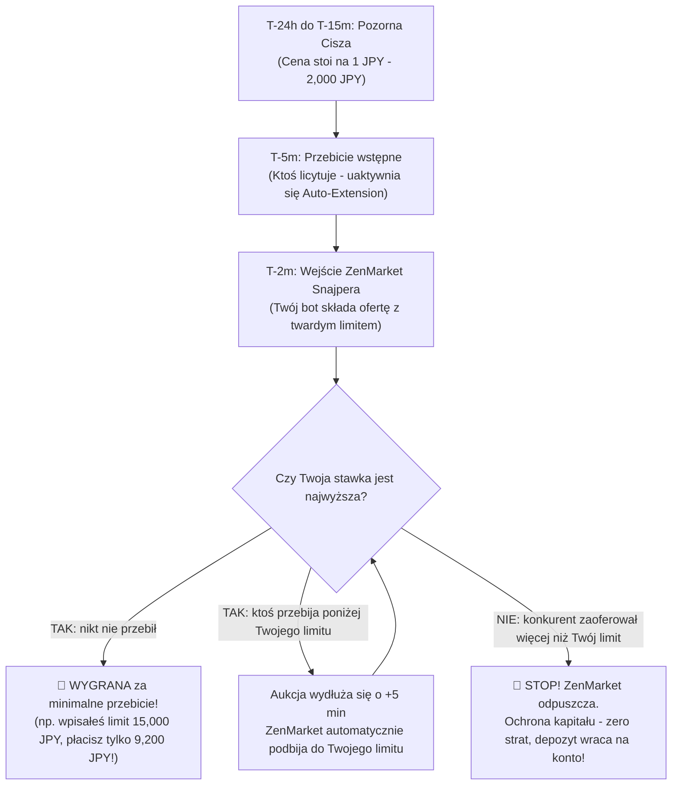

# 🎯 Yahoo! Auctions Sniping Masterclass & Real Closing Price Guide

> **Kompendium Licytacji w Ostatnich Minutach na Yahoo! Japan Auctions (ヤフオク!)**  
> *Prawdziwe Ceny Końcowe (落札相場), Matematyczne Limity Snajpera (Hard Sniping Caps) i Strategia Wyprzedzania Konkurencji.*

    

⬅ **Nawigacja:** [Główny Dashboard Mercari (README.md)](README.md) · [Katalog Alternatywnych Ofert (YAHOO_AUCTIONS_DEALS.md)](YAHOO_AUCTIONS_DEALS.md) · [💰 Audyt Opłacalności (REAL_PROFITABILITY_AUDIT.md)](REAL_PROFITABILITY_AUDIT.md) · [📈 Historia Sprzedaży (MARKET_SALES_HISTORY.md)](MARKET_SALES_HISTORY.md)

---

> [!IMPORTANT]
> **Dlaczego licytacje na Yahoo! Auctions zyskują realną cenę dopiero przed samym końcem?**
> 1. **Iluzja ceny 1 JPY:** Ponad 90% ofert startuje od 1 JPY i przez 5 dni stoi na kwotach rzędu 500–3,000 JPY. To nie jest cena zakupu, lecz zabieg marketingowy.
> 2. **Działanie Snajperów i Proxy:** Wszyscy profesjonalni kupcy używają narzędzi snajperskich (ZenMarket Sniper, Buyee, Boty). Prawdziwy kapitał uderza w aukcję **w ostatnich 2–15 minutach**.
> 3. **Automatyczne Przedłużanie (`自動延長`):** Jeśli w ostatnich 5 minutach ktoś złoży ofertę, czas aukcji wydłuża się o kolejne 5 minut. Zapobiega to wygraniu przez przypadek.
> 4. **Rozwiązanie z tego przewodnika:** Zamiast zgadywać lub dać się ponieść emocjom, używasz poniższej **Tabeli Twardych Limitów Snajpera**. Wpisujesz w ZenMarket wyliczony limit JPY – jeśli aukcja skończy się poniżej, masz gwarantowany zysk; jeśli ktoś podbije wyżej, system automatycznie odpuszcza, chroniąc Twój kapitał!

---

## ⏱️ Anatomia Ostatnich 15 Minut Aukcji: Co Dokładnie Dzieje Się na Yahoo Japan?

### 3 Fundamentalne Prawa Licytacji na Yahoo Japan

1. **Nigdy nie licytuj ręcznie przed czasem:**
   - Jeśli zalicytujesz 2 dni wcześniej kwotą 10,000 JPY, inny użytkownik zauważy ofertę i zacznie sprawdzać Twój limit, podbijając po 500 JPY, aż Cię przelicytuje.
   - Czekając do 2 minut przed końcem, nie dajesz konkurentowi czasu na chłodną kalkulację.
2. **Yahoo Proxy Bidding (Płacisz tylko minimalne przebicie):**
   - Jeśli wpiszesz w Snajperze limit **15,000 JPY**, a najwyższa oferta konkurenta wynosi **8,500 JPY**, to **NIE płacisz 15,000 JPY!**
   - Wygrywasz aukcję za **8,750 JPY** (oferta konkurenta + minimalny krok 250 JPY). Reszta Twojego depozytu (6,250 JPY) natychmiast pozostaje na Twoim koncie!
3. **Twardy Limit z Tabeli = Brak Ryzyka Emocjonalnego:**
   - Najczęstszym błędem początkujących jest tzw. *bidding tilt* – podbijanie o kolejne 1,000 JPY w nieskończoność w ferworze walki.
   - Jeśli wyliczony limit wynosi 16,500 JPY, a cena osiąga 17,000 JPY – **odpuść**. Ta konsola przestała generować satysfakcjonującą marżę.

---

## 📊 Tabela Twardych Limitów Snajpera (Hard Sniping Caps) – 42 Modeli

Poniższa tabela zawiera wyliczone z dokładnością do 100 JPY **twarde limity snajpera**, uwzględniające aktualny kurs NBP, 2 EUR prowizji ZenMarket, 800 JPY obsługi krajowej, 3.5% opłaty depozytowej, udział w paczce lotniczej oraz 23% polskiego podatku VAT. Dopóki wygrasz aukcję poniżej lub równo z tą kwotą, masz **gwarantowany minimalny zysk 30%–100% ROI**!

| Model / Wariant | Wycena w PL | Średnia Cena Końcowa (落札相場) | 🎯 Twardy Limit Snajpera | Koszt w PL przy Limicie | Gwarantowany Zysk Netto | Bateria IATA | 1-Click Linki (Ending Soon & Archiwum) |
|---|---:|---:|---:|---:|---:|:---:|---|
| **New Nintendo 3DS LL (New 3DS XL)** <small>Metallic Blue / Metallic Black (RED-001)</small> | **920.00 zł** | 11,200 – 18,800 JPY | **`19,800 JPY`** | ~695.36 zł | <strong style='color:#10b981;'>+224.64 zł</strong> <small>(+32.3%)</small> | 🔴 1 Li-Ion | [⏰ Kończące się (ZenMarket)](https://zenmarket.jp/pl/yahoo.aspx?q=New%E3%83%8B%E3%83%B3%E3%83%86%E3%83%B3%E3%83%89%E3%83%BC3DS%20LL%20%E6%9C%AC%E4%BD%93&sort=end&order=asc) [🛒 Kończące się (Buyee)](https://buyee.jp/item/search/query/New%E3%83%8B%E3%83%B3%E3%83%86%E3%83%B3%E3%83%89%E3%83%BC3DS%20LL%20%E6%9C%AC%E4%BD%93?translationType=1&sort=end&order=a) [📊 Archiwum Cen Yahoo](https://auctions.yahoo.co.jp/closedsearch/closedsearch?p=New%E3%83%8B%E3%83%B3%E3%83%86%E3%83%B3%E3%83%89%E3%83%BC3DS%20LL%20%E6%9C%AC%E4%BD%93) · [Aucfan](https://aucfan.com/search1/q-New%E3%83%8B%E3%83%B3%E3%83%86%E3%83%B3%E3%83%89%E3%83%BC3DS%20LL%20%E6%9C%AC%E4%BD%93/s-mix/) |
| **New Nintendo 3DS (Kisekae Cover Plates)** <small>White / Black (KTR-001)</small> | **750.00 zł** | 8,000 – 14,900 JPY | **`15,700 JPY`** | ~566.72 zł | <strong style='color:#10b981;'>+183.28 zł</strong> <small>(+32.3%)</small> | 🔴 1 Li-Ion | [⏰ Kończące się (ZenMarket)](https://zenmarket.jp/pl/yahoo.aspx?q=New%E3%83%8B%E3%83%B3%E3%83%86%E3%83%B3%E3%83%89%E3%83%BC3DS%20%E6%9C%AC%E4%BD%93&sort=end&order=asc) [🛒 Kończące się (Buyee)](https://buyee.jp/item/search/query/New%E3%83%8B%E3%83%B3%E3%83%86%E3%83%B3%E3%83%89%E3%83%BC3DS%20%E6%9C%AC%E4%BD%93?translationType=1&sort=end&order=a) [📊 Archiwum Cen Yahoo](https://auctions.yahoo.co.jp/closedsearch/closedsearch?p=New%E3%83%8B%E3%83%B3%E3%83%86%E3%83%B3%E3%83%89%E3%83%BC3DS%20%E6%9C%AC%E4%BD%93) · [Aucfan](https://aucfan.com/search1/q-New%E3%83%8B%E3%83%B3%E3%83%86%E3%83%B3%E3%83%89%E3%83%BC3DS%20%E6%9C%AC%E4%BD%93/s-mix/) |
| **Nintendo 3DS LL (Old 3DS XL)** <small>Blue / Black lub Red / Black (SPR-001)</small> | **580.00 zł** | 6,100 – 11,000 JPY | **`11,600 JPY`** | ~438.08 zł | <strong style='color:#10b981;'>+141.92 zł</strong> <small>(+32.4%)</small> | 🔴 1 Li-Ion | [⏰ Kończące się (ZenMarket)](https://zenmarket.jp/pl/yahoo.aspx?q=%E3%83%8B%E3%83%B3%E3%83%86%E3%83%B3%E3%83%89%E3%83%BC3DS%20LL%20%E6%9C%AC%E4%BD%93&sort=end&order=asc) [🛒 Kończące się (Buyee)](https://buyee.jp/item/search/query/%E3%83%8B%E3%83%B3%E3%83%86%E3%83%B3%E3%83%89%E3%83%BC3DS%20LL%20%E6%9C%AC%E4%BD%93?translationType=1&sort=end&order=a) [📊 Archiwum Cen Yahoo](https://auctions.yahoo.co.jp/closedsearch/closedsearch?p=%E3%83%8B%E3%83%B3%E3%83%86%E3%83%B3%E3%83%89%E3%83%BC3DS%20LL%20%E6%9C%AC%E4%BD%93) · [Aucfan](https://aucfan.com/search1/q-%E3%83%8B%E3%83%B3%E3%83%86%E3%83%B3%E3%83%89%E3%83%BC3DS%20LL%20%E6%9C%AC%E4%BD%93/s-mix/) |
| **Nintendo 3DS (CTR-001)** <small>Aqua Blue</small> | **460.00 zł** | 4,600 – 7,600 JPY | **`8,100 JPY`** | ~328.28 zł | <strong style='color:#10b981;'>+131.72 zł</strong> <small>(+40.1%)</small> | 🔴 1 Li-Ion | [⏰ Kończące się (ZenMarket)](https://zenmarket.jp/pl/yahoo.aspx?q=%E3%83%8B%E3%83%B3%E3%83%86%E3%83%B3%E3%83%89%E3%83%BC3DS%20%E6%9C%AC%E4%BD%93%20%E3%82%A2%E3%82%AF%E3%82%A2%E3%83%96%E3%83%AB%E3%83%BC&sort=end&order=asc) [🛒 Kończące się (Buyee)](https://buyee.jp/item/search/query/%E3%83%8B%E3%83%B3%E3%83%86%E3%83%B3%E3%83%89%E3%83%BC3DS%20%E6%9C%AC%E4%BD%93%20%E3%82%A2%E3%82%AF%E3%82%A2%E3%83%96%E3%83%AB%E3%83%BC?translationType=1&sort=end&order=a) [📊 Archiwum Cen Yahoo](https://auctions.yahoo.co.jp/closedsearch/closedsearch?p=%E3%83%8B%E3%83%B3%E3%83%86%E3%83%B3%E3%83%89%E3%83%BC3DS%20%E6%9C%AC%E4%BD%93%20%E3%82%A2%E3%82%AF%E3%82%A2%E3%83%96%E3%83%AB%E3%83%BC) · [Aucfan](https://aucfan.com/search1/q-%E3%83%8B%E3%83%B3%E3%83%86%E3%83%B3%E3%83%89%E3%83%BC3DS%20%E6%9C%AC%E4%BD%93%20%E3%82%A2%E3%82%AF%E3%82%A2%E3%83%96%E3%83%AB%E3%83%BC/s-mix/) |
| **Nintendo DSi LL (XL)** <small>Wine Red / Dark Brown (Matryce IPS)</small> | **380.00 zł** | 3,200 – 5,800 JPY | **`6,200 JPY`** | ~268.66 zł | <strong style='color:#10b981;'>+111.34 zł</strong> <small>(+41.4%)</small> | 🔴 1 Li-Ion | [⏰ Kończące się (ZenMarket)](https://zenmarket.jp/pl/yahoo.aspx?q=Nintendo%20DSi%20LL%20%E6%9C%AC%E4%BD%93&sort=end&order=asc) [🛒 Kończące się (Buyee)](https://buyee.jp/item/search/query/Nintendo%20DSi%20LL%20%E6%9C%AC%E4%BD%93?translationType=1&sort=end&order=a) [📊 Archiwum Cen Yahoo](https://auctions.yahoo.co.jp/closedsearch/closedsearch?p=Nintendo%20DSi%20LL%20%E6%9C%AC%E4%BD%93) · [Aucfan](https://aucfan.com/search1/q-Nintendo%20DSi%20LL%20%E6%9C%AC%E4%BD%93/s-mix/) |
| **Nintendo DS Lite (USG-001)** <small>Metallic Silver</small> | **260.00 zł** | 1,900 – 3,300 JPY | **`3,500 JPY`** | ~183.96 zł | <strong style='color:#10b981;'>+76.04 zł</strong> <small>(+41.3%)</small> | 🔴 1 Li-Ion | [⏰ Kończące się (ZenMarket)](https://zenmarket.jp/pl/yahoo.aspx?q=Nintendo%20DS%20Lite%20%E6%9C%AC%E4%BD%93%20%E5%8B%95%E4%BD%9C%E7%A2%BA%E8%AA%8D%E6%B8%88%E3%81%BF&sort=end&order=asc) [🛒 Kończące się (Buyee)](https://buyee.jp/item/search/query/Nintendo%20DS%20Lite%20%E6%9C%AC%E4%BD%93%20%E5%8B%95%E4%BD%9C%E7%A2%BA%E8%AA%8D%E6%B8%88%E3%81%BF?translationType=1&sort=end&order=a) [📊 Archiwum Cen Yahoo](https://auctions.yahoo.co.jp/closedsearch/closedsearch?p=Nintendo%20DS%20Lite%20%E6%9C%AC%E4%BD%93%20%E5%8B%95%E4%BD%9C%E7%A2%BA%E8%AA%8D%E6%B8%88%E3%81%BF) · [Aucfan](https://aucfan.com/search1/q-Nintendo%20DS%20Lite%20%E6%9C%AC%E4%BD%93%20%E5%8B%95%E4%BD%9C%E7%A2%BA%E8%AA%8D%E6%B8%88%E3%81%BF/s-mix/) |
| **Nintendo DS Lite (Dwukolorowy)** <small>Crimson / Black</small> | **290.00 zł** | 2,300 – 3,900 JPY | **`4,200 JPY`** | ~205.92 zł | <strong style='color:#10b981;'>+84.08 zł</strong> <small>(+40.8%)</small> | 🔴 1 Li-Ion | [⏰ Kończące się (ZenMarket)](https://zenmarket.jp/pl/yahoo.aspx?q=DS%20Lite%20%E3%82%AF%E3%83%AA%E3%83%A0%E3%82%BE%E3%83%B3%E3%83%96%E3%83%A9%E3%83%83%E3%82%AF&sort=end&order=asc) [🛒 Kończące się (Buyee)](https://buyee.jp/item/search/query/DS%20Lite%20%E3%82%AF%E3%83%AA%E3%83%A0%E3%82%BE%E3%83%B3%E3%83%96%E3%83%A9%E3%83%83%E3%82%AF?translationType=1&sort=end&order=a) [📊 Archiwum Cen Yahoo](https://auctions.yahoo.co.jp/closedsearch/closedsearch?p=DS%20Lite%20%E3%82%AF%E3%83%AA%E3%83%A0%E3%82%BE%E3%83%B3%E3%83%96%E3%83%A9%E3%83%83%E3%82%AF) · [Aucfan](https://aucfan.com/search1/q-DS%20Lite%20%E3%82%AF%E3%83%AA%E3%83%A0%E3%82%BE%E3%83%B3%E3%83%96%E3%83%A9%E3%83%83%E3%82%AF/s-mix/) |
| **Nintendo DS Lite Final Fantasy III Crystal Edition** <small>Crystal White (Limited)</small> | **580.00 zł** | 4,900 – 11,000 JPY | **`11,600 JPY`** | ~438.08 zł | <strong style='color:#10b981;'>+141.92 zł</strong> <small>(+32.4%)</small> | 🔴 1 Li-Ion | [⏰ Kończące się (ZenMarket)](https://zenmarket.jp/pl/yahoo.aspx?q=DS%20Lite%20%E3%83%95%E3%82%A1%E3%82%A4%E3%83%8A%E3%83%AB%E3%83%95%E3%82%A1%E3%83%B3%E3%82%BF%E3%82%B8%E3%83%BCIII%20%E3%82%AF%E3%83%AA%E3%82%B9%E3%82%BF%E3%83%AB%E3%82%A8%E3%83%87%E3%82%A3%E3%82%B7%E3%83%A7%E3%83%B3&sort=end&order=asc) [🛒 Kończące się (Buyee)](https://buyee.jp/item/search/query/DS%20Lite%20%E3%83%95%E3%82%A1%E3%82%A4%E3%83%8A%E3%83%AB%E3%83%95%E3%82%A1%E3%83%B3%E3%82%BF%E3%82%B8%E3%83%BCIII%20%E3%82%AF%E3%83%AA%E3%82%B9%E3%82%BF%E3%83%AB%E3%82%A8%E3%83%87%E3%82%A3%E3%82%B7%E3%83%A7%E3%83%B3?translationType=1&sort=end&order=a) [📊 Archiwum Cen Yahoo](https://auctions.yahoo.co.jp/closedsearch/closedsearch?p=DS%20Lite%20%E3%83%95%E3%82%A1%E3%82%A4%E3%83%8A%E3%83%AB%E3%83%95%E3%82%A1%E3%83%B3%E3%82%BF%E3%82%B8%E3%83%BCIII%20%E3%82%AF%E3%83%AA%E3%82%B9%E3%82%BF%E3%83%AB%E3%82%A8%E3%83%87%E3%82%A3%E3%82%B7%E3%83%A7%E3%83%B3) · [Aucfan](https://aucfan.com/search1/q-DS%20Lite%20%E3%83%95%E3%82%A1%E3%82%A4%E3%83%8A%E3%83%AB%E3%83%95%E3%82%A1%E3%83%B3%E3%82%BF%E3%82%B8%E3%83%BCIII%20%E3%82%AF%E3%83%AA%E3%82%B9%E3%82%BF%E3%83%AB%E3%82%A8%E3%83%87%E3%82%A3%E3%82%B7%E3%83%A7%E3%83%B3/s-mix/) |
| **Game Boy Advance SP Famicom 20th Anniversary Edition** <small>Famicom Red / Gold (Limited)</small> | **720.00 zł** | 8,800 – 14,400 JPY | **`15,200 JPY`** | ~544.71 zł | <strong style='color:#10b981;'>+175.29 zł</strong> <small>(+32.2%)</small> | 🔴 1 Li-Ion | [⏰ Kończące się (ZenMarket)](https://zenmarket.jp/pl/yahoo.aspx?q=%E3%82%B2%E3%83%BC%E3%83%A0%E3%83%9C%E3%83%BC%E3%82%A4%E3%82%A2%E3%83%89%E3%83%90%E3%83%B3%E3%82%B9SP%20%E3%83%95%E3%82%A1%E3%83%9F%E3%82%B3%E3%83%B3%E3%82%AB%E3%83%A9%E3%83%BC&sort=end&order=asc) [🛒 Kończące się (Buyee)](https://buyee.jp/item/search/query/%E3%82%B2%E3%83%BC%E3%83%A0%E3%83%9C%E3%83%BC%E3%82%A4%E3%82%A2%E3%83%89%E3%83%90%E3%83%B3%E3%82%B9SP%20%E3%83%95%E3%82%A1%E3%83%9F%E3%82%B3%E3%83%B3%E3%82%AB%E3%83%A9%E3%83%BC?translationType=1&sort=end&order=a) [📊 Archiwum Cen Yahoo](https://auctions.yahoo.co.jp/closedsearch/closedsearch?p=%E3%82%B2%E3%83%BC%E3%83%A0%E3%83%9C%E3%83%BC%E3%82%A4%E3%82%A2%E3%83%89%E3%83%90%E3%83%B3%E3%82%B9SP%20%E3%83%95%E3%82%A1%E3%83%9F%E3%82%B3%E3%83%B3%E3%82%AB%E3%83%A9%E3%83%BC) · [Aucfan](https://aucfan.com/search1/q-%E3%82%B2%E3%83%BC%E3%83%A0%E3%83%9C%E3%83%BC%E3%82%A4%E3%82%A2%E3%83%89%E3%83%90%E3%83%B3%E3%82%B9SP%20%E3%83%95%E3%82%A1%E3%83%9F%E3%82%B3%E3%83%B3%E3%82%AB%E3%83%A9%E3%83%BC/s-mix/) |
| **Game Boy Advance SP (AGS-101 Brighter LCD)** <small>Pearl Blue (Podświetlenie II Generacji)</small> | **780.00 zł** | 9,400 – 15,700 JPY | **`16,600 JPY`** | ~588.63 zł | <strong style='color:#10b981;'>+191.37 zł</strong> <small>(+32.5%)</small> | 🔴 1 Li-Ion | [⏰ Kończące się (ZenMarket)](https://zenmarket.jp/pl/yahoo.aspx?q=%E3%82%B2%E3%83%BC%E3%83%A0%E3%83%9C%E3%83%BC%E3%82%A4%E3%82%A2%E3%83%89%E3%83%90%E3%83%B3%E3%82%B9SP%20AGS-101&sort=end&order=asc) [🛒 Kończące się (Buyee)](https://buyee.jp/item/search/query/%E3%82%B2%E3%83%BC%E3%83%A0%E3%83%9C%E3%83%BC%E3%82%A4%E3%82%A2%E3%83%89%E3%83%90%E3%83%B3%E3%82%B9SP%20AGS-101?translationType=1&sort=end&order=a) [📊 Archiwum Cen Yahoo](https://auctions.yahoo.co.jp/closedsearch/closedsearch?p=%E3%82%B2%E3%83%BC%E3%83%A0%E3%83%9C%E3%83%BC%E3%82%A4%E3%82%A2%E3%83%89%E3%83%90%E3%83%B3%E3%82%B9SP%20AGS-101) · [Aucfan](https://aucfan.com/search1/q-%E3%82%B2%E3%83%BC%E3%83%A0%E3%83%9C%E3%83%BC%E3%82%A4%E3%82%A2%E3%83%89%E3%83%90%E3%83%B3%E3%82%B9SP%20AGS-101/s-mix/) |
| **Game Boy Color CGB-001** <small>Atomic Purple (Przezroczysty Fiolet)</small> | **450.00 zł** | 5,200 – 7,600 JPY | **`8,000 JPY`** | ~318.82 zł | <strong style='color:#10b981;'>+131.18 zł</strong> <small>(+41.1%)</small> | 🟢 0% Li-Ion | [⏰ Kończące się (ZenMarket)](https://zenmarket.jp/pl/yahoo.aspx?q=%E3%82%B2%E3%83%BC%E3%83%A0%E3%83%9C%E3%83%BC%E3%82%A4%E3%82%AB%E3%83%A9%E3%83%BC%20%E6%9C%AC%E4%BD%93%20%E3%82%AF%E3%83%AA%E3%82%A2%E3%83%91%E3%83%BC%E3%83%97%E3%83%AB&sort=end&order=asc) [🛒 Kończące się (Buyee)](https://buyee.jp/item/search/query/%E3%82%B2%E3%83%BC%E3%83%A0%E3%83%9C%E3%83%BC%E3%82%A4%E3%82%AB%E3%83%A9%E3%83%BC%20%E6%9C%AC%E4%BD%93%20%E3%82%AF%E3%83%AA%E3%82%A2%E3%83%91%E3%83%BC%E3%83%97%E3%83%AB?translationType=1&sort=end&order=a) [📊 Archiwum Cen Yahoo](https://auctions.yahoo.co.jp/closedsearch/closedsearch?p=%E3%82%B2%E3%83%BC%E3%83%A0%E3%83%9C%E3%83%BC%E3%82%A4%E3%82%AB%E3%83%A9%E3%83%BC%20%E6%9C%AC%E4%BD%93%20%E3%82%AF%E3%83%AA%E3%82%A2%E3%83%91%E3%83%BC%E3%83%97%E3%83%AB) · [Aucfan](https://aucfan.com/search1/q-%E3%82%B2%E3%83%BC%E3%83%A0%E3%83%9C%E3%83%BC%E3%82%A4%E3%82%AB%E3%83%A9%E3%83%BC%20%E6%9C%AC%E4%BD%93%20%E3%82%AF%E3%83%AA%E3%82%A2%E3%83%91%E3%83%BC%E3%83%97%E3%83%AB/s-mix/) |
| **Game Boy Advance (AGB-001 Poziomy)** <small>Glacier (Przezroczysty Błękit)</small> | **390.00 zł** | 4,000 – 6,300 JPY | **`6,700 JPY`** | ~278.02 zł | <strong style='color:#10b981;'>+111.98 zł</strong> <small>(+40.3%)</small> | 🟢 0% Li-Ion | [⏰ Kończące się (ZenMarket)](https://zenmarket.jp/pl/yahoo.aspx?q=%E3%82%B2%E3%83%BC%E3%83%A0%E3%83%9C%E3%83%BC%E3%82%A4%E3%82%A2%E3%83%89%E3%83%90%E3%83%B3%E3%82%B9%20%E6%9C%AC%E4%BD%93%20AGB-001&sort=end&order=asc) [🛒 Kończące się (Buyee)](https://buyee.jp/item/search/query/%E3%82%B2%E3%83%BC%E3%83%A0%E3%83%9C%E3%83%BC%E3%82%A4%E3%82%A2%E3%83%89%E3%83%90%E3%83%B3%E3%82%B9%20%E6%9C%AC%E4%BD%93%20AGB-001?translationType=1&sort=end&order=a) [📊 Archiwum Cen Yahoo](https://auctions.yahoo.co.jp/closedsearch/closedsearch?p=%E3%82%B2%E3%83%BC%E3%83%A0%E3%83%9C%E3%83%BC%E3%82%A4%E3%82%A2%E3%83%89%E3%83%90%E3%83%B3%E3%82%B9%20%E6%9C%AC%E4%BD%93%20AGB-001) · [Aucfan](https://aucfan.com/search1/q-%E3%82%B2%E3%83%BC%E3%83%A0%E3%83%9C%E3%83%BC%E3%82%A4%E3%82%A2%E3%83%89%E3%83%90%E3%83%B3%E3%82%B9%20%E6%9C%AC%E4%BD%93%20AGB-001/s-mix/) |
| **PCH-2000 Slim** <small>Aqua Blue (ZA23)</small> | **890.00 zł** | 12,100 – 17,900 JPY | **`18,900 JPY`** | ~673.45 zł | <strong style='color:#10b981;'>+216.55 zł</strong> <small>(+32.2%)</small> | 🔴 1 Li-Ion | [⏰ Kończące się (ZenMarket)](https://zenmarket.jp/pl/yahoo.aspx?q=PS%20Vita%20PCH-2000%20%E3%82%A2%E3%82%AF%E3%82%A2%E3%83%96%E3%83%AB%E3%83%BC&sort=end&order=asc) [🛒 Kończące się (Buyee)](https://buyee.jp/item/search/query/PS%20Vita%20PCH-2000%20%E3%82%A2%E3%82%AF%E3%82%A2%E3%83%96%E3%83%AB%E3%83%BC?translationType=1&sort=end&order=a) [📊 Archiwum Cen Yahoo](https://auctions.yahoo.co.jp/closedsearch/closedsearch?p=PS%20Vita%20PCH-2000%20%E3%82%A2%E3%82%AF%E3%82%A2%E3%83%96%E3%83%AB%E3%83%BC) · [Aucfan](https://aucfan.com/search1/q-PS%20Vita%20PCH-2000%20%E3%82%A2%E3%82%AF%E3%82%A2%E3%83%96%E3%83%AB%E3%83%BC/s-mix/) |
| **PCH-1000 OLED** <small>Sapphire Blue (ZA04)</small> | **850.00 zł** | 11,500 – 17,000 JPY | **`17,900 JPY`** | ~642.07 zł | <strong style='color:#10b981;'>+207.93 zł</strong> <small>(+32.4%)</small> | 🔴 1 Li-Ion | [⏰ Kończące się (ZenMarket)](https://zenmarket.jp/pl/yahoo.aspx?q=PS%20Vita%20PCH-1000%20%E3%82%B5%E3%83%95%E3%82%A1%E3%82%A4%E3%82%A2%E3%83%96%E3%83%AB%E3%83%BC&sort=end&order=asc) [🛒 Kończące się (Buyee)](https://buyee.jp/item/search/query/PS%20Vita%20PCH-1000%20%E3%82%B5%E3%83%95%E3%82%A1%E3%82%A4%E3%82%A2%E3%83%96%E3%83%AB%E3%83%BC?translationType=1&sort=end&order=a) [📊 Archiwum Cen Yahoo](https://auctions.yahoo.co.jp/closedsearch/closedsearch?p=PS%20Vita%20PCH-1000%20%E3%82%B5%E3%83%95%E3%82%A1%E3%82%A4%E3%82%A2%E3%83%96%E3%83%AB%E3%83%BC) · [Aucfan](https://aucfan.com/search1/q-PS%20Vita%20PCH-1000%20%E3%82%B5%E3%83%95%E3%82%A1%E3%82%A4%E3%82%A2%E3%83%96%E3%83%AB%E3%83%BC/s-mix/) |
| **PCH-2000 Slim** <small>Metallic Red (ZA26)</small> | **880.00 zł** | 12,600 – 17,600 JPY | **`18,600 JPY`** | ~664.03 zł | <strong style='color:#10b981;'>+215.97 zł</strong> <small>(+32.5%)</small> | 🔴 1 Li-Ion | [⏰ Kończące się (ZenMarket)](https://zenmarket.jp/pl/yahoo.aspx?q=PS%20Vita%20PCH-2000%20%E3%83%A1%E3%82%BF%E3%83%AA%E3%83%83%E3%82%AF%E3%83%AC%E3%83%83%E3%83%89&sort=end&order=asc) [🛒 Kończące się (Buyee)](https://buyee.jp/item/search/query/PS%20Vita%20PCH-2000%20%E3%83%A1%E3%82%BF%E3%83%AA%E3%83%83%E3%82%AF%E3%83%AC%E3%83%83%E3%83%89?translationType=1&sort=end&order=a) [📊 Archiwum Cen Yahoo](https://auctions.yahoo.co.jp/closedsearch/closedsearch?p=PS%20Vita%20PCH-2000%20%E3%83%A1%E3%82%BF%E3%83%AA%E3%83%83%E3%82%AF%E3%83%AC%E3%83%83%E3%83%89) · [Aucfan](https://aucfan.com/search1/q-PS%20Vita%20PCH-2000%20%E3%83%A1%E3%82%BF%E3%83%AA%E3%83%83%E3%82%AF%E3%83%AC%E3%83%83%E3%83%89/s-mix/) |
| **PCH-2000 Slim** <small>Glacier White (ZA22)</small> | **850.00 zł** | 11,700 – 17,000 JPY | **`17,900 JPY`** | ~642.07 zł | <strong style='color:#10b981;'>+207.93 zł</strong> <small>(+32.4%)</small> | 🔴 1 Li-Ion | [⏰ Kończące się (ZenMarket)](https://zenmarket.jp/pl/yahoo.aspx?q=PS%20Vita%20PCH-2000%20%E3%82%B0%E3%83%AC%E3%82%A4%E3%82%B7%E3%83%A3%E3%83%BC%E3%83%9B%E3%83%AF%E3%82%A4%E3%83%88&sort=end&order=asc) [🛒 Kończące się (Buyee)](https://buyee.jp/item/search/query/PS%20Vita%20PCH-2000%20%E3%82%B0%E3%83%AC%E3%82%A4%E3%82%B7%E3%83%A3%E3%83%BC%E3%83%9B%E3%83%AF%E3%82%A4%E3%83%88?translationType=1&sort=end&order=a) [📊 Archiwum Cen Yahoo](https://auctions.yahoo.co.jp/closedsearch/closedsearch?p=PS%20Vita%20PCH-2000%20%E3%82%B0%E3%83%AC%E3%82%A4%E3%82%B7%E3%83%A3%E3%83%BC%E3%83%9B%E3%83%AF%E3%82%A4%E3%83%88) · [Aucfan](https://aucfan.com/search1/q-PS%20Vita%20PCH-2000%20%E3%82%B0%E3%83%AC%E3%82%A4%E3%82%B7%E3%83%A3%E3%83%BC%E3%83%9B%E3%83%AF%E3%82%A4%E3%83%88/s-mix/) |
| **PCH-2000 Slim** <small>Neon Orange (ZA24)</small> | **1050.00 zł** | 16,600 – 21,500 JPY | **`22,700 JPY`** | ~792.67 zł | <strong style='color:#10b981;'>+257.33 zł</strong> <small>(+32.5%)</small> | 🔴 1 Li-Ion | [⏰ Kończące się (ZenMarket)](https://zenmarket.jp/pl/yahoo.aspx?q=PS%20Vita%20PCH-2000%20%E3%83%8D%E3%82%AA%E3%83%B3%E3%82%AA%E3%83%AC%E3%83%B3%E3%82%B8&sort=end&order=asc) [🛒 Kończące się (Buyee)](https://buyee.jp/item/search/query/PS%20Vita%20PCH-2000%20%E3%83%8D%E3%82%AA%E3%83%B3%E3%82%AA%E3%83%AC%E3%83%B3%E3%82%B8?translationType=1&sort=end&order=a) [📊 Archiwum Cen Yahoo](https://auctions.yahoo.co.jp/closedsearch/closedsearch?p=PS%20Vita%20PCH-2000%20%E3%83%8D%E3%82%AA%E3%83%B3%E3%82%AA%E3%83%AC%E3%83%B3%E3%82%B8) · [Aucfan](https://aucfan.com/search1/q-PS%20Vita%20PCH-2000%20%E3%83%8D%E3%82%AA%E3%83%B3%E3%82%AA%E3%83%AC%E3%83%B3%E3%82%B8/s-mix/) |
| **PSP-3000 Vibrant Blue** <small>Vibrant Blue (Metaliczny Błękit)</small> | **490.00 zł** | 6,700 – 8,200 JPY | **`8,700 JPY`** | ~347.10 zł | <strong style='color:#10b981;'>+142.90 zł</strong> <small>(+41.2%)</small> | 🔴 1 Li-Ion | [⏰ Kończące się (ZenMarket)](https://zenmarket.jp/pl/yahoo.aspx?q=PSP-3000%20%E3%83%90%E3%82%A4%E3%83%96%E3%83%A9%E3%83%B3%E3%83%88%E3%83%96%E3%83%AB%E3%83%BC&sort=end&order=asc) [🛒 Kończące się (Buyee)](https://buyee.jp/item/search/query/PSP-3000%20%E3%83%90%E3%82%A4%E3%83%96%E3%83%A9%E3%83%B3%E3%83%88%E3%83%96%E3%83%AB%E3%83%BC?translationType=1&sort=end&order=a) [📊 Archiwum Cen Yahoo](https://auctions.yahoo.co.jp/closedsearch/closedsearch?p=PSP-3000%20%E3%83%90%E3%82%A4%E3%83%96%E3%83%A9%E3%83%B3%E3%83%88%E3%83%96%E3%83%AB%E3%83%BC) · [Aucfan](https://aucfan.com/search1/q-PSP-3000%20%E3%83%90%E3%82%A4%E3%83%96%E3%83%A9%E3%83%B3%E3%83%88%E3%83%96%E3%83%AB%E3%83%BC/s-mix/) |
| **PSP-3000 Monster Hunter Portable 3rd Hunters Model** <small>MHB Matowa Czerń / Złote Emblematy</small> | **820.00 zł** | 10,600 – 16,500 JPY | **`17,400 JPY`** | ~620.06 zł | <strong style='color:#10b981;'>+199.94 zł</strong> <small>(+32.2%)</small> | 🔴 1 Li-Ion | [⏰ Kończące się (ZenMarket)](https://zenmarket.jp/pl/yahoo.aspx?q=PSP-3000%20MHB%20%E3%83%A2%E3%83%B3%E3%83%8F%E3%83%B3&sort=end&order=asc) [🛒 Kończące się (Buyee)](https://buyee.jp/item/search/query/PSP-3000%20MHB%20%E3%83%A2%E3%83%B3%E3%83%8F%E3%83%B3?translationType=1&sort=end&order=a) [📊 Archiwum Cen Yahoo](https://auctions.yahoo.co.jp/closedsearch/closedsearch?p=PSP-3000%20MHB%20%E3%83%A2%E3%83%B3%E3%83%8F%E3%83%B3) · [Aucfan](https://aucfan.com/search1/q-PSP-3000%20MHB%20%E3%83%A2%E3%83%B3%E3%83%8F%E3%83%B3/s-mix/) |
| **Hurtowy Pakiet 50 Gier Retro (Nintendo DS / GBA / SFC / PS2)** <small>Mix 50 Gier Hurtowo</small> | **750.00 zł** | 3,100 – 14,300 JPY | **`15,100 JPY`** | ~535.25 zł | <strong style='color:#10b981;'>+214.75 zł</strong> <small>(+40.1%)</small> | 🟢 0% Li-Ion | [⏰ Kończące się (ZenMarket)](https://zenmarket.jp/pl/yahoo.aspx?q=%E3%82%B2%E3%83%BC%E3%83%A0%20%E3%82%BD%E3%83%95%E3%83%88%20%E3%81%BE%E3%81%A8%E3%82%81%20%E5%A4%A7%E9%87%8F&sort=end&order=asc) [🛒 Kończące się (Buyee)](https://buyee.jp/item/search/query/%E3%82%B2%E3%83%BC%E3%83%A0%20%E3%82%BD%E3%83%95%E3%83%88%20%E3%81%BE%E3%81%A8%E3%82%81%20%E5%A4%A7%E9%87%8F?translationType=1&sort=end&order=a) [📊 Archiwum Cen Yahoo](https://auctions.yahoo.co.jp/closedsearch/closedsearch?p=%E3%82%B2%E3%83%BC%E3%83%A0%20%E3%82%BD%E3%83%95%E3%83%88%20%E3%81%BE%E3%81%A8%E3%82%81%20%E5%A4%A7%E9%87%8F) · [Aucfan](https://aucfan.com/search1/q-%E3%82%B2%E3%83%BC%E3%83%A0%20%E3%82%BD%E3%83%95%E3%83%88%20%E3%81%BE%E3%81%A8%E3%82%81%20%E5%A4%A7%E9%87%8F/s-mix/) |
| **Zestaw 30 Gier Nintendo DS / 3DS w Pudełkach (CIB Lot)** <small>Mix 30 Gier DS / 3DS</small> | **680.00 zł** | 2,800 – 12,800 JPY | **`13,500 JPY`** | ~485.05 zł | <strong style='color:#10b981;'>+194.95 zł</strong> <small>(+40.2%)</small> | 🟢 0% Li-Ion | [⏰ Kończące się (ZenMarket)](https://zenmarket.jp/pl/yahoo.aspx?q=DS%20%E3%82%BD%E3%83%95%E3%83%88%20%E3%81%BE%E3%81%A8%E3%82%81%E5%A3%B2%E3%82%8A%20%E3%82%BB%E3%83%83%E3%83%88&sort=end&order=asc) [🛒 Kończące się (Buyee)](https://buyee.jp/item/search/query/DS%20%E3%82%BD%E3%83%95%E3%83%88%20%E3%81%BE%E3%81%A8%E3%82%81%E5%A3%B2%E3%82%8A%20%E3%82%BB%E3%83%83%E3%83%88?translationType=1&sort=end&order=a) [📊 Archiwum Cen Yahoo](https://auctions.yahoo.co.jp/closedsearch/closedsearch?p=DS%20%E3%82%BD%E3%83%95%E3%83%88%20%E3%81%BE%E3%81%A8%E3%82%81%E5%A3%B2%E3%82%8A%20%E3%82%BB%E3%83%83%E3%83%88) · [Aucfan](https://aucfan.com/search1/q-DS%20%E3%82%BD%E3%83%95%E3%83%88%20%E3%81%BE%E3%81%A8%E3%82%81%E5%A3%B2%E3%82%8A%20%E3%82%BB%E3%83%83%E3%83%88/s-mix/) |
| **Hurtowy Pakiet 40 Gier PlayStation 1 & 2 (RPG & Akcja)** <small>Mix 40 Gier PS1 / PS2</small> | **720.00 zł** | 3,200 – 13,600 JPY | **`14,400 JPY`** | ~513.28 zł | <strong style='color:#10b981;'>+206.72 zł</strong> <small>(+40.3%)</small> | 🟢 0% Li-Ion | [⏰ Kończące się (ZenMarket)](https://zenmarket.jp/pl/yahoo.aspx?q=%E3%82%B2%E3%83%BC%E3%83%A0%20%E3%82%BD%E3%83%95%E3%83%88%20%E3%81%BE%E3%81%A8%E3%82%81&sort=end&order=asc) [🛒 Kończące się (Buyee)](https://buyee.jp/item/search/query/%E3%82%B2%E3%83%BC%E3%83%A0%20%E3%82%BD%E3%83%95%E3%83%88%20%E3%81%BE%E3%81%A8%E3%82%81?translationType=1&sort=end&order=a) [📊 Archiwum Cen Yahoo](https://auctions.yahoo.co.jp/closedsearch/closedsearch?p=%E3%82%B2%E3%83%BC%E3%83%A0%20%E3%82%BD%E3%83%95%E3%83%88%20%E3%81%BE%E3%81%A8%E3%82%81) · [Aucfan](https://aucfan.com/search1/q-%E3%82%B2%E3%83%BC%E3%83%A0%20%E3%82%BD%E3%83%95%E3%83%88%20%E3%81%BE%E3%81%A8%E3%82%81/s-mix/) |
| **PSone COMBO SCPH-130 (Zintegrowany 5" LCD Sony)** <small>Biały Mini + Doczepiany Ekran LCD</small> | **1600.00 zł** | 21,600 – 34,200 JPY | **`36,000 JPY`** | ~1247.90 zł | <strong style='color:#10b981;'>+352.10 zł</strong> <small>(+28.2%)</small> | 🟢 0% Li-Ion | [⏰ Kończące się (ZenMarket)](https://zenmarket.jp/pl/yahoo.aspx?q=PSone%20%E3%82%B3%E3%83%B3%E3%83%9C%20SCPH-130%20%E6%B6%B2%E6%99%B6&sort=end&order=asc) [🛒 Kończące się (Buyee)](https://buyee.jp/item/search/query/PSone%20%E3%82%B3%E3%83%B3%E3%83%9C%20SCPH-130%20%E6%B6%B2%E6%99%B6?translationType=1&sort=end&order=a) [📊 Archiwum Cen Yahoo](https://auctions.yahoo.co.jp/closedsearch/closedsearch?p=PSone%20%E3%82%B3%E3%83%B3%E3%83%9C%20SCPH-130%20%E6%B6%B2%E6%99%B6) · [Aucfan](https://aucfan.com/search1/q-PSone%20%E3%82%B3%E3%83%B3%E3%83%9C%20SCPH-130%20%E6%B6%B2%E6%99%B6/s-mix/) |
| **PlayStation 4 Pro Monster Hunter World Rathalos (1TB)** <small>Rathalos Red & Black + Pad</small> | **1550.00 zł** | 22,000 – 33,000 JPY | **`34,800 JPY`** | ~1210.26 zł | <strong style='color:#10b981;'>+339.74 zł</strong> <small>(+28.1%)</small> | 🟢 0% Li-Ion | [⏰ Kończące się (ZenMarket)](https://zenmarket.jp/pl/yahoo.aspx?q=PS4%20Pro%20%E3%83%AA%E3%82%AA%E3%83%AC%E3%82%A6%E3%82%B9%20%E3%82%A8%E3%83%87%E3%82%A3%E3%82%B7%E3%83%A7%E3%83%B3&sort=end&order=asc) [🛒 Kończące się (Buyee)](https://buyee.jp/item/search/query/PS4%20Pro%20%E3%83%AA%E3%82%AA%E3%83%AC%E3%82%A6%E3%82%B9%20%E3%82%A8%E3%83%87%E3%82%A3%E3%82%B7%E3%83%A7%E3%83%B3?translationType=1&sort=end&order=a) [📊 Archiwum Cen Yahoo](https://auctions.yahoo.co.jp/closedsearch/closedsearch?p=PS4%20Pro%20%E3%83%AA%E3%82%AA%E3%83%AC%E3%82%A6%E3%82%B9%20%E3%82%A8%E3%83%87%E3%82%A3%E3%82%B7%E3%83%A7%E3%83%B3) · [Aucfan](https://aucfan.com/search1/q-PS4%20Pro%20%E3%83%AA%E3%82%AA%E3%83%AC%E3%82%A6%E3%82%B9%20%E3%82%A8%E3%83%87%E3%82%A3%E3%82%B7%E3%83%A7%E3%83%B3/s-mix/) |
| **Nintendo GameCube DOL-001 Zestaw** <small>Spice Orange + Pad + Kable</small> | **650.00 zł** | 6,100 – 11,300 JPY | **`11,900 JPY`** | ~491.77 zł | <strong style='color:#10b981;'>+158.23 zł</strong> <small>(+32.2%)</small> | 🟢 0% Li-Ion | [⏰ Kończące się (ZenMarket)](https://zenmarket.jp/pl/yahoo.aspx?q=%E3%82%B2%E3%83%BC%E3%83%A0%E3%82%AD%E3%83%A5%E3%83%BC%E3%83%96%20%E6%9C%AC%E4%BD%93%20DOL-001&sort=end&order=asc) [🛒 Kończące się (Buyee)](https://buyee.jp/item/search/query/%E3%82%B2%E3%83%BC%E3%83%A0%E3%82%AD%E3%83%A5%E3%83%BC%E3%83%96%20%E6%9C%AC%E4%BD%93%20DOL-001?translationType=1&sort=end&order=a) [📊 Archiwum Cen Yahoo](https://auctions.yahoo.co.jp/closedsearch/closedsearch?p=%E3%82%B2%E3%83%BC%E3%83%A0%E3%82%AD%E3%83%A5%E3%83%BC%E3%83%96%20%E6%9C%AC%E4%BD%93%20DOL-001) · [Aucfan](https://aucfan.com/search1/q-%E3%82%B2%E3%83%BC%E3%83%A0%E3%82%AD%E3%83%A5%E3%83%BC%E3%83%96%20%E6%9C%AC%E4%BD%93%20DOL-001/s-mix/) |
| **PlayStation 4 Metal Gear Solid V Limited Edition** <small>Bordowo-Złota Diamond Dogs</small> | **1350.00 zł** | 17,800 – 28,300 JPY | **`29,800 JPY`** | ~1053.37 zł | <strong style='color:#10b981;'>+296.63 zł</strong> <small>(+28.2%)</small> | 🟢 0% Li-Ion | [⏰ Kończące się (ZenMarket)](https://zenmarket.jp/pl/yahoo.aspx?q=PS4%20%E3%83%A1%E3%82%BF%E3%83%AB%E3%82%AE%E3%82%A2%20%E3%82%BD%E3%83%AA%E3%83%83%E3%83%89%20%E9%99%90%E5%AE%9A%20%E6%9C%AC%E4%BD%93&sort=end&order=asc) [🛒 Kończące się (Buyee)](https://buyee.jp/item/search/query/PS4%20%E3%83%A1%E3%82%BF%E3%83%AB%E3%82%AE%E3%82%A2%20%E3%82%BD%E3%83%AA%E3%83%83%E3%83%89%20%E9%99%90%E5%AE%9A%20%E6%9C%AC%E4%BD%93?translationType=1&sort=end&order=a) [📊 Archiwum Cen Yahoo](https://auctions.yahoo.co.jp/closedsearch/closedsearch?p=PS4%20%E3%83%A1%E3%82%BF%E3%83%AB%E3%82%AE%E3%82%A2%20%E3%82%BD%E3%83%AA%E3%83%83%E3%83%89%20%E9%99%90%E5%AE%9A%20%E6%9C%AC%E4%BD%93) · [Aucfan](https://aucfan.com/search1/q-PS4%20%E3%83%A1%E3%82%BF%E3%83%AB%E3%82%AE%E3%82%A2%20%E3%82%BD%E3%83%AA%E3%83%83%E3%83%89%20%E9%99%90%E5%AE%9A%20%E6%9C%AC%E4%BD%93/s-mix/) |
| **DualSense 30th Anniversary Limited Edition** <small>Classic PS1 Grey w Pudełku</small> | **850.00 zł** | 12,400 – 17,100 JPY | **`18,100 JPY`** | ~642.02 zł | <strong style='color:#10b981;'>+207.98 zł</strong> <small>(+32.4%)</small> | 🔴 1 Li-Ion | [⏰ Kończące się (ZenMarket)](https://zenmarket.jp/pl/yahoo.aspx?q=DualSense%2030%E5%91%A8%E5%B9%B4%20%E3%82%A2%E3%83%8B%E3%83%90%E3%83%BC%E3%82%B5%E3%83%AA%E3%83%BC%20%E3%82%B3%E3%83%B3%E3%83%88%E3%83%AD%E3%83%BC%E3%83%A9%E3%83%BC&sort=end&order=asc) [🛒 Kończące się (Buyee)](https://buyee.jp/item/search/query/DualSense%2030%E5%91%A8%E5%B9%B4%20%E3%82%A2%E3%83%8B%E3%83%90%E3%83%BC%E3%82%B5%E3%83%AA%E3%83%BC%20%E3%82%B3%E3%83%B3%E3%83%88%E3%83%AD%E3%83%BC%E3%83%A9%E3%83%BC?translationType=1&sort=end&order=a) [📊 Archiwum Cen Yahoo](https://auctions.yahoo.co.jp/closedsearch/closedsearch?p=DualSense%2030%E5%91%A8%E5%B9%B4%20%E3%82%A2%E3%83%8B%E3%83%90%E3%83%BC%E3%82%B5%E3%83%AA%E3%83%BC%20%E3%82%B3%E3%83%B3%E3%83%88%E3%83%AD%E3%83%BC%E3%83%A9%E3%83%BC) · [Aucfan](https://aucfan.com/search1/q-DualSense%2030%E5%91%A8%E5%B9%B4%20%E3%82%A2%E3%83%8B%E3%83%90%E3%83%BC%E3%82%B5%E3%83%AA%E3%83%BC%20%E3%82%B3%E3%83%B3%E3%83%88%E3%83%AD%E3%83%BC%E3%83%A9%E3%83%BC/s-mix/) |
| **DualSense Astro Bot Limited Edition** <small>Astro Bot Blue & White</small> | **600.00 zł** | 7,600 – 11,400 JPY | **`12,100 JPY`** | ~453.76 zł | <strong style='color:#10b981;'>+146.24 zł</strong> <small>(+32.2%)</small> | 🔴 1 Li-Ion | [⏰ Kończące się (ZenMarket)](https://zenmarket.jp/pl/yahoo.aspx?q=DualSense%20%E3%82%A2%E3%82%B9%E3%83%88%E3%83%AD%E3%83%9C%E3%83%83%E3%83%88%20%E3%82%B3%E3%83%B3%E3%83%88%E3%83%AD%E3%83%BC%E3%83%A9%E3%83%BC&sort=end&order=asc) [🛒 Kończące się (Buyee)](https://buyee.jp/item/search/query/DualSense%20%E3%82%A2%E3%82%B9%E3%83%88%E3%83%AD%E3%83%9C%E3%83%83%E3%83%88%20%E3%82%B3%E3%83%B3%E3%83%88%E3%83%AD%E3%83%BC%E3%83%A9%E3%83%BC?translationType=1&sort=end&order=a) [📊 Archiwum Cen Yahoo](https://auctions.yahoo.co.jp/closedsearch/closedsearch?p=DualSense%20%E3%82%A2%E3%82%B9%E3%83%88%E3%83%AD%E3%83%9C%E3%83%83%E3%83%88%20%E3%82%B3%E3%83%B3%E3%83%88%E3%83%AD%E3%83%BC%E3%83%A9%E3%83%BC) · [Aucfan](https://aucfan.com/search1/q-DualSense%20%E3%82%A2%E3%82%B9%E3%83%88%E3%83%AD%E3%83%9C%E3%83%83%E3%83%88%20%E3%82%B3%E3%83%B3%E3%83%88%E3%83%AD%E3%83%BC%E3%83%A9%E3%83%BC/s-mix/) |
| **DualShock 4 500 Million Limited (CUH-ZCT2J50)** <small>Translucent Dark Blue + Złote Logo</small> | **580.00 zł** | 7,300 – 11,000 JPY | **`11,600 JPY`** | ~438.08 zł | <strong style='color:#10b981;'>+141.92 zł</strong> <small>(+32.4%)</small> | 🔴 1 Li-Ion | [⏰ Kończące się (ZenMarket)](https://zenmarket.jp/pl/yahoo.aspx?q=%E3%83%87%E3%83%A5%E3%82%A2%E3%83%AB%E3%82%B7%E3%83%A7%E3%83%83%E3%82%AF4%20500%20Million%20Limited%20Edition&sort=end&order=asc) [🛒 Kończące się (Buyee)](https://buyee.jp/item/search/query/%E3%83%87%E3%83%A5%E3%82%A2%E3%83%AB%E3%82%B7%E3%83%A7%E3%83%83%E3%82%AF4%20500%20Million%20Limited%20Edition?translationType=1&sort=end&order=a) [📊 Archiwum Cen Yahoo](https://auctions.yahoo.co.jp/closedsearch/closedsearch?p=%E3%83%87%E3%83%A5%E3%82%A2%E3%83%AB%E3%82%B7%E3%83%A7%E3%83%83%E3%82%AF4%20500%20Million%20Limited%20Edition) · [Aucfan](https://aucfan.com/search1/q-%E3%83%87%E3%83%A5%E3%82%A2%E3%83%AB%E3%82%B7%E3%83%A7%E3%83%83%E3%82%AF4%20500%20Million%20Limited%20Edition/s-mix/) |
| **HORI Dragon Quest Slime Controller PS2 (HP2-177)** <small>Niebieski Kropelka Slime</small> | **450.00 zł** | 3,700 – 7,400 JPY | **`7,800 JPY`** | ~318.87 zł | <strong style='color:#10b981;'>+131.13 zł</strong> <small>(+41.1%)</small> | 🟢 0% Li-Ion | [⏰ Kończące się (ZenMarket)](https://zenmarket.jp/pl/yahoo.aspx?q=PS2%20%E3%82%B9%E3%83%A9%E3%82%A4%E3%83%A0%20%E3%82%B3%E3%83%B3%E3%83%88%E3%83%AD%E3%83%BC%E3%83%A9%E3%83%BC%20HORI&sort=end&order=asc) [🛒 Kończące się (Buyee)](https://buyee.jp/item/search/query/PS2%20%E3%82%B9%E3%83%A9%E3%82%A4%E3%83%A0%20%E3%82%B3%E3%83%B3%E3%83%88%E3%83%AD%E3%83%BC%E3%83%A9%E3%83%BC%20HORI?translationType=1&sort=end&order=a) [📊 Archiwum Cen Yahoo](https://auctions.yahoo.co.jp/closedsearch/closedsearch?p=PS2%20%E3%82%B9%E3%83%A9%E3%82%A4%E3%83%A0%20%E3%82%B3%E3%83%B3%E3%83%88%E3%83%AD%E3%83%BC%E3%83%A9%E3%83%BC%20HORI) · [Aucfan](https://aucfan.com/search1/q-PS2%20%E3%82%B9%E3%83%A9%E3%82%A4%E3%83%A0%20%E3%82%B3%E3%83%B3%E3%83%88%E3%83%AD%E3%83%BC%E3%83%A9%E3%83%BC%20HORI/s-mix/) |
| **DualShock 4 Monster Hunter World Rathalos Edition** <small>Głęboka Czerwień / Złoty Herb</small> | **380.00 zł** | 3,100 – 5,800 JPY | **`6,200 JPY`** | ~268.66 zł | <strong style='color:#10b981;'>+111.34 zł</strong> <small>(+41.4%)</small> | 🔴 1 Li-Ion | [⏰ Kończące się (ZenMarket)](https://zenmarket.jp/pl/yahoo.aspx?q=%E3%83%87%E3%83%A5%E3%82%A2%E3%83%AB%E3%82%B7%E3%83%A7%E3%83%83%E3%82%AF4%20%E3%83%AA%E3%82%AA%E3%83%AC%E3%82%A6%E3%82%B9%20%E3%82%A8%E3%83%87%E3%82%A3%E3%82%B7%E3%83%A7%E3%83%B3&sort=end&order=asc) [🛒 Kończące się (Buyee)](https://buyee.jp/item/search/query/%E3%83%87%E3%83%A5%E3%82%A2%E3%83%AB%E3%82%B7%E3%83%A7%E3%83%83%E3%82%AF4%20%E3%83%AA%E3%82%AA%E3%83%AC%E3%82%A6%E3%82%B9%20%E3%82%A8%E3%83%87%E3%82%A3%E3%82%B7%E3%83%A7%E3%83%B3?translationType=1&sort=end&order=a) [📊 Archiwum Cen Yahoo](https://auctions.yahoo.co.jp/closedsearch/closedsearch?p=%E3%83%87%E3%83%A5%E3%82%A2%E3%83%AB%E3%82%B7%E3%83%A7%E3%83%83%E3%82%AF4%20%E3%83%AA%E3%82%AA%E3%83%AC%E3%82%A6%E3%82%B9%20%E3%82%A8%E3%83%87%E3%82%A3%E3%82%B7%E3%83%A7%E3%83%B3) · [Aucfan](https://aucfan.com/search1/q-%E3%83%87%E3%83%A5%E3%82%A2%E3%83%AB%E3%82%B7%E3%83%A7%E3%83%83%E3%82%AF4%20%E3%83%AA%E3%82%AA%E3%83%AC%E3%82%A6%E3%82%B9%20%E3%82%A8%E3%83%87%E3%82%A3%E3%82%B7%E3%83%A7%E3%83%B3/s-mix/) |
| **Minolta Riva Zoom 70 Date (35-70mm AF)** <small>Black Classic</small> | **220.00 zł** | 900 – 2,600 JPY | **`2,800 JPY`** | ~155.67 zł | <strong style='color:#10b981;'>+64.33 zł</strong> <small>(+41.3%)</small> | 🟢 0% Li-Ion | [⏰ Kończące się (ZenMarket)](https://zenmarket.jp/pl/yahoo.aspx?q=%E3%83%9F%E3%83%8E%E3%83%AB%E3%82%BF%20%E3%83%AA%E3%83%BC%E3%83%90%20%E3%82%BA%E3%83%BC%E3%83%A0%2070&sort=end&order=asc) [🛒 Kończące się (Buyee)](https://buyee.jp/item/search/query/%E3%83%9F%E3%83%8E%E3%83%AB%E3%82%BF%20%E3%83%AA%E3%83%BC%E3%83%90%20%E3%82%BA%E3%83%BC%E3%83%A0%2070?translationType=1&sort=end&order=a) [📊 Archiwum Cen Yahoo](https://auctions.yahoo.co.jp/closedsearch/closedsearch?p=%E3%83%9F%E3%83%8E%E3%83%AB%E3%82%BF%20%E3%83%AA%E3%83%BC%E3%83%90%20%E3%82%BA%E3%83%BC%E3%83%A0%2070) · [Aucfan](https://aucfan.com/search1/q-%E3%83%9F%E3%83%8E%E3%83%AB%E3%82%BF%20%E3%83%AA%E3%83%BC%E3%83%90%20%E3%82%BA%E3%83%BC%E3%83%A0%2070/s-mix/) |
| **Fuji Cardia Travel Mini Dual-P (28mm/45mm)** <small>Tytanowy Szampański</small> | **260.00 zł** | 1,000 – 3,500 JPY | **`3,700 JPY`** | ~183.91 zł | <strong style='color:#10b981;'>+76.09 zł</strong> <small>(+41.4%)</small> | 🟢 0% Li-Ion | [⏰ Kończące się (ZenMarket)](https://zenmarket.jp/pl/yahoo.aspx?q=%E5%AF%8C%E5%A3%AB%20%E3%82%AB%E3%83%AB%E3%83%87%E3%82%A3%E3%82%A2%20%E3%83%88%E3%83%A9%E3%83%99%E3%83%AB%20%E3%83%9F%E3%83%8B&sort=end&order=asc) [🛒 Kończące się (Buyee)](https://buyee.jp/item/search/query/%E5%AF%8C%E5%A3%AB%20%E3%82%AB%E3%83%AB%E3%83%87%E3%82%A3%E3%82%A2%20%E3%83%88%E3%83%A9%E3%83%99%E3%83%AB%20%E3%83%9F%E3%83%8B?translationType=1&sort=end&order=a) [📊 Archiwum Cen Yahoo](https://auctions.yahoo.co.jp/closedsearch/closedsearch?p=%E5%AF%8C%E5%A3%AB%20%E3%82%AB%E3%83%AB%E3%83%87%E3%82%A3%E3%82%A2%20%E3%83%88%E3%83%A9%E3%83%99%E3%83%AB%20%E3%83%9F%E3%83%8B) · [Aucfan](https://aucfan.com/search1/q-%E5%AF%8C%E5%A3%AB%20%E3%82%AB%E3%83%AB%E3%83%87%E3%82%A3%E3%82%A2%20%E3%83%88%E3%83%A9%E3%83%99%E3%83%AB%20%E3%83%9F%E3%83%8B/s-mix/) |
| **Canon Autoboy 3 Quartz Date (38mm f/2.8 Prime)** <small>Czarny / Czerwona Linia</small> | **480.00 zł** | 3,400 – 3,800 JPY | **`4,000 JPY`** | ~193.32 zł | <strong style='color:#10b981;'>+286.68 zł</strong> <small>(+148.3%)</small> | 🟢 0% Li-Ion | [⏰ Kończące się (ZenMarket)](https://zenmarket.jp/pl/yahoo.aspx?q=Canon%20%E3%82%AA%E3%83%BC%E3%83%88%E3%83%9C%E3%83%BC%E3%82%A4%203%2038mm%20F2.8&sort=end&order=asc) [🛒 Kończące się (Buyee)](https://buyee.jp/item/search/query/Canon%20%E3%82%AA%E3%83%BC%E3%83%88%E3%83%9C%E3%83%BC%E3%82%A4%203%2038mm%20F2.8?translationType=1&sort=end&order=a) [📊 Archiwum Cen Yahoo](https://auctions.yahoo.co.jp/closedsearch/closedsearch?p=Canon%20%E3%82%AA%E3%83%BC%E3%83%88%E3%83%9C%E3%83%BC%E3%82%A4%203%2038mm%20F2.8) · [Aucfan](https://aucfan.com/search1/q-Canon%20%E3%82%AA%E3%83%BC%E3%83%88%E3%83%9C%E3%83%BC%E3%82%A4%203%2038mm%20F2.8/s-mix/) |
| **Pentax Espio 80 Date (38-80mm SMC)** <small>Czarny Mat</small> | **250.00 zł** | 1,300 – 3,300 JPY | **`3,500 JPY`** | ~177.63 zł | <strong style='color:#10b981;'>+72.37 zł</strong> <small>(+40.7%)</small> | 🟢 0% Li-Ion | [⏰ Kończące się (ZenMarket)](https://zenmarket.jp/pl/yahoo.aspx?q=PENTAX%20%E3%82%A8%E3%82%B9%E3%83%94%E3%82%AA%2080&sort=end&order=asc) [🛒 Kończące się (Buyee)](https://buyee.jp/item/search/query/PENTAX%20%E3%82%A8%E3%82%B9%E3%83%94%E3%82%AA%2080?translationType=1&sort=end&order=a) [📊 Archiwum Cen Yahoo](https://auctions.yahoo.co.jp/closedsearch/closedsearch?p=PENTAX%20%E3%82%A8%E3%82%B9%E3%83%94%E3%82%AA%2080) · [Aucfan](https://aucfan.com/search1/q-PENTAX%20%E3%82%A8%E3%82%B9%E3%83%94%E3%82%AA%2080/s-mix/) |
| **Olympus AF-10 Twin (35mm/70mm Dwuogniskowy)** <small>Czarny Clamshell</small> | **280.00 zł** | 1,800 – 3,800 JPY | **`4,000 JPY`** | ~193.32 zł | <strong style='color:#10b981;'>+86.68 zł</strong> <small>(+44.8%)</small> | 🟢 0% Li-Ion | [⏰ Kończące się (ZenMarket)](https://zenmarket.jp/pl/yahoo.aspx?q=%E3%82%AA%E3%83%AA%E3%83%B3%E3%83%91%E3%82%B9%20AF-10%20TWIN&sort=end&order=asc) [🛒 Kończące się (Buyee)](https://buyee.jp/item/search/query/%E3%82%AA%E3%83%AA%E3%83%B3%E3%83%91%E3%82%B9%20AF-10%20TWIN?translationType=1&sort=end&order=a) [📊 Archiwum Cen Yahoo](https://auctions.yahoo.co.jp/closedsearch/closedsearch?p=%E3%82%AA%E3%83%AA%E3%83%B3%E3%83%91%E3%82%B9%20AF-10%20TWIN) · [Aucfan](https://aucfan.com/search1/q-%E3%82%AA%E3%83%AA%E3%83%B3%E3%83%91%E3%82%B9%20AF-10%20TWIN/s-mix/) |
| **Nikon TW2D Dual Lens 35mm/70mm** <small>Czarny Klasyczny Nikon</small> | **280.00 zł** | 1,000 – 3,800 JPY | **`4,000 JPY`** | ~193.32 zł | <strong style='color:#10b981;'>+86.68 zł</strong> <small>(+44.8%)</small> | 🟢 0% Li-Ion | [⏰ Kończące się (ZenMarket)](https://zenmarket.jp/pl/yahoo.aspx?q=Nikon%20TW2D%20%E3%83%95%E3%82%A3%E3%83%AB%E3%83%A0%E3%82%AB%E3%83%A1%E3%83%A9&sort=end&order=asc) [🛒 Kończące się (Buyee)](https://buyee.jp/item/search/query/Nikon%20TW2D%20%E3%83%95%E3%82%A3%E3%83%AB%E3%83%A0%E3%82%AB%E3%83%A1%E3%83%A9?translationType=1&sort=end&order=a) [📊 Archiwum Cen Yahoo](https://auctions.yahoo.co.jp/closedsearch/closedsearch?p=Nikon%20TW2D%20%E3%83%95%E3%82%A3%E3%83%AB%E3%83%A0%E3%82%AB%E3%83%A1%E3%83%A9) · [Aucfan](https://aucfan.com/search1/q-Nikon%20TW2D%20%E3%83%95%E3%82%A3%E3%83%AB%E3%83%A0%E3%82%AB%E3%83%A1%E3%83%A9/s-mix/) |
| **Canon Prima Super 28V (28-48mm Wide)** <small>Srebrno-Czarny</small> | **300.00 zł** | 2,200 – 3,800 JPY | **`4,000 JPY`** | ~193.32 zł | <strong style='color:#10b981;'>+106.68 zł</strong> <small>(+55.2%)</small> | 🟢 0% Li-Ion | [⏰ Kończące się (ZenMarket)](https://zenmarket.jp/pl/yahoo.aspx?q=Canon%20%E3%82%AA%E3%83%BC%E3%83%88%E3%83%9C%E3%83%BC%E3%82%A4%20WT28&sort=end&order=asc) [🛒 Kończące się (Buyee)](https://buyee.jp/item/search/query/Canon%20%E3%82%AA%E3%83%BC%E3%83%88%E3%83%9C%E3%83%BC%E3%82%A4%20WT28?translationType=1&sort=end&order=a) [📊 Archiwum Cen Yahoo](https://auctions.yahoo.co.jp/closedsearch/closedsearch?p=Canon%20%E3%82%AA%E3%83%BC%E3%83%88%E3%83%9C%E3%83%BC%E3%82%A4%20WT28) · [Aucfan](https://aucfan.com/search1/q-Canon%20%E3%82%AA%E3%83%BC%E3%83%88%E3%83%9C%E3%83%BC%E3%82%A4%20WT28/s-mix/) |
| **Konica Big Mini NEO-R z etui** <small>Tytanowy Szary</small> | **420.00 zł** | 2,500 – 3,800 JPY | **`4,000 JPY`** | ~193.32 zł | <strong style='color:#10b981;'>+226.68 zł</strong> <small>(+117.3%)</small> | 🟢 0% Li-Ion | [⏰ Kończące się (ZenMarket)](https://zenmarket.jp/pl/yahoo.aspx?q=%E3%82%B3%E3%83%8B%E3%82%AB%20%E3%83%93%E3%83%83%E3%82%B0%E3%83%9F%E3%83%8B%20NEO&sort=end&order=asc) [🛒 Kończące się (Buyee)](https://buyee.jp/item/search/query/%E3%82%B3%E3%83%8B%E3%82%AB%20%E3%83%93%E3%83%83%E3%82%B0%E3%83%9F%E3%83%8B%20NEO?translationType=1&sort=end&order=a) [📊 Archiwum Cen Yahoo](https://auctions.yahoo.co.jp/closedsearch/closedsearch?p=%E3%82%B3%E3%83%8B%E3%82%AB%20%E3%83%93%E3%83%83%E3%82%B0%E3%83%9F%E3%83%8B%20NEO) · [Aucfan](https://aucfan.com/search1/q-%E3%82%B3%E3%83%8B%E3%82%AB%20%E3%83%93%E3%83%83%E3%82%B0%E3%83%9F%E3%83%8B%20NEO/s-mix/) |
| **SMC Pentax-M 50mm f/1.4** <small>Mocowanie K</small> | **420.00 zł** | 2,200 – 3,800 JPY | **`4,000 JPY`** | ~193.32 zł | <strong style='color:#10b981;'>+226.68 zł</strong> <small>(+117.3%)</small> | 🟢 0% Li-Ion | [⏰ Kończące się (ZenMarket)](https://zenmarket.jp/pl/yahoo.aspx?q=SMC%20PENTAX-M%2050mm%20F1.4&sort=end&order=asc) [🛒 Kończące się (Buyee)](https://buyee.jp/item/search/query/SMC%20PENTAX-M%2050mm%20F1.4?translationType=1&sort=end&order=a) [📊 Archiwum Cen Yahoo](https://auctions.yahoo.co.jp/closedsearch/closedsearch?p=SMC%20PENTAX-M%2050mm%20F1.4) · [Aucfan](https://aucfan.com/search1/q-SMC%20PENTAX-M%2050mm%20F1.4/s-mix/) |
| **SMC Pentax-M 50mm f/2 (K-mount)** <small>Mocowanie Bagnet K</small> | **260.00 zł** | 1,600 – 3,500 JPY | **`3,700 JPY`** | ~183.91 zł | <strong style='color:#10b981;'>+76.09 zł</strong> <small>(+41.4%)</small> | 🟢 0% Li-Ion | [⏰ Kończące się (ZenMarket)](https://zenmarket.jp/pl/yahoo.aspx?q=SMC%20PENTAX-M%2050mm%20F2&sort=end&order=asc) [🛒 Kończące się (Buyee)](https://buyee.jp/item/search/query/SMC%20PENTAX-M%2050mm%20F2?translationType=1&sort=end&order=a) [📊 Archiwum Cen Yahoo](https://auctions.yahoo.co.jp/closedsearch/closedsearch?p=SMC%20PENTAX-M%2050mm%20F2) · [Aucfan](https://aucfan.com/search1/q-SMC%20PENTAX-M%2050mm%20F2/s-mix/) |
| **Super-Takumar 55mm f/1.8** <small>Mocowanie M42</small> | **320.00 zł** | 1,900 – 3,800 JPY | **`4,000 JPY`** | ~193.32 zł | <strong style='color:#10b981;'>+126.68 zł</strong> <small>(+65.5%)</small> | 🟢 0% Li-Ion | [⏰ Kończące się (ZenMarket)](https://zenmarket.jp/pl/yahoo.aspx?q=Super-Takumar%2055mm%20F1.8&sort=end&order=asc) [🛒 Kończące się (Buyee)](https://buyee.jp/item/search/query/Super-Takumar%2055mm%20F1.8?translationType=1&sort=end&order=a) [📊 Archiwum Cen Yahoo](https://auctions.yahoo.co.jp/closedsearch/closedsearch?p=Super-Takumar%2055mm%20F1.8) · [Aucfan](https://aucfan.com/search1/q-Super-Takumar%2055mm%20F1.8/s-mix/) |

---

## 🌍 Złote Okna Czasowe: Kiedy Japończycy Śpią, a Ty Zgarniasz Okazje (Arbitraż Stref Czasowych)

Ceny końcowe na Yahoo! Auctions w ogromnym stopniu zależą od **dnia tygodnia i godziny zakończenia aukcji**. Różnica czasu między Tokio (JST, UTC+9) a Polską (CET, UTC+1 / CEST, UTC+2) to Twoja największa przewaga strategiczna.

| Pora Zakończenia (Czas Japoński JST) | Godzina w Polsce (CET) | Poziom Konkurencji | Rekomendowana Strategia |
|---|---|:---:|---|
| **🔴 Niedziela 21:00 – 23:30 JST** | **Niedziela 13:00 – 15:30 CET** | **EKSTREMALNY (95%)** | **Unikaj licytacji wojennych!** Największy ruch w Japonii, całe rodziny siedzą w domach przed telefonami. Ceny końcowe dobijają do 100-110% wartości rynkowej. Ustawiaj snajpera wyłącznie z twardym limitem. |
| **🟡 Piątek/Sobota 20:00 – 23:00 JST** | **Piątek/Sobota 12:00 – 15:00 CET** | **ŚREDNI (60%)** | Dobry czas na popularne modele (PS Vita, GameCube), ale licytacje mogą być dynamiczne. |
| **🟢 Wtorek – Czwartek 08:00 – 11:30 JST** | **Wtorek – Czwartek 00:00 – 03:30 w nocy CET** | **MINIMALNY (20% – ZŁOTE OKNO)** | **🏆 MEKKA OKAZJI!** Aukcje wystawione przez amatorów, kończące się rano w Tokio, gdy Japończycy jadą zatłoczonym metrem do pracy. Ustaw Snajpera wieczorem w Polsce – rano budzisz się z wygraną o 30–45% taniej! |
| **🟢 Dni robocze 13:30 – 16:30 JST** | **Dni robocze 05:30 – 08:30 rano CET** | **NISKI (30%)** | Środek japońskiego dnia pracy w biurach. Mało kto może śledzić licytacje w pracy. Znakomite okno na pakiety gier retro i aparaty analogowe. |

---

## 🛡️ Czarna Lista i Pułapki Sprzedawców na Yahoo Japan

Aukcje od 1 JPY niosą ze sobą pewne specyficzne ryzyka. Oto jak chronić swój kapitał:

### 1. サクラ入札 (*Sakura Bidding* – Sztuczne Podbijanie Ceny)
- **Co to jest?** Nieuczciwy sprzedawca widzi, że jego rzadka konsola warta 20,000 JPY kończy się za 7,000 JPY. Używa drugiego konta lub prosi znajomego, by podbił cenę do 18,000 JPY.
- **Jak to rozpoznać?** W historii ofert (*Bidding History*) licytujący ma ocenę **0 (新規)** lub małą liczbę ocen i składał oferty wyłącznie na aukcjach tego jednego sprzedawcy.
- **Obrona:** Twój twardy limit snajpera w ZenMarket całkowicie eliminuje to ryzyko – jeśli oszust przebije Twój limit, zostaje sam z towarem i musi zapłacić prowizję Yahoo! Ty nie tracisz ani grosza.

### 2. Pułapka Ukrytych Kosztów Wysyłki Krajowej (送料落とし穴)
- **Co to jest?** Sprzedawca wystawia aparat za 1 JPY, ale w sekcji dostawy ukrywa koszt wysyłki kurierem Sagawa na poziomie **3,500 JPY** (np. z odległej wyspy Okinawa).
- **Jak sprawdzić?** Zawsze sprawdzaj pole **`送料` (Koszty dostawy)** na karcie aukcji w ZenMarket:
  - `送料無料` (Zielony napis) = **Darmowa wysyłka krajowa** (najlepsza opcja!).
  - `全国一律 800円` = Zryczałtowana normalna stawka w całej Japonii (nasz model to uwzględnia).
  - `着払い` (*Chakubarai*) = Płatność przy odbiorze w magazynie ZenMarket (unikać, chyba że sprzedawca podał dokładną kwotę).

### 3. Słowniczek Japońskiego Stanu Technicznego (Deciphering Keywords)

| Japoński Zwrot | Dosłowne Znaczenie | Werdykt Snajpera |
|---|---|:---:|
| **`完動品` / `極美品`** | W pełni sprawny / Stan gabinetowy | ✅ **Licytuj śmiało** do pełnego limitu snajpera |
| **`動作確認済み`** | Przetestowany, działa | ✅ **Bezpieczny zakup** |
| **`通電のみ確認`** | Sprawdzono tylko podłączenie do prądu (dioda świeci) | 🟡 **Ryzykowna szansa:** Nie przetestowano lasera lub ekranu. Licytuj maks. do 50% limitu! |
| **`未確認` / `未チェック`** | Niesprawdzany (brak zasilacza / kabla) | ⚡ **POTENCJAŁ ZYSKU:** Często w pełni sprawny sprzęt z czyszczenia strychu. Limit do 60%. |
| **`ジャンク` / `JUNK`** | Uszkodzony / Na części | 🔴 **UNIKAJ**, chyba że szukasz obudów lub tanich części. |

---

## 💼 Zaawansowana Strategia: Multi-Sniper na 1 Budżet

ZenMarket posiada unikalną cechę, o której nie wie większość kupujących:

> **Zasada Depozytu ZenMarket:**  
> ZenMarket blokuje Twój depozyt na snajpera dopiero **na 2 minuty przed końcem aukcji**. Nie blokuje go w momencie planowania zlecenia!

### Jak wykorzystać to do maksymalizacji zysków?
1. Załóżmy, że masz na koncie w ZenMarket **16,000 JPY** (budżet na 1 konsolę PS Vita Aqua Blue).
2. Znajdź **3 różne aukcje** PS Vita kończące się w odstępach czasu (np. Aukcja A o 13:00, Aukcja B o 15:30, Aukcja C o 21:00).
3. Ustaw Snajpera na kwotę 15,000 JPY **na wszystkie trzy aukcje**!
4. **Scenariusz sukcesu:**
   - O 13:00 Snajper licytuje Aukcję A. Jeśli wygrasz np. za 11,500 JPY -> natychmiast wchodzisz w panel ZenMarket i jednym kliknięciem **anulujesz snajper B i C**!
   - Jeśli Aukcja A przekroczy 15,000 JPY -> przegrywasz, ale Twój depozyt natychmiast pozostaje nietknięty. O 15:30 system automatycznie zaatakuje Aukcję B!
5. W ten sposób **potrajasz swoje szanse na trafienie perełki cenowej bez powiększania budżetu**!

---

## 🔋 Tajniki Logistyki Bateryjnej: Czy na pewno nie da się wysłać więcej niż 2 baterie?

Często pojawia się pytanie: *„Czy limit IATA oznacza, że w jednym zamówieniu mogę kupić tylko 2 konsole przenośne?”*  
Odpowiedź brzmi: **NIE! Istnieją 4 sprawdzone w boju metody, aby legalnie i tanio sprowadzić znacznie więcej konsol w jednej dostawie.**

> [!NOTE]
> **Dlaczego w ogóle istnieje limit 2 baterii?**  
> Wynika on z międzynarodowych przepisów lotniczych **IATA DGR (Packing Instruction 967 Section II)**. Zgodnie z nimi, w standardowej przesyłce lotniczej (Japan Post EMS, DHL Express, FedEx, Airmail) dopuszcza się maksymalnie **2 urządzenia z zainstalowanym akumulatorem litowo-jonowym na 1 paczkę** bez konieczności zgłaszania ładunku niebezpiecznego (Dangerous Goods – DG). Status DG wiązałby się z certyfikowanym opakowaniem UN i opłatą manipulacyjną rzędu 200–400 zł.

### 4 Sprawdzone Sposoby na Ominięcie Limitu Baterii

#### 🚢 Metoda 1: Poczta Morska (Japan Post Seamail / 船便) – ZERO LIMITÓW BATERII!
- **Jak to działa:** Przepisy IATA obowiązują **wyłącznie w transporcie lotniczym**. Kodeks morski (IMDG Code) dla małych akumulatorów konsumenckich (<100 Wh) nie nakłada limitu 2 sztuk na karton.
- **Możliwości:** Przez pocztę morską możesz w ZenMarket spakować potężny karton zawierający **10, 15, a nawet 25 konsol (Nintendo DS Lite, DSi, 3DS, PSP, PS Vita) z bateriami w środku w 1 paczce!**
- **Finanse:** Poczta morska jest **o 40–50% tańsza** od przesyłek kurierskich EMS/DHL (np. 10 kg karton to ułamek kosztu lotniczego).
- **Czas dostawy:** Statek płynie z portu w Osace do Polski około **60–90 dni**. To perfekcyjna metoda dla osób budujących stały asortyment retro sklepiku lub hurtowe zapasy na flipy.

#### 🪛 Metoda 2: „Dry Shipping” (Usunięcie Baterii w Magazynie) – PRO TIP DLA NINTENDO DS & PSP!
- **Jak to działa:** W konsolach takich jak **Nintendo DS Lite, DSi, DSi LL, 3DS, 3DS XL/LL, 2DS oraz Sony PSP-1000/2000/3000** akumulator nie jest wklejony – znajduje się pod klapką serwisową na jedną małą śrubkę krzyżakową lub zatrzask.
- **Instrukcja dla ZenMarket:** Przy tworzeniu paczki lub w wiadomości do obsługi klienta ZenMarket wpisujesz:
  > *"Please open the battery covers and safely remove/dispose of the lithium-ion batteries from items #... (本体からリチウムバッテリーを取り外して破棄してください). Please ship consoles as battery-free equipment."*
- **Magiczny efekt prawny:** Konsola bez baterii staje się towarem **0% Li-Ion** (zwykła elektronika i tworzywo sztuczne). Możesz wysłać **15–20 konsol Nintendo DS / PSP w jednej szybkiej paczce kurierskiej lotniczej (dostawa 3–5 dni)!**
- **Rachunek ekonomiczny:** Japońskie 15-20 letnie baterie w konsolach retro i tak są zużyte lub spuchnięte. Nowe, świeże zamienniki baterii do DS Lite, DSi, 3DS czy PSP na polskim Allegro kosztują zaledwie **15–25 zł**! Kupujący w Polsce znacznie chętniej zapłaci za konsolę ze świeżą, nową baterią o 100% fabrycznej pojemności.

#### 📦 Metoda 3: Konsolidacja Hybrydowa i Podział Paczek (Split Consolidation)
- **Jak to działa:** ZenMarket zapewnia aż **60 dni darmowego przechowywania** w magazynie w Osace.
- Jeśli w ciągu tego okresu upolujesz 4 konsole Li-Ion (np. 2x PS Vita + 2x 3DS) oraz 10 obiektywów analogowych i 20 gier PSP UMD:
  - Tworzysz w panelu **Paczkę A**: 2 konsole Li-Ion + 5 obiektywów + 10 gier.
  - Tworzysz **Paczkę B**: 2 konsole Li-Ion + 5 obiektywów + 10 gier.
- Obie paczki lecą kurierem lotniczym, obie w 100% spełniają limit IATA (maks. 2 Li-Ion), a koszt transportu lotniczego rozkłada się równo pomiędzy poszczególne przedmioty.

#### ✈️ Metoda 4: Dedykowane Kanały Cargo B2C (ECMS Express / ZenMarket Express)
- Niektóre komercyjne linie drobnicowe zintegrowane z ZenMarket (np. **ZenMarket Express** / **ECMS**) posiadają własne certyfikaty przewoźnika i pozwalają na wysyłkę **do 4 urządzeń z akumulatorami Li-Ion** w jednej przesyłce do hubu tranzytowego w Europie.
- Dostępność tej opcji zależy od aktualnych umów frachtowych ZenMarket i wagi paczki – warto sprawdzić kalkulator wysyłki przed finalizacją.

---

## ✅ Szybka Checklista Przed Wciśnięciem „Snajper”

- [ ] **Krok 1:** Czy sprawdziłem wycenę w Polsce w [Tabeli Limitów](#-tabela-twardych-limitów-snajpera-hard-sniping-caps--41-modeli)?
- [ ] **Krok 2:** Czy wpisałem w Snajperze **Twardy Limit JPY** (a nie przypadkową kwotę)?
- [ ] **Krok 3:** Czy aukcja ma oznaczenie `送料無料` lub normalne koszty dostawy krajowej?
- [ ] **Krok 4:** Czy sprawdziłem opis japoński pod kątem `完動品` lub `動作確認済み`?
- [ ] **Krok 5:** Czy pamiętam o limicie **maks. 2 baterii Li-Ion na paczkę** konsolidacyjną?
- [ ] **Krok 6:** Czy po wygranej konsoliduję z grami UMD / aparatami 0% Li-Ion w ciągu **59 dni**?

---
*Poradnik wygenerowany automatycznie dla Japan Deal Watcher. Ostatnia aktualizacja bazy: 2026-11-09 11:58 UTC.*